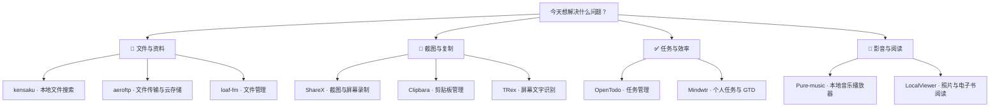

# 每日实用开源精选 · 2026-11-08

10 个实用开源项目。许可证与维护日期来自 GitHub API；中文介绍由 AI 辅助生成，安装前请核对项目说明。

## 先按需求找工具

**📁 文件与资料**：[kensaku](https://github.com/yjid/kensaku) · [aeroftp](https://github.com/axpdev-lab/aeroftp) · [loaf-fm](https://github.com/m-uvex/loaf-fm)

**📸 截图与复制**：[ShareX](https://github.com/ShareX/ShareX) · [Clipbara](https://github.com/mobrava/Clipbara) · [TRex](https://github.com/amebalabs/TRex)

**✅ 任务与效率**：[OpenTodo](https://github.com/OpenTodoApp/OpenTodo) · [Mindwtr](https://github.com/dongdongbh/Mindwtr)

**🎵 影音与阅读**：[Pure-music](https://github.com/qingyueyin/Pure-music) · [LocalViewer](https://github.com/zmz125000/LocalViewer)

---

## 01 · [OpenTodoApp/OpenTodo](https://github.com/OpenTodoApp/OpenTodo)

分类：任务管理

用自然语言快速记录待办，并支持日历规划、专注计时、离线使用和共享清单；适合想自托管或跨设备管理任务的人。

- 平台：手机和电脑；提供 Android 应用及网页应用，支持自托管
- 费用：资料称应用免费；托管服务费用待核实
- 安装：可用 Docker 一条命令启动，难度低；也可通过 PikaPods 托管
- 注意：自托管需要维护服务器和备份；加密、AI 等功能需要按文档配置。
- [许可证 AGPL-3.0](https://github.com/OpenTodoApp/OpenTodo/blob/main/LICENSE)
- [默认分支最近提交：2026-11-08T02:49:07Z](https://github.com/OpenTodoApp/OpenTodo/commit/9ae39827cdbbcd38113d8f294ab5a1a5b9a1af07)
- 最近正式发布：[v1.1.1 · 2026-11-07T23:37:32Z](https://github.com/OpenTodoApp/OpenTodo/releases/tag/v1.1.1)
- [安装说明](https://github.com/OpenTodoApp/OpenTodo/blob/main/README.md)

## 02 · [ShareX/ShareX](https://github.com/ShareX/ShareX)

分类：截图与屏幕录制

截图、录屏、标注和 OCR 集于一体，还能自动上传并复制分享链接，适合制作教程、提交问题截图或快速分享文件。

- 平台：Windows
- 费用：资料称软件免费且无广告；上传目标服务可能另收费
- 安装：从官网或 GitHub Releases 下载并安装，难度低
- 注意：上传内容会发送到所配置的目标服务；分享前注意遮挡隐私信息。
- [许可证 GPL-3.0](https://github.com/ShareX/ShareX/blob/develop/LICENSE.txt)
- [默认分支最近提交：2026-11-08T02:44:55Z](https://github.com/ShareX/ShareX/commit/f230d21a35e7d648e37e69cc5f81ebfb9f7144df)
- 最近正式发布：[v22.3.0 · 2026-11-07T05:52:09Z](https://github.com/ShareX/ShareX/releases/tag/v22.3.0)
- [安装说明](https://github.com/ShareX/ShareX/blob/develop/README.md)

## 03 · [dongdongbh/Mindwtr](https://github.com/dongdongbh/Mindwtr)

分类：个人任务与 GTD

按 GTD 流程整理收件箱、下一步行动和每周回顾，支持离线、无需账号，也可从其他待办应用导入任务。

- 平台：Windows、macOS、Linux、iOS、Android
- 费用：资料称应用免费；同步服务或第三方存储费用待核实
- 安装：可从 Microsoft Store、应用商店、Flathub、F-Droid 等渠道安装，难度低
- 注意：跨设备同步需自行选择并配置 iCloud、WebDAV、共享文件夹等方式。
- [许可证 AGPL-3.0](https://github.com/dongdongbh/Mindwtr/blob/main/LICENSE)
- [默认分支最近提交：2026-11-08T01:53:19Z](https://github.com/dongdongbh/Mindwtr/commit/978699180ab6eb0282740851cdf8c4a936bd2019)
- 最近正式发布：[v1.3.8 · 2026-11-04T22:05:39Z](https://github.com/dongdongbh/Mindwtr/releases/tag/v1.3.8)
- [安装说明](https://github.com/dongdongbh/Mindwtr/blob/main/README.md)

## 04 · [yjid/kensaku](https://github.com/yjid/kensaku)

分类：本地文件搜索

不仅按文件名搜索，还能搜索 PDF、Office 文档、代码和截图中的文字，并按含义查找；索引保留在本机，适合找回记不清文件名的资料。

- 平台：Windows、macOS、Linux
- 费用：资料称免费；待核实
- 安装：从 GitHub Releases 下载对应系统的安装包，难度低
- 注意：首次图片 OCR 可能需要下载模型；需留意索引范围和磁盘占用。
- [许可证 MIT](https://github.com/yjid/kensaku/blob/master/LICENSE)
- [默认分支最近提交：2026-11-08T02:38:21Z](https://github.com/yjid/kensaku/commit/919775155b24794f88171a3e29fa44e029d00536)
- 最近正式发布：[v1.0.16 · 2026-11-06T11:09:57Z](https://github.com/yjid/kensaku/releases/tag/v1.0.16)
- [安装说明](https://github.com/yjid/kensaku/blob/master/README.md)

## 05 · [mobrava/Clipbara](https://github.com/mobrava/Clipbara)

分类：剪贴板管理

保存剪贴板历史并支持搜索、固定常用内容和快速预览，减少反复复制粘贴；可与 iPhone 同步。

- 平台：macOS 14 及以上、iOS 26 及以上
- 费用：DMG 和 Homebrew 版本免费；App Store 版本试用 7 天后一次性付费
- 安装：可下载 DMG 拖入应用程序，或用 Homebrew 安装，难度低
- 注意：iCloud 同步和 iPhone 配套应用仅限 App Store 版本；剪贴板可能包含敏感信息。
- [许可证 GPL-3.0](https://github.com/mobrava/Clipbara/blob/main/LICENSE)
- [默认分支最近提交：2026-11-08T01:45:47Z](https://github.com/mobrava/Clipbara/commit/d8ecb7dfcec576ec0395f5894b08ee548d1e31e3)
- 最近正式发布：[v1.5.2 · 2026-11-08T01:45:30Z](https://github.com/mobrava/Clipbara/releases/tag/v1.5.2)
- [安装说明](https://github.com/mobrava/Clipbara/blob/main/README.md)

## 06 · [amebalabs/TRex](https://github.com/amebalabs/TRex)

分类：屏幕文字识别

框选屏幕区域即可用 OCR 提取文字到剪贴板，适合复制不可选中的 PDF、图片、视频字幕或会议共享内容。

- 平台：macOS Big Sur 及以上
- 费用：GitHub Releases 可下载；App Store 为付费版本，具体价格待核实
- 安装：可从 Releases 下载，或通过 Homebrew 安装，难度低
- 注意：离线识别；OCR 结果可能有误，复制前应检查专有名词和数字。
- [许可证 MIT](https://github.com/amebalabs/TRex/blob/main/LICENSE)
- [默认分支最近提交：2026-11-08T02:31:36Z](https://github.com/amebalabs/TRex/commit/1ce6eb289095a45e153133115a9f6a152127c382)
- 最近正式发布：[v2.0.0 · 2026-02-13T18:38:25Z](https://github.com/amebalabs/TRex/releases/tag/v2.0.0)
- [安装说明](https://github.com/amebalabs/TRex/blob/main/.github/README.md)

## 07 · [qingyueyin/Pure-music](https://github.com/qingyueyin/Pure-music)

分类：本地音乐播放器

管理并播放电脑本地音乐，支持歌词、歌单、桌面歌词和多种播放界面，适合整理个人曲库。

- 平台：Windows
- 费用：待核实
- 安装：README 提供 GitHub Releases 下载入口；安装难度待核实
- 注意：面向本地音乐文件；在线歌词来自第三方，版权及可用性需自行确认。
- [许可证 GPL-3.0](https://github.com/qingyueyin/Pure-music/blob/main/LICENSE)
- [默认分支最近提交：2026-11-07T11:23:55Z](https://github.com/qingyueyin/Pure-music/commit/82d23ccea5a39ac193e18f826839e82249ce9a73)
- 最近正式发布：[v2.3.4 · 2026-11-05T12:34:37Z](https://github.com/qingyueyin/Pure-music/releases/tag/v2.3.4)
- [安装说明](https://github.com/qingyueyin/Pure-music/blob/main/README.md)

## 08 · [zmz125000/LocalViewer](https://github.com/zmz125000/LocalViewer)

分类：照片与电子书阅读

在 Android 上浏览本地或 SMB/WebDAV 网络文件夹中的照片、漫画、视频和电子书，并支持 RAW 与 HDR 图像。

- 平台：Android 12 及以上；部分 HDR 功能要求 Android 14 及以上
- 费用：待核实
- 安装：从 GitHub Releases 下载对应设备版本，难度中等
- 注意：不同功能有 Android 版本和芯片架构要求；连接网络共享需配置访问权限。
- [许可证 GPL-3.0](https://github.com/zmz125000/LocalViewer/blob/main/LICENSE)
- [默认分支最近提交：2026-11-08T02:28:37Z](https://github.com/zmz125000/LocalViewer/commit/7067c2dbede67e93fdbccfce83500efd4f54bc4f)
- 最近正式发布：[1.13.28 · 2026-11-06T10:50:06Z](https://github.com/zmz125000/LocalViewer/releases/tag/1.13.28)
- [安装说明](https://github.com/zmz125000/LocalViewer/blob/main/README.md)

## 09 · [axpdev-lab/aeroftp](https://github.com/axpdev-lab/aeroftp)

分类：文件传输与云存储

用一个客户端连接 FTP、SFTP、WebDAV、S3 和多种云存储，适合在电脑、本地服务器及云端之间传输和管理文件。

- 平台：Windows、macOS、Linux
- 费用：待核实；项目提供赞助入口
- 安装：可从 Releases 获取安装包，也列有 Winget、Snap 等渠道，难度低
- 注意：macOS 下载包未签名，README 要求额外处理隔离属性；连接前应核验服务器和凭据设置。
- [许可证 GPL-3.0](https://github.com/axpdev-lab/aeroftp/blob/main/LICENSE)
- [默认分支最近提交：2026-11-08T02:26:22Z](https://github.com/axpdev-lab/aeroftp/commit/fcb5f440fb0a99f7966fa22e96e77cbf88652956)
- 最近正式发布：[v4.2.6 · 2026-11-05T07:14:36Z](https://github.com/axpdev-lab/aeroftp/releases/tag/v4.2.6)
- [安装说明](https://github.com/axpdev-lab/aeroftp/blob/main/README.md)

## 10 · [m-uvex/loaf-fm](https://github.com/m-uvex/loaf-fm)

分类：文件管理

为 Linux 提供带标签页、分栏视图、压缩解压、撤销操作和 SMB 网络共享的文件管理器，可作为日常文件整理工具。

- 平台：Linux
- 费用：待核实
- 安装：提供 AppImage、Deb、RPM、AUR 和 Nix 等安装方式；AppImage 使用简单
- 注意：项目仍处于 Alpha 阶段，可能存在缺陷或功能不完整。
- [许可证 MIT](https://github.com/m-uvex/loaf-fm/blob/main/LICENSE)
- [默认分支最近提交：2026-11-08T00:30:36Z](https://github.com/m-uvex/loaf-fm/commit/fa43a97709e6f1db5c9cdfb01a639d3ac1639726)
- 最近正式发布：[v0.2.1 · 2026-10-27T19:00:53Z](https://github.com/m-uvex/loaf-fm/releases/tag/v0.2.1)
- [安装说明](https://github.com/m-uvex/loaf-fm/blob/main/README.md)
