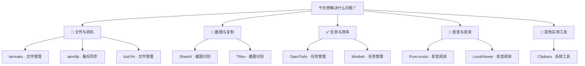

# 每日实用开源精选 · 2026-11-08

10 个实用开源项目。许可证与维护日期来自 GitHub API；中文介绍由 AI 辅助生成，安装前请核对项目说明。

## 🌟 今日首选 · [OpenTodo](https://github.com/OpenTodoApp/OpenTodo)

> 任务散落在各处？用自然语言记下待办，再按日期安排一天。

**为什么先试：**支持网页使用、离线记录和自然语言快速添加，适合先体验待办整理；自托管则需维护服务器。

**适用平台：**Android ｜ **上手门槛：**自建服务

---

## 先按需求找工具

**📁 文件与资料**：[kensaku](https://github.com/yjid/kensaku) · [aeroftp](https://github.com/axpdev-lab/aeroftp) · [loaf-fm](https://github.com/m-uvex/loaf-fm)

**📸 截图与复制**：[ShareX](https://github.com/ShareX/ShareX) · [TRex](https://github.com/amebalabs/TRex)

**✅ 任务与效率**：[OpenTodo](https://github.com/OpenTodoApp/OpenTodo) · [Mindwtr](https://github.com/dongdongbh/Mindwtr)

**🎵 影音与阅读**：[Pure-music](https://github.com/qingyueyin/Pure-music) · [LocalViewer](https://github.com/zmz125000/LocalViewer)

**🧰 其他实用工具**：[Clipbara](https://github.com/mobrava/Clipbara)

---

## 01 · [OpenTodoApp/OpenTodo](https://github.com/OpenTodoApp/OpenTodo)

分类：任务管理 ｜ 上手门槛：自建服务

> 任务散落在各处？用自然语言记下待办，再按日期安排一天。

用自然语言快速记录待办，并提供日历规划、专注计时、离线使用和共享清单；可自托管，也可使用托管服务。

- 平台：手机和电脑；提供 Android 应用及网页应用，支持自托管
- 费用：资料称应用免费；托管服务费用待核实
- 安装：可用 Docker 启动，或选择托管服务；自托管需要配置和维护服务器
- 注意：自托管需要自行维护服务器和备份；加密、AI 等功能需按文档配置。
- [许可证 AGPL-3.0](https://github.com/OpenTodoApp/OpenTodo/blob/main/LICENSE)
- [默认分支最近提交：2026-11-08T02:49:07Z](https://github.com/OpenTodoApp/OpenTodo/commit/9ae39827cdbbcd38113d8f294ab5a1a5b9a1af07)
- 最近正式发布：[v1.1.1 · 2026-11-07T23:37:32Z](https://github.com/OpenTodoApp/OpenTodo/releases/tag/v1.1.1)
- [安装说明](https://github.com/OpenTodoApp/OpenTodo/blob/main/README.md)

## 02 · [ShareX/ShareX](https://github.com/ShareX/ShareX)

分类：截图识别 ｜ 上手门槛：下载安装

> 要说明软件问题？截取屏幕、标出重点，再保存或分享。

面向 Windows 的截图与录屏工具，可标注图片、识别屏幕文字，并按设置保存或上传文件；也支持配置快捷键和自动处理流程。

- 平台：Windows
- 费用：资料称免费且无广告；上传目标服务可能另收费
- 安装：从官网或 GitHub Releases 下载并安装，难度低
- 注意：上传内容会发送到所配置的目标服务；分享前应遮挡隐私信息。
- [许可证 GPL-3.0](https://github.com/ShareX/ShareX/blob/develop/LICENSE.txt)
- [默认分支最近提交：2026-11-08T02:44:55Z](https://github.com/ShareX/ShareX/commit/f230d21a35e7d648e37e69cc5f81ebfb9f7144df)
- 最近正式发布：[v22.3.0 · 2026-11-07T05:52:09Z](https://github.com/ShareX/ShareX/releases/tag/v22.3.0)
- [安装说明](https://github.com/ShareX/ShareX/blob/develop/README.md)

## 03 · [dongdongbh/Mindwtr](https://github.com/dongdongbh/Mindwtr)

分类：任务管理 ｜ 上手门槛：下载安装

> 待办和想法越积越多？先放进收件箱，再逐步整理成行动。

按 GTD 流程整理收件箱、项目和下一步行动，并提供每周回顾、离线使用及任务导入；不需要账号，跨设备同步需自行配置。

- 平台：Windows、macOS、Linux、iOS、Android
- 费用：资料称应用免费；同步服务或第三方存储费用待核实
- 安装：可从 Microsoft Store 等渠道安装，难度低
- 注意：跨设备同步需自行选择并配置 iCloud、WebDAV、共享文件夹等方式。
- [许可证 AGPL-3.0](https://github.com/dongdongbh/Mindwtr/blob/main/LICENSE)
- [默认分支最近提交：2026-11-08T01:53:19Z](https://github.com/dongdongbh/Mindwtr/commit/978699180ab6eb0282740851cdf8c4a936bd2019)
- 最近正式发布：[v1.3.8 · 2026-11-04T22:05:39Z](https://github.com/dongdongbh/Mindwtr/releases/tag/v1.3.8)
- [安装说明](https://github.com/dongdongbh/Mindwtr/blob/main/README.md)

## 04 · [yjid/kensaku](https://github.com/yjid/kensaku)

分类：文件管理 ｜ 上手门槛：下载安装

> 记不清文件名？搜索文档中的内容或截图里的文字来找资料。

为 Windows、macOS 和 Linux 提供本地文件搜索，可按文件名、文档内容和图片文字查找，也支持语义搜索；索引保存在本机。

- 平台：Windows、macOS、Linux
- 费用：资料称免费；具体费用待核实
- 安装：从 GitHub Releases 下载对应系统的安装包，难度低
- 注意：图片 OCR 模型首次使用时可能需要下载；注意索引范围和磁盘占用。
- [许可证 MIT](https://github.com/yjid/kensaku/blob/master/LICENSE)
- [默认分支最近提交：2026-11-08T02:38:21Z](https://github.com/yjid/kensaku/commit/919775155b24794f88171a3e29fa44e029d00536)
- 最近正式发布：[v1.0.16 · 2026-11-06T11:09:57Z](https://github.com/yjid/kensaku/releases/tag/v1.0.16)
- [安装说明](https://github.com/yjid/kensaku/blob/master/README.md)

## 05 · [mobrava/Clipbara](https://github.com/mobrava/Clipbara)

分类：系统工具 ｜ 上手门槛：下载安装

> 刚复制过一段文字却找不到？打开历史记录搜索并重新复制。

为 macOS 保存剪贴板历史，支持搜索、固定常用内容和预览；App Store 版本可与 iPhone 通过 iCloud 同步。

- 平台：macOS 14 及以上、iOS 26 及以上
- 费用：DMG 和 Homebrew 版本免费；App Store 版本试用 7 天后一次性付费
- 安装：可下载 DMG 拖入应用程序，或用 Homebrew 安装，难度低
- 注意：iCloud 同步和 iPhone 配套应用仅限 App Store 版本；剪贴板可能包含敏感信息。
- [许可证 GPL-3.0](https://github.com/mobrava/Clipbara/blob/main/LICENSE)
- [默认分支最近提交：2026-11-08T01:45:47Z](https://github.com/mobrava/Clipbara/commit/d8ecb7dfcec576ec0395f5894b08ee548d1e31e3)
- 最近正式发布：[v1.5.2 · 2026-11-08T01:45:30Z](https://github.com/mobrava/Clipbara/releases/tag/v1.5.2)
- [安装说明](https://github.com/mobrava/Clipbara/blob/main/README.md)

## 06 · [amebalabs/TRex](https://github.com/amebalabs/TRex)

分类：截图识别 ｜ 上手门槛：下载安装

> PDF 页面不能选中文字？框选内容识别后粘贴到笔记里。

在 macOS 上框选屏幕区域，通过 OCR 提取文字并放入剪贴板，可识别二维码和条码；项目说明其功能可离线使用。

- 平台：macOS Big Sur 及以上
- 费用：GitHub Releases 可下载；App Store 为付费版本，具体价格待核实
- 安装：可从 Releases 下载，或通过 Homebrew 安装，难度低
- 注意：OCR 结果可能有误，复制后应检查专有名词和数字。
- [许可证 MIT](https://github.com/amebalabs/TRex/blob/main/LICENSE)
- [默认分支最近提交：2026-11-08T02:31:36Z](https://github.com/amebalabs/TRex/commit/1ce6eb289095a45e153133115a9f6a152127c382)
- 最近正式发布：[v2.0.0 · 2026-02-13T18:38:25Z](https://github.com/amebalabs/TRex/releases/tag/v2.0.0)
- [安装说明](https://github.com/amebalabs/TRex/blob/main/.github/README.md)

## 07 · [qingyueyin/Pure-music](https://github.com/qingyueyin/Pure-music)

分类：影音阅读 ｜ 上手门槛：待核实

> 本地歌曲分散难管理？用曲库和歌单整理后集中播放。

面向 Windows 的本地音乐播放器，可整理曲库、歌单和专辑，支持歌词、桌面歌词及多种播放界面。

- 平台：Windows
- 费用：待核实
- 安装：README 提供 GitHub Releases 下载入口；安装难度待核实
- 注意：主要播放本地音乐；在线歌词来自第三方，版权及可用性需自行确认。
- [许可证 GPL-3.0](https://github.com/qingyueyin/Pure-music/blob/main/LICENSE)
- [默认分支最近提交：2026-11-07T11:23:55Z](https://github.com/qingyueyin/Pure-music/commit/82d23ccea5a39ac193e18f826839e82249ce9a73)
- 最近正式发布：[v2.3.4 · 2026-11-05T12:34:37Z](https://github.com/qingyueyin/Pure-music/releases/tag/v2.3.4)
- [安装说明](https://github.com/qingyueyin/Pure-music/blob/main/README.md)

## 08 · [zmz125000/LocalViewer](https://github.com/zmz125000/LocalViewer)

分类：影音阅读 ｜ 上手门槛：需要配置

> 照片或漫画存放在网络共享中？用手机连接文件夹浏览阅读。

在 Android 上浏览本地或 SMB、WebDAV 网络文件夹中的照片、漫画、视频和电子书，并支持 RAW 图像及部分 HDR 格式。

- 平台：Android 12 及以上；部分 HDR 功能要求 Android 14 及以上
- 费用：待核实
- 安装：从 GitHub Releases 下载对应设备版本；安装 APK 可能需要调整系统设置
- 注意：部分功能受 Android 版本和设备架构限制；访问网络共享需配置连接权限。
- [许可证 GPL-3.0](https://github.com/zmz125000/LocalViewer/blob/main/LICENSE)
- [默认分支最近提交：2026-11-08T02:28:37Z](https://github.com/zmz125000/LocalViewer/commit/7067c2dbede67e93fdbccfce83500efd4f54bc4f)
- 最近正式发布：[1.13.28 · 2026-11-06T10:50:06Z](https://github.com/zmz125000/LocalViewer/releases/tag/1.13.28)
- [安装说明](https://github.com/zmz125000/LocalViewer/blob/main/README.md)

## 09 · [axpdev-lab/aeroftp](https://github.com/axpdev-lab/aeroftp)

分类：备份同步 ｜ 上手门槛：下载安装

> 要在电脑和服务器间传文件？添加连接后用客户端管理文件。

跨平台文件传输客户端，可连接 FTP、SFTP、WebDAV、S3 等协议及多种云存储，适合在电脑、服务器和云端之间管理文件。

- 平台：Windows、macOS、Linux
- 费用：待核实；项目提供赞助入口
- 安装：提供 Windows 安装包、便携包及 Winget 渠道，难度低
- 注意：连接前核对服务器地址、证书验证和账号凭据；项目称 macOS 安装包未签名。
- [许可证 GPL-3.0](https://github.com/axpdev-lab/aeroftp/blob/main/LICENSE)
- [默认分支最近提交：2026-11-08T02:26:22Z](https://github.com/axpdev-lab/aeroftp/commit/fcb5f440fb0a99f7966fa22e96e77cbf88652956)
- 最近正式发布：[v4.2.6 · 2026-11-05T07:14:36Z](https://github.com/axpdev-lab/aeroftp/releases/tag/v4.2.6)
- [安装说明](https://github.com/axpdev-lab/aeroftp/blob/main/README.md)

## 10 · [m-uvex/loaf-fm](https://github.com/m-uvex/loaf-fm)

分类：文件管理 ｜ 上手门槛：下载安装

> 整理 Linux 电脑里的文件？用标签页和分栏浏览并执行文件操作。

面向 Linux 的文件管理器，提供标签页、分栏视图、搜索、压缩解压、撤销操作及 SMB 网络共享浏览。

- 平台：Linux
- 费用：待核实
- 安装：提供 AppImage、Deb、RPM 等安装包；AppImage 可直接运行，难度低
- 注意：项目仍处于 Alpha 阶段，可能存在缺陷或功能不完整。
- [许可证 MIT](https://github.com/m-uvex/loaf-fm/blob/main/LICENSE)
- [默认分支最近提交：2026-11-08T00:30:36Z](https://github.com/m-uvex/loaf-fm/commit/fa43a97709e6f1db5c9cdfb01a639d3ac1639726)
- 最近正式发布：[v0.2.1 · 2026-10-27T19:00:53Z](https://github.com/m-uvex/loaf-fm/releases/tag/v0.2.1)
- [安装说明](https://github.com/m-uvex/loaf-fm/blob/main/README.md)
