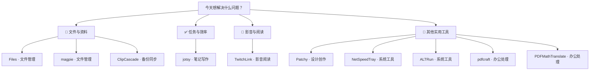

# 每日实用开源精选 · 2026-11-09

10 个实用开源项目。许可证与维护日期来自 GitHub API；中文介绍由 AI 辅助生成，安装前请核对项目说明。

## 🌟 今日首选 · [ALTRun](https://github.com/zhugecaomao/ALTRun)

> 频繁在开始菜单找应用？按快捷键搜索名称并快速打开。

**为什么先试：**免安装、快捷键明确，能集中处理启动应用和常见搜索任务，适合先试用。

**工作流程：**应用名、文件名或计算表达式 → 呼出搜索框并选择结果 → 打开目标或得到计算结果

**适用平台：**Windows

---

## 先按需求找工具

**📁 文件与资料**：[Files](https://github.com/files-community/Files) · [magpie](https://github.com/newdee/magpie) · [ClipCascade](https://github.com/Sathvik-Rao/ClipCascade)

**✅ 任务与效率**：[jotsy](https://github.com/CikeSeven/jotsy)

**🎵 影音与阅读**：[TwitchLink](https://github.com/devhotteok/TwitchLink)

**🧰 其他实用工具**：[Patchy](https://github.com/SethRobinson/Patchy) · [NetSpeedTray](https://github.com/erez-c137/NetSpeedTray) · [ALTRun](https://github.com/zhugecaomao/ALTRun) · [pdfcraft](https://github.com/storytold/pdfcraft) · [PDFMathTranslate](https://github.com/PDFMathTranslate/PDFMathTranslate)

---

## 01 · [files-community/Files](https://github.com/files-community/Files)

分类：文件管理

> 文件夹越堆越乱？用标签和文件管理功能整理常用资料。

**工作流程：**需要整理的文件和文件夹 → 浏览目录并分类整理 → 更易查找的文件布局

面向 Windows 的文件管理器，帮助浏览和整理文件夹，提供标签、多任务操作与系统集成。可从 Microsoft Store 或项目网站获取安装包；README 提到 Store 购买及支持项目，但未说明各渠道的具体价格。

- 平台：Windows；其他平台待核实
- 费用：各渠道费用待核实；README 提供 Microsoft Store 与经典安装包渠道。
- 安装：Microsoft Store 安装或从项目网站下载安装包，难度低。
- 注意：安装渠道和价格可能不同；操作文件前建议核对目标路径。
- [许可证 MIT](https://github.com/files-community/Files/blob/main/LICENSE-MIT)
- [默认分支最近提交：2026-11-08T15:17:09Z](https://github.com/files-community/Files/commit/ee5ba5648541880c98a56436d65d1f9d108332b1)
- 最近正式发布：[v4.3 · 2026-10-11T18:35:07Z](https://github.com/files-community/Files/releases/tag/v4.3)
- [安装说明](https://github.com/files-community/Files/blob/main/.github/README.md)

## 02 · [newdee/magpie](https://github.com/newdee/magpie)

分类：文件管理

> 只记得截图内容却找不到文件？用描述或图片搜索已索引资料。

**工作流程：**要找的文件名或内容线索 → 在启动器中搜索本地索引 → 匹配的文件或资料

桌面搜索启动器，可搜索用户主动添加的本地文件夹、图片、GitHub 收藏、浏览器书签与历史记录，也支持搜索剪贴板历史和已安装应用。README 声称索引和语义模型在本机运行，并提供 Windows 支持。

- 平台：Windows、macOS、Linux
- 费用：待核实
- 安装：可从 GitHub Releases 获取；具体安装包格式与步骤待核实，难度待核实。
- 注意：仅索引用户明确添加的文件夹；启用浏览器数据搜索或剪贴板历史前，先确认本机隐私需求。
- [许可证 MIT](https://github.com/newdee/magpie/blob/main/LICENSE)
- [默认分支最近提交：2026-11-09T01:52:17Z](https://github.com/newdee/magpie/commit/287f924ebbdb113b2cb0e04b58ece998c844d4d2)
- 最近正式发布：[v0.6.10 · 2026-10-31T04:59:56Z](https://github.com/newdee/magpie/releases/tag/v0.6.10)
- [安装说明](https://github.com/newdee/magpie/blob/main/README.md)

## 03 · [SethRobinson/Patchy](https://github.com/SethRobinson/Patchy)

分类：设计创作

> 需要继续修改分层 PSD？用 Patchy 打开图层文件并保留可编辑内容。

**工作流程：**PSD 或其他设计文件 → 打开文件并编辑图层内容 → 可继续修改的设计稿

面向 Windows、macOS、Linux 和浏览器的图像编辑器，重点支持 PSD 文件中的文本、矢量、蒙版、图层样式和智能对象编辑，也可处理多种图像与设计文件。Windows 提供安装程序和免安装 ZIP。

- 平台：Windows 10/11、macOS 12+、Linux、现代浏览器
- 费用：待核实
- 安装：Windows 可下载安装程序或免安装 ZIP；难度低。
- 注意：PSD 兼容和具体文件格式表现可能因文档内容而异；处理重要文件时保留原件备份。
- [许可证 MIT](https://github.com/SethRobinson/Patchy/blob/main/LICENSE)
- [默认分支最近提交：2026-11-08T23:49:43Z](https://github.com/SethRobinson/Patchy/commit/72a3256257ea00f502a5212d0fabf1f81b30b6a8)
- 最近正式发布：[v1.30 · 2026-11-08T23:47:43Z](https://github.com/SethRobinson/Patchy/releases/tag/v1.30)
- [安装说明](https://github.com/SethRobinson/Patchy/blob/main/README.md)

## 04 · [erez-c137/NetSpeedTray](https://github.com/erez-c137/NetSpeedTray)

分类：系统工具

> 下载变慢却不清楚原因？查看任务栏实时网络速度和监控数据。

**工作流程：**正在使用的 Windows 电脑 → 查看任务栏网络速度 → 实时上传与下载读数

Windows 任务栏网络监视工具，可显示实时上传和下载速度；README 还列出 CPU、GPU、内存、温度、电量、历史图表和数据用量等监控信息。

- 平台：Windows 10/11 64 位
- 费用：README 描述为免费；具体商店渠道条款待核实。
- 安装：可用 winget 安装，也可下载 Setup.exe 或 Portable.zip；难度低。
- 注意：部分硬件温度数据需要可选辅助组件；README 提到的部分功能可能随版本变化。
- [许可证 GPL-3.0](https://github.com/erez-c137/NetSpeedTray/blob/main/LICENSE)
- [默认分支最近提交：2026-11-09T01:43:53Z](https://github.com/erez-c137/NetSpeedTray/commit/22b63c4e5fcc9f9e62a0955f82ce9b52d627fec5)
- 最近正式发布：[v2.1.7 · 2026-09-23T15:24:05Z](https://github.com/erez-c137/NetSpeedTray/releases/tag/v2.1.7)
- [安装说明](https://github.com/erez-c137/NetSpeedTray/blob/main/README.md)

## 05 · [zhugecaomao/ALTRun](https://github.com/zhugecaomao/ALTRun)

分类：系统工具

> 频繁在开始菜单找应用？按快捷键搜索名称并快速打开。

**工作流程：**应用名、文件名或计算表达式 → 呼出搜索框并选择结果 → 打开目标或得到计算结果

面向 Windows 的轻量启动器，按 Alt+Space 呼出后可搜索应用和文件，也支持网页搜索、计算、剪贴板历史、片段和系统命令。README 说明数据默认保存在本地，并提供免安装版本。

- 平台：Windows 10/11
- 费用：待核实
- 安装：下载并解压后运行 ALTRun.exe；也支持 winget 或 Scoop，难度低。
- 注意：Windows SmartScreen 可能提示；剪贴板历史保存在本机用户目录，注意其中可能包含敏感文本。
- [许可证 GPL-3.0](https://github.com/zhugecaomao/ALTRun/blob/main/LICENSE)
- [默认分支最近提交：2026-11-09T01:49:38Z](https://github.com/zhugecaomao/ALTRun/commit/5c8da23432972bb7ab33f8d46abb1c343679e6c4)
- 最近正式发布：[2026.11.03 · 2026-11-03T06:06:11Z](https://github.com/zhugecaomao/ALTRun/releases/tag/2026.11.03)
- [安装说明](https://github.com/zhugecaomao/ALTRun/blob/main/README.md)

## 06 · [CikeSeven/jotsy](https://github.com/CikeSeven/jotsy)

分类：笔记写作

> 想记录每天的心情和生活片段？用日记条目留存并按日期回顾。

**工作流程：**当天的文字、照片或心情 → 创建日记并添加记录 → 可按日期回顾的日记

离线优先的日记应用，可记录文字、图片、视频、录音及心情等信息，并提供日历回顾、搜索、备份和多种格式导出。README 列出 Windows 10+ x64 与 Android 版本。

- 平台：Windows 10+ x64、Android、Linux x64
- 费用：README 标示免费；具体分发渠道费用待核实。
- 安装：Windows 安装包获取及步骤待核实；难度待核实。
- 注意：README 称数据保存在设备本地；设备损坏或丢失仍可能导致数据丢失，建议定期备份。
- [许可证 GPL-3.0](https://github.com/CikeSeven/jotsy/blob/main/LICENSE)
- [默认分支最近提交：2026-11-09T00:23:29Z](https://github.com/CikeSeven/jotsy/commit/ca03b663517a7348fa97cb3cea0c40e78bad98b3)
- 最近正式发布：[v0.12.0 · 2026-11-06T14:48:30Z](https://github.com/CikeSeven/jotsy/releases/tag/v0.12.0)
- [安装说明](https://github.com/CikeSeven/jotsy/blob/main/README.md)

## 07 · [storytold/pdfcraft](https://github.com/storytold/pdfcraft)

分类：办公处理

> 多个 PDF 需要合并或拆分？用工具整理成便于发送的文档。

**工作流程：**要整理的 PDF 文件 → 选择页面并合并或拆分 → 整理后的 PDF 文档

以 Rust 编写的 PDF 阅读和编辑工具，支持阅读、整理、合并、拆分及保护 PDF。项目说明支持 Windows、macOS、Linux、FreeBSD 和 Web，并标注无账号、无遥测。

- 平台：Windows、macOS、Linux、FreeBSD、Web
- 费用：待核实
- 安装：README 提供下载入口，但具体 Windows 安装包格式与步骤待核实；难度待核实。
- 注意：进行拆分、合并或安全设置前，先保留原始 PDF；不同平台功能细节待核实。
- [许可证 Apache-2.0](https://github.com/storytold/pdfcraft/blob/main/LICENSE-APACHE)
- [默认分支最近提交：2026-11-09T02:08:50Z](https://github.com/storytold/pdfcraft/commit/138acb38b1a40181f495ec8b451fc5e512d8236f)
- 最近正式发布：[v0.19.0 · 2026-11-06T20:21:58Z](https://github.com/storytold/pdfcraft/releases/tag/v0.19.0)
- [安装说明](https://github.com/storytold/pdfcraft/blob/main/README.md)

## 08 · [PDFMathTranslate/PDFMathTranslate](https://github.com/PDFMathTranslate/PDFMathTranslate)

分类：办公处理

> 外文论文阅读吃力？翻译 PDF 并保留原有排版供对照。

**工作流程：**需要阅读的科学论文 PDF → 选择语言和翻译服务 → 译文 PDF 供阅读对照

用于翻译科学论文 PDF 的工具，目标是在翻译文本时保留文档排版，并尽量保留公式、图表、目录和批注。提供命令行、图形界面及 Docker 使用方式，支持多种翻译服务。

- 平台：Windows、macOS、Linux；另有 Docker 和在线演示
- 费用：软件费用待核实；所选翻译服务可能另行收费或需要 API 密钥。
- 安装：README 提及交互界面和 Windows ZIP；具体步骤依版本而异，难度中等。
- 注意：翻译可能出现术语或排版错误；处理敏感文档前确认所选翻译服务的数据政策。
- [许可证 AGPL-3.0](https://github.com/PDFMathTranslate/PDFMathTranslate/blob/main/LICENSE)
- [默认分支最近提交：2026-11-09T01:58:45Z](https://github.com/PDFMathTranslate/PDFMathTranslate/commit/a4d36737004b6e48d9051c4ef512e7f03366160c)
- 最近正式发布：[v1.9.11 · 2025-07-11T08:37:31Z](https://github.com/PDFMathTranslate/PDFMathTranslate/releases/tag/v1.9.11)
- [安装说明](https://github.com/PDFMathTranslate/PDFMathTranslate/blob/main/README.md)

## 09 · [Sathvik-Rao/ClipCascade](https://github.com/Sathvik-Rao/ClipCascade)

分类：备份同步

> 电脑复制的文字需要在手机粘贴？用剪贴板同步传到另一台设备。

**工作流程：**在一台设备复制的文字 → 让已连接设备同步剪贴板 → 另一设备可粘贴的内容

跨设备剪贴板同步工具，支持 Windows、macOS、Android 和 Linux；README 描述自动同步及端到端加密，并提供社区服务器和自建服务器等连接方式。

- 平台：Windows、macOS、Android、Linux；另有 Docker
- 费用：待核实；社区服务器的服务条款与可用性待核实。
- 安装：桌面端可从 GitHub Releases 获取；具体安装步骤待核实，难度待核实。
- 注意：剪贴板可能含密码、验证码或个人信息；启用同步前确认设备授权和服务器可信度。
- [许可证 GPL-3.0](https://github.com/Sathvik-Rao/ClipCascade/blob/main/LICENSE)
- [默认分支最近提交：2026-11-08T23:45:53Z](https://github.com/Sathvik-Rao/ClipCascade/commit/2f027d88b2a6b4f77d2b100840072df17343d3d8)
- 最近正式发布：[v3.5.1 · 2026-11-08T23:45:52Z](https://github.com/Sathvik-Rao/ClipCascade/releases/tag/v3.5.1)
- [安装说明](https://github.com/Sathvik-Rao/ClipCascade/blob/main/README.md)

## 10 · [devhotteok/TwitchLink](https://github.com/devhotteok/TwitchLink)

分类：影音阅读

> 想离线观看获准保存的 Twitch 视频？用图形界面下载或录制内容。

**工作流程：**Twitch 视频或片段链接 → 选择下载或录制内容 → 本地视频文件

Twitch 视频下载与录制工具，提供图形界面，可下载或录制 Twitch 直播、视频点播和片段。README 中有 Windows 标识，但具体系统要求与安装细节在所给资料中未完整说明。

- 平台：Windows、macOS；其他平台待核实
- 费用：待核实
- 安装：可从 GitHub Releases 获取；安装包格式与步骤待核实，难度待核实。
- 注意：下载或录制内容前确认平台规则、内容授权和当地版权要求；Windows 兼容细节待核实。
- [许可证 MIT](https://github.com/devhotteok/TwitchLink/blob/main/LICENSE)
- [默认分支最近提交：2026-11-09T01:34:58Z](https://github.com/devhotteok/TwitchLink/commit/7812bcb52acf8e085e6530ac1f028750d1c88dda)
- 最近正式发布：[3.5.7 · 2026-11-09T02:06:35Z](https://github.com/devhotteok/TwitchLink/releases/tag/3.5.7)
- [安装说明](https://github.com/devhotteok/TwitchLink/blob/main/README.md)
