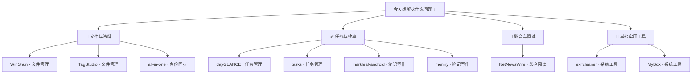

# 每日实用开源精选 · 2026-11-10

10 个实用开源项目。许可证与维护日期来自 GitHub API；中文介绍由 AI 辅助生成，安装前请核对项目说明。

## 🌟 今日首选 · [WinShun](https://github.com/LingCore/WinShun)

> 忘了报告存在哪？输入文件名或文档中的文字，找到并打开它。

**为什么先试：**安装方式明确，Windows 用户能直接解决找文件难题；基础搜索步骤清楚，适合先尝试。

**工作流程：**记得报告中的一句话 → 搜索文档内容并选中结果 → 打开对应的报告文件

**适用平台：**Windows

---

## 先按需求找工具

**📁 文件与资料**：[WinShun](https://github.com/LingCore/WinShun) · [TagStudio](https://github.com/TagStudioDev/TagStudio) · [all-in-one](https://github.com/nextcloud/all-in-one)

**✅ 任务与效率**：[dayGLANCE](https://github.com/krelltunez/dayGLANCE) · [tasks](https://github.com/tasks/tasks) · [markleaf-android](https://github.com/jeiel85/markleaf-android) · [memry](https://github.com/memrynote/memry)

**🎵 影音与阅读**：[NetNewsWire](https://github.com/Ranchero-Software/NetNewsWire)

**🧰 其他实用工具**：[exifcleaner](https://github.com/szTheory/exifcleaner) · [MyBox](https://github.com/Mararsh/MyBox)

---

## 01 · [LingCore/WinShun](https://github.com/LingCore/WinShun)

分类：文件管理

> 忘了报告存在哪？输入文件名或文档中的文字，找到并打开它。

**工作流程：**记得报告中的一句话 → 搜索文档内容并选中结果 → 打开对应的报告文件

Windows 文件搜索与快速启动工具。双击 Ctrl 打开搜索框，可按文件名、拼音或文档内容查找本机资料，并从结果中打开文件；剪贴板历史等功能可按需启用。

- 平台：Windows 10、11（x64）
- 费用：项目说明称免费；其他费用待核实
- 安装：从发布页下载安装程序，双击安装；入门难度低
- 注意：安装包据说明尚未签名，可能触发系统警告；内容索引和剪贴板历史需按需开启。
- [许可证 MIT](https://github.com/LingCore/WinShun/blob/main/LICENSE)
- [默认分支最近提交：2026-11-10T05:06:28Z](https://github.com/LingCore/WinShun/commit/6fff68423285ede40366416304a4191f407e054d)
- 最近正式发布：[v0.22.0 · 2026-11-07T02:44:30Z](https://github.com/LingCore/WinShun/releases/tag/v0.22.0)
- [安装说明](https://github.com/LingCore/WinShun/blob/main/README.md)

## 02 · [TagStudioDev/TagStudio](https://github.com/TagStudioDev/TagStudio)

分类：文件管理

> 照片散在多个文件夹？给资料库中的照片打标签，按主题找回它们。

**工作流程：**文件夹中的旅行照片 → 建立资料库并标记地点 → 按地点找到相关照片

用标签整理照片和其他文件的桌面应用。它在现有文件夹上建立资料库，无须为了分类而搬动或复制原文件；可为文件添加标签和字段，并用于查找资料。

- 平台：桌面平台；具体支持的系统待核实
- 费用：收费情况待核实
- 安装：有发布页；安装包格式与具体安装步骤待核实，难度待核实
- 注意：项目截图标注为测试阶段；资料库会在所选文件夹内建立 .TagStudio 目录，重要资料应备份。
- [许可证 GPL-3.0](https://github.com/TagStudioDev/TagStudio/blob/main/LICENSE)
- [默认分支最近提交：2026-11-09T19:25:06Z](https://github.com/TagStudioDev/TagStudio/commit/873de7e5bbeabb8d7103811e9e5bedbabf041b32)
- 最近正式发布：[v9.6.4 · 2026-10-02T19:30:15Z](https://github.com/TagStudioDev/TagStudio/releases/tag/v9.6.4)
- [安装说明](https://github.com/TagStudioDev/TagStudio/blob/main/README.md)

## 03 · [krelltunez/dayGLANCE](https://github.com/krelltunez/dayGLANCE)

分类：任务管理

> 一天的待办总排不开？把任务放进时间块，看看各时段要做什么。

**工作流程：**今天的待办和可用时段 → 把任务安排进时间块 → 得到当天的时间安排

以可视化时间块规划一天的工具，提供任务收集、日程视图、提醒和周期任务。可在网页直接使用，数据默认保存在浏览器本地；同步与自行托管是可选方式。

- 平台：浏览器；另有 Android、iOS 应用
- 费用：项目说明网页使用免费；可选服务费用待核实
- 安装：打开项目提供的网站即可使用，无需安装；也可自行用 Docker 部署
- 注意：浏览器本地数据需自行做好备份；启用同步或外部集成前应确认数据去向。
- [许可证 MIT](https://github.com/krelltunez/dayGLANCE/blob/main/LICENSE)
- [默认分支最近提交：2026-11-10T04:59:03Z](https://github.com/krelltunez/dayGLANCE/commit/f99a87dbef46b555083e7eb847e25ee4aab24bc2)
- 最近正式发布：[v5.12.0 · 2026-11-07T23:52:18Z](https://github.com/krelltunez/dayGLANCE/releases/tag/v5.12.0)
- [安装说明](https://github.com/krelltunez/dayGLANCE/blob/main/README.md)

## 04 · [tasks/tasks](https://github.com/tasks/tasks)

分类：任务管理

> 出门时怕忘记待办？在手机任务应用中记录要做的事。

**工作流程：**需要记住的待办事项 → 在应用中记录任务 → 得到手机上的待办记录

源于 Astrid 的任务管理应用，提供 Android 版本，另有测试阶段的桌面版。适合在手机上记录和查看待办；所给 README 未列出具体任务操作细节。

- 平台：Android；桌面版处于测试阶段，具体系统待核实
- 费用：收费情况待核实
- 安装：Android 可通过 Google Play、F-Droid 或发布页获取；桌面版安装细节待核实
- 注意：桌面版仍标为测试阶段；提醒、同步等具体能力不能仅凭所给资料确认。
- [许可证 GPL-3.0](https://github.com/tasks/tasks/blob/main/LICENSE)
- [默认分支最近提交：2026-11-10T05:01:46Z](https://github.com/tasks/tasks/commit/6973b5261020ff73078558fc271341ded823e450)
- 最近正式发布：[15.13 · 2026-10-14T00:21:52Z](https://github.com/tasks/tasks/releases/tag/15.13)
- [安装说明](https://github.com/tasks/tasks/blob/main/README.md)

## 05 · [jeiel85/markleaf-android](https://github.com/jeiel85/markleaf-android)

分类：笔记写作

> 逛店时想记采购清单？在手机笔记里插入勾选项并预览。

**工作流程：**待购买的物品名称 → 新建笔记并插入清单 → 得到可查看的购物笔记

Android 本地优先的 Markdown 笔记应用，支持快捷插入标题、清单和表格，并可切换编辑与预览。笔记保存在设备上，应用本身不会主动上传或同步。

- 平台：Android
- 费用：收费情况待核实
- 安装：可从 F-Droid 获取；发布页亦提供版本信息，安装难度低
- 注意：不要把可选择的文件夹同步理解成应用自动同步；换机前需自行确认笔记备份方式。
- [许可证 Apache-2.0](https://github.com/jeiel85/markleaf-android/blob/main/LICENSE)
- [默认分支最近提交：2026-11-10T05:07:31Z](https://github.com/jeiel85/markleaf-android/commit/149fe5cca997ec244d9e04e34431287b09f2df68)
- 最近正式发布：[v2.72.0 · 2026-11-04T15:30:43Z](https://github.com/jeiel85/markleaf-android/releases/tag/v2.72.0)
- [安装说明](https://github.com/jeiel85/markleaf-android/blob/main/README.md)

## 06 · [memrynote/memry](https://github.com/memrynote/memry)

分类：笔记写作

> 会议笔记和每日记录分散？存进同一资料夹，用标签查找。

**工作流程：**会议讨论要点 → 写成笔记并添加标签 → 得到可搜索的会议记录

本地优先的桌面笔记与规划应用，支持 Markdown 笔记、标签、搜索，也整合任务、日记和日历。使用时可将资料保存在自选文件夹；多设备加密同步为可选服务。

- 平台：macOS、Windows、Linux
- 费用：项目说明应用免费，可选同步收费
- 安装：从发布页下载对应系统安装包，安装后选择资料文件夹；难度较低
- 注意：项目标为测试版；使用重要笔记前先备份。同步并非记笔记的必要步骤。
- [许可证 AGPL-3.0](https://github.com/memrynote/memry/blob/feat/tauri-v2/LICENSE)
- [默认分支最近提交：2026-11-10T04:21:14Z](https://github.com/memrynote/memry/commit/5afdb700658e94bc166ed90ced9ed1aaf1634ac8)
- 最近正式发布：[v2026-11-09 · 2026-11-09T14:37:29Z](https://github.com/memrynote/memry/releases/tag/v2026-11-09)
- [安装说明](https://github.com/memrynote/memry/blob/feat/tauri-v2/README.md)

## 07 · [szTheory/exifcleaner](https://github.com/szTheory/exifcleaner)

分类：系统工具

> 发照片前担心附带拍摄信息？清理元数据并查看前后差异。

**工作流程：**准备分享的照片 → 拖入照片并另存清理副本 → 得到元数据已清理的副本

用于清理受支持图片、媒体文件及 PDF 元数据的桌面工具。可拖入文件或文件夹批量处理，查看清理前后的元数据差异，并选择保留原文件、另存副本。

- 平台：Windows 10 及以上、macOS 13 及以上、64 位 Linux
- 费用：项目说明免费
- 安装：Windows 可从发布页选免安装便携版或安装程序；其他系统有对应安装包，难度较低
- 注意：发布包未做代码签名，初次运行可能出现系统提示；处理前建议勾选另存副本，并核对支持的文件类型。
- [许可证 MIT](https://github.com/szTheory/exifcleaner/blob/master/LICENSE)
- [默认分支最近提交：2026-10-25T13:40:41Z](https://github.com/szTheory/exifcleaner/commit/1ba131f5dea7c6e51b929e6f37d92ce63fde980f)
- 最近正式发布：[v4.7.0 · 2026-10-25T13:58:00Z](https://github.com/szTheory/exifcleaner/releases/tag/v4.7.0)
- [安装说明](https://github.com/szTheory/exifcleaner/blob/master/README.md)

## 08 · [Mararsh/MyBox](https://github.com/Mararsh/MyBox)

分类：系统工具

> 临时要改一张图片？用图形界面编辑副本，再检查结果。

**工作流程：**待修改图片的副本 → 打开图片并调整尺寸 → 得到调整后的图片副本

图形化综合工具箱，提供文档、图像、文件、数据等多类处理功能。Windows 自包含程序包解压即可运行，无须另装 Java；适合偶尔需要在一个界面处理不同素材的人。

- 平台：Windows x64、Linux Mint x64、macOS x64；另有需 Java 环境的包
- 费用：项目说明免费
- 安装：下载对应系统的自包含程序包，解压后运行；入门安装难度低
- 注意：作者明确警告软件测试不足，可能损坏数据或输出错误；只用副本操作并核对结果。
- [许可证 Apache-2.0](https://github.com/Mararsh/MyBox/blob/master/LICENSE)
- [默认分支最近提交：2026-11-10T05:10:27Z](https://github.com/Mararsh/MyBox/commit/b1f2f846a89e063bbc2c59e908c61da54047c2b4)
- 最近正式发布：[v6.9.3 · 2026-02-10T11:25:09Z](https://github.com/Mararsh/MyBox/releases/tag/v6.9.3)
- [安装说明](https://github.com/Mararsh/MyBox/blob/master/README.md)

## 09 · [Ranchero-Software/NetNewsWire](https://github.com/Ranchero-Software/NetNewsWire)

分类：影音阅读

> 常看的博客太分散？订阅它们的资讯源，在一处读更新。

**工作流程：**常看博客的订阅源 → 添加订阅并阅读更新 → 得到集中的文章列表

macOS 和 iOS 上的资讯订阅阅读器，支持 RSS、Atom、JSON Feed 等格式，适合把不同网站的更新集中阅读。所给资料未说明 Windows 版本。

- 平台：macOS、iOS
- 费用：项目说明免费
- 安装：提供项目网站及发布页；面向普通用户的具体安装步骤待核实
- 注意：需准备目标网站可用的订阅源；从源码自行构建的版本可能缺少部分账户与阅读功能。
- [许可证 MIT](https://github.com/Ranchero-Software/NetNewsWire/blob/main/LICENSE)
- [默认分支最近提交：2026-11-10T05:10:22Z](https://github.com/Ranchero-Software/NetNewsWire/commit/7662c90692288928da3acb0dc8bced05fc0f1ff9)
- 最近正式发布：[mac-7.2.1 · 2026-10-20T16:59:23Z](https://github.com/Ranchero-Software/NetNewsWire/releases/tag/mac-7.2.1)
- [安装说明](https://github.com/Ranchero-Software/NetNewsWire/blob/main/README.md)

## 10 · [nextcloud/all-in-one](https://github.com/nextcloud/all-in-one)

分类：备份同步

> 家里有闲置服务器？自建文件服务，并按需配置备份。

**工作流程：**需要集中保存的家庭文件 → 上传到自建文件服务 → 得到可集中访问的文件

用于自行部署 Nextcloud 的整合安装方案，包含文件服务及网页管理界面，并可选启用基于 BorgBackup 的备份功能。适合已有服务器、想自己管理家庭文件访问与备份的人。

- 平台：部署于支持 Docker 的主机；具体主机系统要求待核实，客户端平台待核实
- 费用：软件及运行所需主机、存储等费用待核实
- 安装：通过 Docker 部署并在网页界面维护；需要服务器、存储及网络配置，难度较高
- 注意：备份功能为可选项，不会因安装而自动具备完整备份策略；自行托管需负责更新、存储和恢复验证。
- [许可证 AGPL-3.0](https://github.com/nextcloud/all-in-one/blob/main/LICENSE)
- [默认分支最近提交：2026-11-09T14:52:25Z](https://github.com/nextcloud/all-in-one/commit/6324a90bc72d2cd8b1d5487f6edf3bf2a29e16ad)
- 最近正式发布：[v15.0.2 · 2026-11-03T11:02:16Z](https://github.com/nextcloud/all-in-one/releases/tag/v15.0.2)
- [安装说明](https://github.com/nextcloud/all-in-one/blob/main/readme.md)

---

## 🔥 今日热门

额外 5 项 · 从 GitHub Trending 日榜筛选，排除历史推荐与当天精选，不代表全网热度排名。

[来源：GitHub Trending 日榜](https://github.com/trending?since=daily) ｜ 采集时间：2026-11-10T06:40:20.918Z

### [astryx](https://github.com/meta/astryx)

**日榜第 2 位 · 今日新增 3,278 Star**

**这是什么：**这是面向 React 应用的设计系统，也就是一套可复用的界面组件与样式规则。原本开发团队需要分别制作按钮等组件、维护视觉规范并处理主题切换；Astryx 提供现成组件、模板和主题机制，让团队把精力放在组合页面及调整品牌样式上，但仍需在项目中编写代码。

**适合谁：**适合前端开发者及与其协作的设计团队；需要编程和现有 React 项目，普通读者不能直接当作独立软件使用。

**举个例子：**帮助理解的示例：假设你要为已有 React 应用制作后台页面，先准备页面内容和品牌配色，在项目中引入 Astryx 的组件与主题，组合所需界面，再用 CSS 变量调整颜色。最终得到与品牌样式一致的页面代码，而不是一个自动生成并上线的网站。

**工作流程：**已有页面需求和品牌样式 → 组合组件并调整主题变量 → 符合品牌样式的页面界面

Astryx 是供 React 项目使用的设计系统，提供可访问性组件、主题、深色模式、页面模板和命令行工具。团队可使用现成组件搭建界面，再通过 CSS 变量调整品牌样式；它不是无需开发即可使用的网站制作软件。

- 平台：React 19 及以上版本的网页项目；具体部署平台待核实。
- 费用：README 未说明项目使用及相关服务的费用，待核实；开源不等于所有使用环节均免费。
- 安装：在 React 19 及以上项目中安装 @astryxdesign/core、@astryxdesign/theme-neutral 和 @stylexjs/stylex；可另装 @astryxdesign/cli。随后按项目说明引入 CSS 并配置主题提供器。
- 注意：README 标明仍处于 Beta 阶段。它用 StyleX 编写内部样式，但使用组件时不要求另配构建插件；具体组件用法仍应查看相应文档。
- [许可证 MIT](https://github.com/meta/astryx/blob/main/LICENSE)
- [最近提交 2026-11-10T06:37:34Z](https://github.com/meta/astryx/commit/5b0eb0fb4e054b34619e0e2fb580c016c1115492)
- 最近正式发布：[v0.7.11 · 2026-11-07T15:00:47Z](https://github.com/meta/astryx/releases/tag/v0.7.11)
- [项目说明](https://github.com/meta/astryx/blob/main/README.md)

### [sherlock](https://github.com/sherlock-project/sherlock)

**日榜第 3 位 · 今日新增 4,267 Star**

**这是什么：**这是用用户名查找社交网站账号的命令行工具。原本需要逐个打开网站、输入同一用户名并记录结果；Sherlock 将这些查询集中执行，按用户名保存发现的账号。它提供的是账号线索，不负责证明不同网站上的同名账号属于同一个人，也不是可直接点击使用的普通网页应用。

**适合谁：**适合需要核对公开用户名的研究或调查人员；不必编程，但需会安装工具并使用命令行，无须自建服务。

**举个例子：**帮助理解的示例：假设你要检查自己常用的用户名是否出现在其他社交网站，先准备该用户名，在命令行运行 Sherlock 的用户名检索命令，必要时限定网站或选择 CSV 导出。最终得到待逐项核对的账号结果文件，不能仅凭同名认定账号归属。

**工作流程：**一个或多个待查用户名 → 运行检索并核对结果 → 按用户名保存的账号线索

Sherlock 是命令行工具，可用一个或多个用户名检索其在多个社交网站上的出现情况，并将发现的账号保存为文本文件；README 还列出 CSV、XLSX 导出及限定检索网站等选项。

- 平台：命令行环境；README 列出 pipx、pip、uv、Docker 和部分系统软件包的安装途径。
- 费用：所给 README 未说明使用费用；代理或其他配套服务是否收费待核实。
- 安装：可用 pipx install sherlock-project 安装，或按 README 选择 pip、uv、Docker 等方式。部分社区维护的软件包不由项目直接支持。
- 注意：同名不等于同一人，结果应人工核对，并注意隐私和网站规则。README 警告第三方维护的 ParrotOS 与 Ubuntu 24.04 软件包可能损坏，建议改用 pipx、pip、uv 或 Docker。
- [许可证 MIT](https://github.com/sherlock-project/sherlock/blob/master/LICENSE)
- [最近提交 2026-11-01T17:41:43Z](https://github.com/sherlock-project/sherlock/commit/c588d7c8b476df9f9c84912a05d1430fb8cdcdae)
- 最近正式发布：[v0.16.2 · 2026-09-08T20:54:15Z](https://github.com/sherlock-project/sherlock/releases/tag/v0.16.2)
- [项目说明](https://github.com/sherlock-project/sherlock/blob/master/docs/README.md)

### [mujoco](https://github.com/google-deepmind/mujoco)

**日榜第 4 位 · 今日新增 574 Star**

**这是什么：**这是供研究与开发使用的物理仿真引擎，不是自动设计机器人的成品软件。原本需要自行实现关节运动、接触等计算，或搭建相应仿真环境；MuJoCo 承担物理计算，并提供查看模型运行情况的工具。浏览器可以用来体验和查看模型，深入建模或接入程序仍需要相关技术知识。

**适合谁：**适合机器人、生物力学、动画及机器学习研究开发者；浏览器体验可不编程，深入使用通常需要建模或编程。

**举个例子：**帮助理解的示例：假设你要查看一个已有机器人模型在仿真环境中的运动，先准备模型文件，再按 README 所述将其拖入浏览器版 MuJoCo Studio，观察并检查模型表现。最终得到可视化的仿真观察结果；这不等于真实机器人的测试结论。

**工作流程：**待观察的仿真模型 → 载入模型并运行仿真 → 可观察的运动与接触表现

MuJoCo 是通用物理仿真引擎，用于研究关节结构与环境接触时的运动，面向机器人、生物力学、动画和机器学习等领域。它提供 C 接口、Python 绑定及可视化工具；README 还介绍了浏览器体验和预编译版本。

- 平台：可在浏览器体验；预编译版本面向 Linux、Windows 和 macOS，另提供 Python 绑定及 Unity 插件。
- 费用：所给 README 未说明软件使用或相关计算资源的费用，待核实。
- 安装：浏览器体验无需安装。本地使用可按文档下载对应系统的预编译版本并运行查看工具；从源码构建及编程接入需遵循项目文档。
- 注意：浏览器中的 WebAssembly 版本据 README 比原生 C 版本慢。仿真结果取决于模型和设置，不能直接代替现实测试。
- [许可证 Apache-2.0](https://github.com/google-deepmind/mujoco/blob/main/LICENSE)
- [最近提交 2026-11-10T01:28:23Z](https://github.com/google-deepmind/mujoco/commit/a937a4f916dc586660145973b015e56e04043377)
- 最近正式发布：[4.0.0 · 2026-11-06T15:39:53Z](https://github.com/google-deepmind/mujoco/releases/tag/4.0.0)
- [项目说明](https://github.com/google-deepmind/mujoco/blob/main/README.md)

### [claude-quickstarts](https://github.com/anthropics/claude-quickstarts)

**日榜第 5 位 · 今日新增 551 Star**

**这是什么：**这是多个可修改的应用示例组成的资料库。原本开发者要自行设计 Claude API 的接入方式，并从头搭建应用界面和交互流程；这些 quickstart 提供不同任务的起点代码，例如结合知识库的客服系统或通过聊天分析财务数据。它们帮助启动开发，不代表无需配置就能投入正式使用。

**适合谁：**适合要开发 Claude 应用的程序员或技术团队；需要编程、API 密钥及相应运行环境，普通读者不能直接当成完整服务使用。

**举个例子：**帮助理解的示例：假设你要制作能参考企业知识库的客服应用，先准备可供使用的知识资料和 Claude API 密钥，选择 Customer Support Agent 示例并按业务需求修改。最终得到可继续测试和完善的客服应用基础，而不是已验证可直接上线的客服系统。

**工作流程：**业务需求、资料和API密钥 → 选择示例并修改应用逻辑 → 可继续测试的应用基础

这是帮助开发者构建 Claude API 应用的示例项目集合，而不是单一成品软件。所给 README 列出知识库客服、财务数据分析、浏览器及电脑操作、编程代理等起点项目，开发者可选择示例并按需求修改。

- 平台：包含不同应用示例；各示例的运行平台和部署条件需分别查看，所给 README 未统一说明。
- 费用：README 说明需要 Claude API 密钥，并提到可免费注册账号；API 调用及部署费用未在所给资料中说明，待核实。
- 安装：先取得 Claude API 密钥，再选择具体 quickstart，按其子目录说明配置和运行；所给总 README 未提供适用于所有示例的统一安装命令。
- 注意：各示例用途和成熟度不同；README 明确指出 Browser Toolset Quickstart 展示的是接口而非生产代码。不要把演示项目直接视作可上线服务。
- [许可证 MIT](https://github.com/anthropics/claude-quickstarts/blob/main/LICENSE)
- [最近提交 2026-11-06T19:37:53Z](https://github.com/anthropics/claude-quickstarts/commit/4a4224bdf0e9cfb3332167b69c90457403813625)
- 最近正式发布：无正式 Release
- [项目说明](https://github.com/anthropics/claude-quickstarts/blob/main/README.md)

### [gbrain](https://github.com/garrytan/gbrain)

**日榜第 6 位 · 今日新增 216 Star**

**这是什么：**这是连接现有 AI 助手的记忆管理工具，不是独立替代助手的聊天软件。原本使用者可能要在不同助手中重复提供背景信息，或自行整理事实及其出处；GBrain 将明确记录的事实保存为可检索的记忆，并支持更正、撤回及跨助手使用。若要共享给团队，还需处理访问权限和数据边界。

**适合谁：**适合管理多个 AI 助手记忆的个人或团队；托管方案可免自行运维，自托管和复杂集成需要技术配置。

**举个例子：**帮助理解的示例：假设你在不同 AI 助手中处理同一项目，先准备希望保留的项目事实及来源，将它们写入 GBrain，并把已有助手接入该记忆。之后提问时，助手可检索相关记录；如项目情况变化，也可更正或撤回旧事实。这是功能示例，不代表已验证的实际效果。

**工作流程：**项目事实及其来源 → 记录事实并连接已有助手 → 可检索、可更正的共享记忆

GBrain 为已有 AI 助手提供可由用户管理的记忆：保存带来源的事实，支持更正、撤回和跨助手使用。它可先用关键词检索，再按需增加语义检索、回答整理等能力；可自行托管，也有可选的付费托管服务。

- 平台：可接入已有 AI 助手；README 提到本地使用、通过 MCP 远程连接及可选的托管服务，具体客户端条件需按接入指南核对。
- 费用：README 称自行托管免费，gbrain.io 为可选付费托管；运行基础设施和其他接入服务的费用待核实。
- 安装：按对应指南将 GBrain 加入已有助手；自托管远程使用可按 README 的 MCP 与 Tailscale 指南配置。若选托管服务，则按其接入说明连接，无需自行保持本地服务在线。
- 注意：团队共享时须先确认来源、操作和可见性权限。README 明确提示，本地文件与共享数据库凭据属于不同信任边界，权限测试也不构成绝对防泄漏保证。
- [许可证 MIT](https://github.com/garrytan/gbrain/blob/master/LICENSE)
- [最近提交 2026-11-10T06:02:23Z](https://github.com/garrytan/gbrain/commit/a94d50f3584d84cdb5966f43cca21a877f209286)
- 最近正式发布：[v0.60.639.0 · 2026-11-10T06:07:55Z](https://github.com/garrytan/gbrain/releases/tag/v0.60.639.0)
- [项目说明](https://github.com/garrytan/gbrain/blob/master/README.md)
