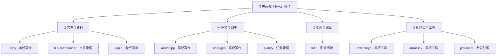

# 每日实用开源精选 · 2026-11-11

10 个实用开源项目。许可证与维护日期来自 GitHub API；中文介绍由 AI 辅助生成，安装前请核对项目说明。

## 🌟 今日首选 · [folio](https://github.com/Forward-Future/folio)

> PDF 不方便标注？打开文件添加高亮和批注，整理出可回看的重点。

**为什么先试：**支持 Windows 安装或便携运行，PDF 阅读和标注用途明确，上手路径清楚。

**工作流程：**需要阅读的 PDF 文件 → 搜索页面并添加高亮批注 → 带重点标记的 PDF

**适用平台：**Windows / macOS / Linux

---

## 先按需求找工具

**📁 文件与资料**：[iCopy](https://github.com/Z1Code/iCopy) · [file-commander](https://github.com/VioletGiraffe/file-commander) · [kopia](https://github.com/kopia/kopia)

**✅ 任务与效率**：[xournalpp](https://github.com/xournalpp/xournalpp) · [note-gen](https://github.com/codexu/note-gen) · [planify](https://github.com/alainm23/planify)

**🎵 影音与阅读**：[folio](https://github.com/Forward-Future/folio)

**🧰 其他实用工具**：[PowerToys](https://github.com/microsoft/PowerToys) · [auraclick](https://github.com/ryanlua/auraclick) · [jitsi-meet](https://github.com/jitsi/jitsi-meet)

---

## 01 · [Forward-Future/folio](https://github.com/Forward-Future/folio)

分类：影音阅读

> PDF 不方便标注？打开文件添加高亮和批注，整理出可回看的重点。

**工作流程：**需要阅读的 PDF 文件 → 搜索页面并添加高亮批注 → 带重点标记的 PDF

跨平台 PDF 阅读与编辑工具，可阅读、搜索、添加高亮和批注，也支持签名。Windows 10/11 可下载安装程序或便携版。

- 平台：Windows 10/11、macOS、Linux
- 费用：README 称免费；其他费用待核实。
- 安装：下载 Windows 安装程序并运行，难度低；也可使用便携版。
- 注意：Windows 版本未签名，首次启动可能遇到 SmartScreen 提示；打开网页或在线 PDF 需联网。
- [许可证 MIT](https://github.com/Forward-Future/folio/blob/main/LICENSE)
- [默认分支最近提交：2026-11-11T01:46:45Z](https://github.com/Forward-Future/folio/commit/4b9cadb6a5be8d955500295b5f7c00001e9bc78b)
- 最近正式发布：无正式 Release
- [安装说明](https://github.com/Forward-Future/folio/blob/main/README.md)

## 02 · [Z1Code/iCopy](https://github.com/Z1Code/iCopy)

分类：备份同步

> 担心 iCloud 原片没存到电脑？下载到本地并校验后再整理空间。

**工作流程：**iCloud 照片库和备份目标磁盘 → 下载原片并检查文件 → 按日期整理的本地照片副本

面向 Windows 和 macOS 的 iCloud 照片下载备份工具，可将照片、视频及 Live Photo 相关文件保存到电脑或外接盘，并校验文件、在中断后续传。

- 平台：Windows、macOS（README 标注测试版）
- 费用：费用待核实。
- 安装：README 提供 Windows 发布版本下载；运行安装方式待核实，难度待核实。
- 注意：需要 iCloud 账号访问照片；释放 iCloud 空间是可选操作，删除前应确认本地备份完整。
- [许可证 MIT](https://github.com/Z1Code/iCopy/blob/master/LICENSE)
- [默认分支最近提交：2026-11-11T01:11:06Z](https://github.com/Z1Code/iCopy/commit/4a35b2f91866adc0724560e276693ae1a9b0d4f9)
- 最近正式发布：[v0.3.0 · 2026-11-11T01:19:02Z](https://github.com/Z1Code/iCopy/releases/tag/v0.3.0)
- [安装说明](https://github.com/Z1Code/iCopy/blob/master/README.md)

## 03 · [VioletGiraffe/file-commander](https://github.com/VioletGiraffe/file-commander)

分类：文件管理

> 在两个文件夹间整理资料？用双栏同时打开来源和目标位置。

**工作流程：**待整理的来源和目标文件夹 → 双栏浏览并整理文件 → 整理到目标位置的文件

面向 Windows 的双栏文件管理器，也支持 macOS 和 Linux，提供插件支持；适合并排浏览文件夹并进行文件整理。

- 平台：Windows、macOS、Linux；FreeBSD 尽力支持
- 费用：费用待核实。
- 安装：从 Releases 下载 Windows x64 版本并运行，难度低；自行编译需 Visual Studio 2022 或更新版本及 Qt 6.8+。
- 注意：项目仍有已知问题列表；编译安装需要额外开发环境。
- [许可证 Apache-2.0](https://github.com/VioletGiraffe/file-commander/blob/master/LICENSE)
- [默认分支最近提交：2026-11-10T22:56:29Z](https://github.com/VioletGiraffe/file-commander/commit/fd0713da0e3c965ef94ef2fbeb012192d1ea5924)
- 最近正式发布：[0.9.9.7 · 2026-04-25T09:33:53Z](https://github.com/VioletGiraffe/file-commander/releases/tag/0.9.9.7)
- [安装说明](https://github.com/VioletGiraffe/file-commander/blob/master/README.md)

## 04 · [microsoft/PowerToys](https://github.com/microsoft/PowerToys)

分类：系统工具

> 文件名要批量修改？用 PowerRename 统一替换文件名中的文字。

**工作流程：**需要统一命名的一批文件 → 设置规则并批量重命名 → 按规则更新的文件名

微软提供的 Windows 实用工具集合，包含窗口布局、批量重命名、快速搜索、颜色拾取、文件预览等多种日常辅助功能。

- 平台：Windows
- 费用：费用待核实。
- 安装：README 提供安装章节及文档入口；具体安装命令待核实，难度待核实。
- 注意：包含多个独立工具，建议只启用需要的功能；不同工具的系统要求待核实。
- [许可证 MIT](https://github.com/microsoft/PowerToys/blob/main/LICENSE)
- [默认分支最近提交：2026-11-10T18:22:39Z](https://github.com/microsoft/PowerToys/commit/b1084dfe27eae7e4089109b2c03e0573e25aec6a)
- 最近正式发布：[v0.102.3101 · 2026-11-06T09:54:30Z](https://github.com/microsoft/PowerToys/releases/tag/v0.102.3101)
- [安装说明](https://github.com/microsoft/PowerToys/blob/main/README.md)

## 05 · [ryanlua/auraclick](https://github.com/ryanlua/auraclick)

分类：系统工具

> 需要重复点击同一位置？设好间隔和类型后用快捷键控制点击。

**工作流程：**目标窗口和点击间隔要求 → 设置点击类型并启停自动点击 → 按设定执行的鼠标点击

Windows 自动点击工具，可通过快捷键启动点击，并调整点击间隔和点击类型。README 标注为公开预览版。

- 平台：Windows
- 费用：费用待核实。
- 安装：可通过 Microsoft Store、WinGet 或发布页安装；WinGet 命令为 winget install --id RyanLuu.AuraClick --source winget，难度低。
- 注意：目前为预览版；自动点击可能在不适合的窗口触发操作，使用前确认目标位置。
- [许可证 GPL-3.0](https://github.com/ryanlua/auraclick/blob/main/COPYING.md)
- [默认分支最近提交：2026-11-11T01:34:45Z](https://github.com/ryanlua/auraclick/commit/1e79f97b6ad865a2636669a125ceaf94bc60335f)
- 最近正式发布：[v0.0.1.0 · 2026-10-31T02:34:47Z](https://github.com/ryanlua/auraclick/releases/tag/v0.0.1.0)
- [安装说明](https://github.com/ryanlua/auraclick/blob/main/README.md)

## 06 · [xournalpp/xournalpp](https://github.com/xournalpp/xournalpp)

分类：笔记写作

> 想在讲义上手写补充？打开 PDF 后直接标注并保存批注。

**工作流程：**待批注的 PDF 讲义 → 手写重点并添加文字说明 → 带手写批注的 PDF

支持手写笔记和 PDF 批注的应用，可使用压感手写笔、荧光笔、形状和文本工具，并将内容导出为 PDF、PNG 或 SVG。

- 平台：Windows 10、macOS、Linux
- 费用：费用待核实。
- 安装：从 Releases 下载对应 Windows 安装包并运行，难度低。
- 注意：LaTeX 功能需要另行安装可用的 LaTeX 环境；触控笔压感效果取决于设备支持。
- [许可证 GPL-2.0](https://github.com/xournalpp/xournalpp/blob/master/LICENSE)
- [默认分支最近提交：2026-11-10T12:35:46Z](https://github.com/xournalpp/xournalpp/commit/4d6810b3760c7b3f90c6a3271d6a5623cfb5481f)
- 最近正式发布：[v1.3.8 · 2026-09-26T06:23:53Z](https://github.com/xournalpp/xournalpp/releases/tag/v1.3.8)
- [安装说明](https://github.com/xournalpp/xournalpp/blob/master/README.md)

## 07 · [codexu/note-gen](https://github.com/codexu/note-gen)

分类：笔记写作

> 会议记录散落各处？先收集文字和截图，再整理成一份 Markdown 纪要。

**工作流程：**会议文字、截图和链接 → 筛选相关记录并整理成笔记 → 可继续编辑的 Markdown 纪要

本地优先的 Markdown 笔记应用，可收集文字、录音、截图、链接和文件，再筛选素材整理为结构化笔记；也支持搜索、导出和工作区管理。

- 平台：桌面与移动端；具体系统版本待核实
- 费用：费用待核实；AI 模型服务可能涉及额外费用，具体待核实。
- 安装：README 提供下载页面；具体安装包与步骤待核实，难度待核实。
- 注意：AI 功能需要配置模型提供方；使用云端模型时，需留意素材是否会发送给服务商。
- [许可证 GPL-3.0](https://github.com/codexu/note-gen/blob/dev/LICENSE)
- [默认分支最近提交：2026-11-11T00:44:38Z](https://github.com/codexu/note-gen/commit/4dcaa3f03a661c1259f8dfcdbc4a94c8cba0ffd5)
- 最近正式发布：[note-gen-v0.39.2 · 2026-11-01T09:20:45Z](https://github.com/codexu/note-gen/releases/tag/note-gen-v0.39.2)
- [安装说明](https://github.com/codexu/note-gen/blob/dev/README.md)

## 08 · [alainm23/planify](https://github.com/alainm23/planify)

分类：任务管理

> 容易忘记待办截止时间？给任务设置提醒并按项目分类查看。

**工作流程：**待办事项和截止时间 → 创建任务并设置提醒 → 可跟进的任务清单

GNOME 桌面任务管理器，可整理项目和任务、设置提醒与重复任务，并与 Todoist、Nextcloud 或 CalDAV 同步。

- 平台：Linux，需支持 GTK4 的发行版
- 费用：费用待核实。
- 安装：可从 Flathub 安装；也可按 README 在 Linux 上编译，后者需要开发依赖，难度较高。
- 注意：README 列出的系统要求是 Linux；Windows 支持待核实。Todoist 等第三方服务需相应账号。
- [许可证 GPL-3.0](https://github.com/alainm23/planify/blob/main/LICENSE)
- [默认分支最近提交：2026-11-11T01:47:49Z](https://github.com/alainm23/planify/commit/984fd82a436ccfc21d6f847d3e7f2a68bf47d170)
- 最近正式发布：[v4.20.0 · 2026-09-10T18:06:35Z](https://github.com/alainm23/planify/releases/tag/v4.20.0)
- [安装说明](https://github.com/alainm23/planify/blob/main/README.md)

## 09 · [kopia/kopia](https://github.com/kopia/kopia)

分类：备份同步

> 怕误删重要文件？定期备份指定文件夹，必要时恢复旧版本。

**工作流程：**需要保护的文件夹和备份位置 → 创建加密备份快照 → 可供恢复的文件备份

跨平台文件备份与恢复工具，提供图形界面和命令行，可将选定文件夹备份到本机、网络存储或云端存储，并支持加密、压缩和去重。

- 平台：Windows、macOS、Linux
- 费用：软件费用待核实；云存储空间可能需要另行付费。
- 安装：按官方安装页面下载 Windows 版本；详细步骤待核实，难度待核实。
- 注意：需自行选择并准备存储位置；启用加密后应妥善保存密钥，避免无法恢复数据。
- [许可证 Apache-2.0](https://github.com/kopia/kopia/blob/master/LICENSE)
- [默认分支最近提交：2026-11-10T23:17:42Z](https://github.com/kopia/kopia/commit/07d64c2273e2297c4b669180ce2e58a0345c3fec)
- 最近正式发布：[v0.23.1 · 2026-06-16T01:27:33Z](https://github.com/kopia/kopia/releases/tag/v0.23.1)
- [安装说明](https://github.com/kopia/kopia/blob/master/README.md)

## 10 · [jitsi/jitsi-meet](https://github.com/jitsi/jitsi-meet)

分类：办公处理

> 临时需要远程讨论？打开网页创建会议并共享屏幕。

**工作流程：**会议主题和参会者 → 打开会议并共享屏幕 → 可进行交流的线上会议

浏览器可用的视频会议软件，支持音视频通话、屏幕共享、聊天、举手和投票；也可部署自有会议服务。

- 平台：支持当前主流浏览器；另有 Android 和 iOS 应用
- 费用：使用 meet.jit.si 的费用说明为免费；自建部署的主机成本待核实。
- 安装：浏览器打开 meet.jit.si 即可使用；发起会议需 Google、Facebook 或 GitHub 账号；自建需要按文档部署。
- 注意：公共服务需联网；会议隐私和端到端加密设置应按官方安全说明确认。
- [许可证 Apache-2.0](https://github.com/jitsi/jitsi-meet/blob/master/LICENSE)
- [默认分支最近提交：2026-11-11T00:32:20Z](https://github.com/jitsi/jitsi-meet/commit/70143c68c21019d9a17a1ce04c39675fff41aa0f)
- 最近正式发布：[stable/jitsi-meet_11248 · 2026-09-14T13:07:11Z](https://github.com/jitsi/jitsi-meet/releases/tag/stable/jitsi-meet_11248)
- [安装说明](https://github.com/jitsi/jitsi-meet/blob/master/README.md)

---

## 🔥 今日热门

今日热榜暂时无法获取，实用精选正常发送。

[来源：GitHub Trending 日榜](https://github.com/trending?since=daily) ｜ 采集时间：2026-11-11T01:49:51.221Z

