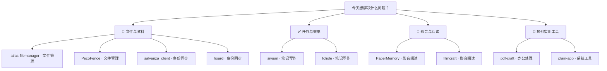

# 每日实用开源精选 · 2026-11-12

10 个实用开源项目。许可证与维护日期来自 GitHub API；中文介绍由 AI 辅助生成，安装前请核对项目说明。

## 🌟 今日首选 · [plain-app](https://github.com/plainhub/plain-app)

> 想用电脑整理手机文件？在同一 Wi-Fi 下用浏览器访问手机管理界面。

**为什么先试：**电脑端无需安装应用，适合临时查看和管理手机内容；需留意权限授予与网络环境。

**工作流程：**同一网络中的 Android 手机 → 浏览器打开手机管理页面 → 可在电脑查看的手机资料

**适用平台：**Windows / Android

---

## 先按需求找工具

**📁 文件与资料**：[atlas-filemanager](https://github.com/neondeex/atlas-filemanager) · [PecoFence](https://github.com/DayuanJiang/PecoFence) · [salvanza\_client](https://github.com/Salvanza/salvanza_client) · [hoard](https://github.com/rleeon/hoard)

**✅ 任务与效率**：[siyuan](https://github.com/siyuan-note/siyuan) · [foliole](https://github.com/campfirium/foliole)

**🎵 影音与阅读**：[PaperMemory](https://github.com/vict0rsch/PaperMemory) · [filmcraft](https://github.com/storytold/filmcraft)

**🧰 其他实用工具**：[pdf-craft](https://github.com/oomol-lab/pdf-craft) · [plain-app](https://github.com/plainhub/plain-app)

---

## 01 · [neondeex/atlas-filemanager](https://github.com/neondeex/atlas-filemanager)

分类：文件管理

> 文件夹里资料太多难整理？用标签、搜索和分栏更快定位文件。

**工作流程：**要整理的本地文件夹 → 搜索文件并按需移动整理 → 更易查找的文件布局

面向 Windows 10/11 的本地文件管理器，支持多种文件视图、标签页、分栏、模糊搜索、文件预览和磁盘空间清理；文件留在本机。项目处于 alpha 阶段。

- 平台：Windows 10/11；Linux 版本在开发中，macOS 计划中
- 费用：可免费使用；可选一次性付费升级 Premium，解锁更高使用限额。
- 安装：可从 Microsoft Store 安装，难度低；也可按 README 指引用 Rust 和 MSVC 工具链从源码构建，难度高。
- 注意：处于 alpha 阶段，功能可能有粗糙之处；云盘连接和部分扩展可能涉及额外配置。
- [许可证 AGPL-3.0](https://github.com/neondeex/atlas-filemanager/blob/main/LICENSE)
- [默认分支最近提交：2026-11-12T01:26:37Z](https://github.com/neondeex/atlas-filemanager/commit/7da9f0fdc129791bca8cb5ea5ab89fa94495a313)
- 最近正式发布：[v0.1.5 · 2026-11-06T00:41:54Z](https://github.com/neondeex/atlas-filemanager/releases/tag/v0.1.5)
- [安装说明](https://github.com/neondeex/atlas-filemanager/blob/main/README.md)

## 02 · [DayuanJiang/PecoFence](https://github.com/DayuanJiang/PecoFence)

分类：文件管理

> 桌面文件越堆越乱？按项目分区收纳，并为新文件设置整理规则。

**工作流程：**桌面上的文件和项目分类 → 创建分区并整理图标 → 按项目归类的桌面布局

Windows 桌面文件整理工具，可将桌面图标收纳到分区面板，支持标签页、文件夹视图、规则整理和快捷搜索，也提供 CLI 管理布局与设置。

- 平台：Windows 10/11
- 费用：README 标注可免费使用；其他收费安排待核实。
- 安装：可通过 Microsoft Store 安装，或下载便携 ZIP；难度低。
- 注意：自动整理规则会影响文件在桌面上的呈现；调整前建议先备份配置。
- [许可证 Apache-2.0](https://github.com/DayuanJiang/PecoFence/blob/main/LICENSE)
- [默认分支最近提交：2026-11-12T00:56:42Z](https://github.com/DayuanJiang/PecoFence/commit/b4fff2e7bdb60fca3551f57fc392231dbb82ab76)
- 最近正式发布：[v0.3.3 · 2026-11-09T13:58:55Z](https://github.com/DayuanJiang/PecoFence/releases/tag/v0.3.3)
- [安装说明](https://github.com/DayuanJiang/PecoFence/blob/main/README.md)

## 03 · [Salvanza/salvanza_client](https://github.com/Salvanza/salvanza_client)

分类：备份同步

> 担心电脑故障丢资料？定期备份文件或整机，并在需要时恢复。

**工作流程：**待备份的文件夹或磁盘 → 连接备份服务器并创建备份 → 可供恢复的备份数据

连接 Proxmox Backup Server 的 Windows 和 Linux 备份客户端，可按计划或手动备份文件夹及整机磁盘，并支持恢复文件、回滚和客户端加密。

- 平台：Windows、Linux（amd64、arm64）
- 费用：费用待核实；开源不代表服务端存储或部署没有成本。
- 安装：提供桌面应用、后台服务、命令行工具和恢复 ISO；具体安装步骤见项目手册，难度中等。
- 注意：需要可用的 Proxmox Backup Server；整机备份和恢复涉及磁盘操作，操作前应核对目标和备份。
- [许可证 GPL-3.0](https://github.com/Salvanza/salvanza_client/blob/master/LICENSE)
- [默认分支最近提交：2026-11-08T20:41:57Z](https://github.com/Salvanza/salvanza_client/commit/b0bbc0fbb2c2f7d7e62e172263532c9bec61d0f8)
- 最近正式发布：[v2.0.0 · 2026-11-08T20:43:43Z](https://github.com/Salvanza/salvanza_client/releases/tag/v2.0.0)
- [安装说明](https://github.com/Salvanza/salvanza_client/blob/master/README.md)

## 04 · [rleeon/hoard](https://github.com/rleeon/hoard)

分类：备份同步

> 换电脑怕游戏存档丢失？自动保存多个版本，需要时恢复旧进度。

**工作流程：**已安装游戏的存档 → 备份存档并保留历史版本 → 可恢复的游戏存档版本

跨平台游戏存档备份与同步工具，可自动识别大量游戏和模拟器，保存多个历史版本，并在存档损坏或换机时回滚或恢复。

- 平台：Windows、Linux、macOS、SteamOS、BazziteOS
- 费用：可自托管；README 描述 Hoard One 云服务有免费额度，后续费用待核实。
- 安装：可安装桌面应用或命令行工具；自托管需另行运行服务器，难度中等。
- 注意：云服务额度有限；自托管需要维护服务器和存储。自动识别范围不代表每款游戏都受支持。
- [许可证 AGPL-3.0](https://github.com/rleeon/hoard/blob/main/LICENSE)
- [默认分支最近提交：2026-11-11T22:09:07Z](https://github.com/rleeon/hoard/commit/05d5304622b8ee30ab887500d5c8b8072020372b)
- 最近正式发布：[v1.3.0 · 2026-10-25T20:17:18Z](https://github.com/rleeon/hoard/releases/tag/v1.3.0)
- [安装说明](https://github.com/rleeon/hoard/blob/main/README.md)

## 05 · [siyuan-note/siyuan](https://github.com/siyuan-note/siyuan)

分类：笔记写作

> 笔记越积越多找不到关联？用双向链接把想法和资料串起来。

**工作流程：**课程、工作或生活中的零散笔记 → 创建笔记并添加关联引用 → 相互链接的知识笔记

隐私优先的个人知识管理工具，支持块级引用、双向链接和 Markdown 所见即所得编辑，可用于整理笔记与建立知识关联。

- 平台：README 提及桌面应用及 Docker、自托管部署；具体桌面系统支持待核实
- 费用：README 称大多数功能免费；部分功能或服务的费用需查看项目说明。
- 安装：可从项目发布页获取安装包，也支持 Docker 等部署方式；个人桌面安装难度待核实。
- 注意：数据存储和同步方式需按指南配置；使用第三方同步盘或相关服务时需关注数据隐私与备份。
- [许可证 AGPL-3.0](https://github.com/siyuan-note/siyuan/blob/master/LICENSE)
- [默认分支最近提交：2026-11-10T04:12:44Z](https://github.com/siyuan-note/siyuan/commit/be17ed1e0510bb6371cb8a162e16898a697fa118)
- 最近正式发布：[v3.8.10 · 2026-11-10T04:13:26Z](https://github.com/siyuan-note/siyuan/releases/tag/v3.8.10)
- [安装说明](https://github.com/siyuan-note/siyuan/blob/master/README.md)

## 06 · [campfirium/foliole](https://github.com/campfirium/foliole)

分类：笔记写作

> 读完资料总记不住重点？摘录关键段落并安排间隔复习。

**工作流程：**要阅读的 PDF 或 EPUB → 摘录重点并创建复习材料 → 可定期回顾的阅读笔记

渐进式阅读应用，可集中管理文档、摘录段落、制作填空卡片并安排复习；支持 Markdown、PDF、EPUB 等材料。

- 平台：macOS、Windows、Linux（实验性）、iOS、Android
- 费用：费用待核实。
- 安装：可下载安装包，也可先体验在线演示；桌面安装难度低，项目目前处于 beta。
- 注意：Linux 版本为实验性，整体处于 beta；设备间同步通过本地网络，README 未说明中心云同步。
- [许可证 Apache-2.0](https://github.com/campfirium/foliole/blob/dev/LICENSE)
- [默认分支最近提交：2026-11-11T23:50:56Z](https://github.com/campfirium/foliole/commit/20ef0685318a7f8694a5d774189fb0e78cc26bc8)
- 最近正式发布：[v0.8.1 · 2026-11-07T07:31:20Z](https://github.com/campfirium/foliole/releases/tag/v0.8.1)
- [安装说明](https://github.com/campfirium/foliole/blob/dev/README.md)

## 07 · [vict0rsch/PaperMemory](https://github.com/vict0rsch/PaperMemory)

分类：影音阅读

> 浏览论文时总忘记保存？用浏览器扩展自动记录并整理阅读清单。

**工作流程：**浏览器中打开的论文页面 → 记录论文并添加标签或评论 → 可搜索的论文阅读清单

浏览器内的科研论文管理扩展，可在打开支持来源的论文时自动记录，搜索、添加标签和评论，并查找代码仓库、已发表版本及 BibTeX 引文。

- 平台：Chrome、Brave、Edge、Firefox
- 费用：费用待核实；README 提供捐赠入口。
- 安装：从 Chrome Web Store 或 Firefox Add-ons 安装扩展，难度低。
- 注意：自动识别仅覆盖 README 列出的来源；查找代码仓库和发表版本依赖外部数据库或 API。
- [许可证 MIT](https://github.com/vict0rsch/PaperMemory/blob/master/LICENSE)
- [默认分支最近提交：2026-11-12T00:21:16Z](https://github.com/vict0rsch/PaperMemory/commit/d6bbea7375cfe64b99d3cf9a62d70244d09a7693)
- 最近正式发布：[1.0.3 · 2025-11-15T10:10:20Z](https://github.com/vict0rsch/PaperMemory/releases/tag/1.0.3)
- [安装说明](https://github.com/vict0rsch/PaperMemory/blob/master/Readme.md)

## 08 · [oomol-lab/pdf-craft](https://github.com/oomol-lab/pdf-craft)

分类：办公处理

> 扫描书籍无法搜索？转成 Markdown 检索内容，或生成 EPUB 阅读。

**工作流程：**扫描版 PDF 文件 → 选择 Markdown 或 EPUB 转换 → 可搜索或阅读的文档

处理扫描书籍、论文和技术文档的工具，可将扫描 PDF 转成 Markdown 或 EPUB，也支持翻译内容并生成双语电子书或翻译后的 PDF。

- 平台：在线服务可通过浏览器使用；本地方式提供 Python 库，具体桌面平台待核实
- 费用：在线服务及第三方 OCR 的收费情况待核实；本地运行所需资源和模型可能产生额外成本。
- 安装：可直接使用在线转换服务；本地 OCR 需配置 Python、Poppler、CUDA 和模型，安装难度较高。
- 注意：扫描质量和页面排版会影响识别准确度；在线转换会上传文件，敏感资料应谨慎处理。
- [许可证 MIT](https://github.com/oomol-lab/pdf-craft/blob/main/LICENSE)
- [默认分支最近提交：2026-11-12T01:19:53Z](https://github.com/oomol-lab/pdf-craft/commit/73371dcbf2137443c27afafa7a9d79da3f63604a)
- 最近正式发布：[v2.6.7 · 2026-10-28T13:22:08Z](https://github.com/oomol-lab/pdf-craft/releases/tag/v2.6.7)
- [安装说明](https://github.com/oomol-lab/pdf-craft/blob/main/README.md)

## 09 · [storytold/filmcraft](https://github.com/storytold/filmcraft)

分类：影音阅读

> 想剪辑家庭或旅行视频？把素材放入时间线，剪出一段成片。

**工作流程：**待剪辑的视频与音频素材 → 排列片段并编辑时间线 → 剪辑后的影片

面向多轨剪辑、调色和声音处理的视频编辑器，支持 Windows、macOS、Linux 及浏览器版；项目说明其仍较新、快速迭代。

- 平台：Windows、macOS、Linux、浏览器（WebAssembly）
- 费用：费用待核实。
- 安装：README 提供下载入口，具体 Windows 安装包格式与安装步骤待核实；难度待核实。
- 注意：项目状态标注为较新且仍在快速迭代，重要剪辑项目建议保留原素材和独立备份。
- [许可证 Apache-2.0](https://github.com/storytold/filmcraft/blob/main/LICENSE-APACHE)
- [默认分支最近提交：2026-11-11T22:26:13Z](https://github.com/storytold/filmcraft/commit/db60ee45c2f5a5a125f26e4f6fc5de0b74fb811b)
- 最近正式发布：[v0.20.1 · 2026-11-12T00:26:09Z](https://github.com/storytold/filmcraft/releases/tag/v0.20.1)
- [安装说明](https://github.com/storytold/filmcraft/blob/main/README.md)

## 10 · [plainhub/plain-app](https://github.com/plainhub/plain-app)

分类：系统工具

> 想用电脑整理手机文件？在同一 Wi-Fi 下用浏览器访问手机管理界面。

**工作流程：**同一网络中的 Android 手机 → 浏览器打开手机管理页面 → 可在电脑查看的手机资料

Android 手机管理应用，可在同一网络的电脑浏览器中查看和管理手机文件、媒体、联系人等，也提供屏幕镜像、短信和通知访问等功能。

- 平台：Android；电脑端通过浏览器访问，包含 Windows 可用场景
- 费用：README 标注免费且无广告；其他费用待核实。
- 安装：在 Android 设备上通过 Google Play、F-Droid 或 GitHub Releases 安装；电脑无需安装桌面端，难度低。
- 注意：访问短信、联系人、通话记录等功能需谨慎授予权限；手机与电脑需要处于同一网络。
- [许可证 AGPL-3.0](https://github.com/plainhub/plain-app/blob/main/LICENSE)
- [默认分支最近提交：2026-11-11T23:38:33Z](https://github.com/plainhub/plain-app/commit/84b633904370747d13ec26b8367f9d5fa1b72abd)
- 最近正式发布：[v3.3.25 · 2026-09-11T14:10:31Z](https://github.com/plainhub/plain-app/releases/tag/v3.3.25)
- [安装说明](https://github.com/plainhub/plain-app/blob/main/README.md)

---

## 🔥 今日热门

额外 5 项 · 从 GitHub Trending 日榜筛选，排除历史推荐与当天精选，不代表全网热度排名。

[来源：GitHub Trending 日榜](https://github.com/trending?since=daily) ｜ 采集时间：2026-11-12T01:32:51.284Z

### [daily\_stock\_analysis](https://github.com/ZhuLinsen/daily_stock_analysis)

**日榜第 2 位 · 今日新增 278 Star**

**这是什么：**这是一个需要配置后运行的股票分析系统，覆盖多个股票市场及 ETF。原本要分别查询行情、新闻和公告，再自行整理成报告；它把数据汇集起来，交给大模型生成决策仪表盘，并提供查看历史报告和自动推送的途径。它提供分析辅助信息，不是代替用户作出交易决定的服务。

**适合谁：**适合跟踪自选股的投资者；不一定要编程，但需会配置模型密钥及运行环境，不能直接免配置使用。

**举个例子：**以下仅是帮助理解的示例，非亲测：假设你想每天查看几只自选股的变化，先准备股票代码、可用的大模型 API Key 和接收报告的渠道；配置定时任务后，系统汇集行情与新闻，生成分析报告，并将决策仪表盘推送给你阅读。

**工作流程：**自选股代码与可用数据源 → 汇集行情新闻并生成分析 → 决策仪表盘与推送消息

汇集自选股行情、新闻等资料，借助大模型生成包含趋势、风险和操作检查清单的分析报告。支持网页工作台、定时运行，并可向企业微信、飞书、邮件等渠道推送。

- 平台：GitHub Actions、Docker、本地运行；提供网页工作台和桌面工作台。
- 费用：仓库提供免费行情源，README 称可用 GitHub Actions 无服务器定时运行；模型接口、可选数据源及消息服务的实际费用依所选服务而定，不能保证整体免费。
- 安装：可 Fork 仓库，在 GitHub Actions 的 Secrets 中至少配置一个模型服务商的 API Key；README 也列出 Docker 和本地运行方式。具体步骤以项目文档为准。
- 注意：免费行情源可能受限流、接口变动或网络波动影响；不同市场的数据能力不完全相同。报告包含模型生成的判断，应核对数据与风险，不宜直接当作交易指令。
- [许可证 MIT](https://github.com/ZhuLinsen/daily_stock_analysis/blob/main/LICENSE)
- [最近提交 2026-11-10T11:51:09Z](https://github.com/ZhuLinsen/daily_stock_analysis/commit/ef44660f00e08ce66dcd4dc4d2e700836c45e833)
- 最近正式发布：[v3.34.0 · 2026-11-09T12:39:03Z](https://github.com/ZhuLinsen/daily_stock_analysis/releases/tag/v3.34.0)
- [项目说明](https://github.com/ZhuLinsen/daily_stock_analysis/blob/main/README.md)

### [modern-web-guidance-src](https://github.com/GoogleChrome/modern-web-guidance-src)

**日榜第 3 位 · 今日新增 159 Star**

**这是什么：**这是网页开发指导项目的源码与维护资料库，不是打开就能制作网页的独立软件。过去开发者需要自行查找浏览器新功能、兼容性和实现建议，再把要点告诉编程智能体；相关指导工具可按问题检索资料，让智能体在写代码时参考现代网页平台的做法，而本仓库侧重这些内容的编写与评估。

**适合谁：**适合网页开发者、编程智能体使用者及指导内容贡献者；需理解网页开发，使用命令行，普通读者不能直接当网页工具使用。

**举个例子：**以下仅是帮助理解的示例，非亲测：假设你要让编程智能体实现对话框动画，先准备需求或现有网页项目，再用 README 给出的 search 命令检索相关指导、按编号读取内容；得到的建议可作为实现参考，最后仍需由开发者检查代码和浏览器表现。

**工作流程：**网页需求或待检查的代码库 → 检索指导或扫描旧写法 → 相关建议或待改进线索

Modern Web Guidance 的源码仓库，包含编写、校准和评估网页开发指导内容所需的代码与文档。相关指导可供编程智能体检索，帮助其选用现代浏览器能力，并考虑性能、无障碍和兼容性。

- 平台：命令行与支持接入相关指导的编程智能体；具体系统兼容范围待核实。
- 费用：资料未说明使用所选编程智能体、模型或运行环境的费用；具体成本待核实。
- 安装：README 提供 `npx modern-web-guidance@latest install` 交互式安装；也可先用 `npx modern-web-guidance@latest search` 等命令试用。需具备运行 npx 的环境。
- 注意：本仓库是指导内容的源码仓库，与面向使用者的指导项目有所区别。检索结果是开发参考，具体实现仍需核对目标浏览器的兼容性并测试。
- [许可证 Apache-2.0](https://github.com/GoogleChrome/modern-web-guidance-src/blob/main/LICENSE)
- [最近提交 2026-11-12T01:18:28Z](https://github.com/GoogleChrome/modern-web-guidance-src/commit/179dbc6fe830be1309f4d0b079a2442d71d983b9)
- 最近正式发布：无正式 Release
- [项目说明](https://github.com/GoogleChrome/modern-web-guidance-src/blob/main/README.md)

### [improve](https://github.com/shadcn/improve)

**日榜第 4 位 · 今日新增 361 Star**

**这是什么：**这是安装到兼容编程智能体中的技能，不是自动修好程序的独立软件。原本开发者要通读代码、判断哪些问题值得处理，再为接手者写清修改步骤和验证办法；它协助完成审查、排序和计划编写。默认产物是计划文件，是否实施由用户决定，也可另行调用其执行命令交给其他智能体处理。

**适合谁：**适合维护代码库的开发者和技术团队；需要已有项目及兼容的编程智能体，不适合不接触代码的读者直接使用。

**举个例子：**以下仅是帮助理解的示例，非亲测：假设你要梳理现有项目的性能问题，先准备代码库，在其中运行 \`/improve perf\` 查看有代码位置依据的发现；选定要处理的项目后，请它写出 Markdown 计划，再交给开发者或其他智能体实施和验证。

**工作流程：**现有代码库和审查范围 → 审查发现并选定改进项 → 带验证步骤的计划文件

供编程智能体使用的技能：检查代码库，整理有证据的改进项，并为选中的问题编写可交接的 Markdown 实施计划。它也提供针对分支、安全等范围的审查命令；计划生成后仍需执行和验证。

- 平台：支持 Agent Skills 格式的编程智能体；计划文件为 Markdown，可供人阅读。
- 费用：资料未给出固定使用费用；审查及后续执行所用模型可能产生费用，取决于所选服务。
- 安装：README 给出的安装命令是 `npx skills add shadcn/improve`；还需在支持 Agent Skills 的智能体中打开目标代码库。
- 注意：审查发现和实施计划都需人工核对。技能本身的主要产物是计划；即使使用 `/improve execute` 委派执行，README 也说明合并决定仍由用户作出。
- [许可证 MIT](https://github.com/shadcn/improve/blob/main/LICENSE.md)
- [最近提交 2026-09-12T11:29:28Z](https://github.com/shadcn/improve/commit/cac56e1ebd3c279aa9153616cfeac7b174ab90f9)
- 最近正式发布：无正式 Release
- [项目说明](https://github.com/shadcn/improve/blob/main/README.md)

### [agent-skills](https://github.com/addyosmani/agent-skills)

**日榜第 5 位 · 今日新增 787 Star**

**这是什么：**这是给编程智能体使用的工程技能资料库，不是普通用户点击按钮就能生成软件的成品工具。原本开发者需要反复说明需求澄清、分步实现、测试和评审的要求；它将这些流程写成可调用的技能与命令，帮助智能体在开发不同阶段遵循相应检查步骤。实际代码质量仍取决于项目、模型和人工把关。

**适合谁：**适合使用编程智能体开发软件的开发者或团队；需要会操作所选智能体并检查代码，普通读者不能独立直接使用。

**举个例子：**以下仅是帮助理解的示例，非亲测：假设你要给现有项目增加一个功能，先准备项目代码和功能需求，再在兼容智能体中调用 \`/spec\` 梳理需求、用 \`/plan\` 拆分任务，并在实现后调用 \`/test\` 检查；最终得到规格、代码和测试结果，仍须人工复核。

**工作流程：**项目代码与功能需求 → 调用对应阶段的技能 → 规格、实现及验证结果

面向编程智能体的一组工程技能，覆盖需求定义、规划、实现、测试、评审和发布等阶段。提供相应命令，可整组或按技能安装；它为智能体提供工作流程和检查要求，而不是独立完成开发的应用。

- 平台：支持相关技能格式的编程智能体；README 另列 Claude Code 等集成方式。
- 费用：资料未说明模型或智能体服务费用；使用成本取决于所选工具与服务。
- 安装：可运行 `npx skills add addyosmani/agent-skills` 安装整组技能，或用 `--list` 查看后选择单项；README 也提供 Claude Code 插件安装方式。
- 注意：README 提醒：单独安装某项技能时，仓库级 `references/` 补充清单可能不会一并复制。技能提供流程约束，不保证生成代码无需审查。
- [许可证 MIT](https://github.com/addyosmani/agent-skills/blob/main/LICENSE)
- [最近提交 2026-11-01T19:24:49Z](https://github.com/addyosmani/agent-skills/commit/301b02b12bff98e4688e6984af6556802322bbde)
- 最近正式发布：[0.6.15 · 2026-10-31T06:40:31Z](https://github.com/addyosmani/agent-skills/releases/tag/0.6.15)
- [项目说明](https://github.com/addyosmani/agent-skills/blob/main/README.md)

### [agent-browser](https://github.com/vercel-labs/agent-browser)

**日榜第 6 位 · 今日新增 708 Star**

**这是什么：**这是供编程智能体调用的浏览器命令行工具，不是面向普通读者的图形浏览器。原本要让智能体操作网页，需要另行接入浏览器并说明怎样定位按钮；它把打开页面、读取可访问性树和操作元素变成逐条命令。可访问性树是按页面结构整理的文字信息，智能体据此定位元素并在操作后核对页面变化。

**适合谁：**适合开发浏览器自动化流程或测试网页的开发者；需使用命令行或编程智能体，普通读者不能把它当作即开即用的浏览器。

**举个例子：**以下仅是帮助理解的示例，非亲测：假设你要检查网站的一个按钮是否跳转，先准备目标网址，用 \`agent-browser open\` 打开页面，再用 \`snapshot -i\` 找到按钮引用并点击；最后用 \`get url\` 读取跳转后的地址，作为检查结果。

**工作流程：**目标网址与待检查操作 → 读取快照并操作页面元素 → 页面状态或目标地址

命令行浏览器自动化工具，让智能体打开网页、读取页面元素的文字表示，并逐步执行点击等操作。页面快照会为元素给出引用编号，便于智能体操作后再次读取页面，检查结果。

- 平台：命令行；默认使用 Chrome for Testing。README 还列出 Linux 安装方式及其他浏览器连接选项。
- 费用：资料未给出工具使用费用；如选用云浏览器提供商或其他外部服务，其费用需另行核实。
- 安装：README 给出 `npm install -g agent-browser`，首次使用再运行 `agent-browser install` 获取 Chrome for Testing；Linux 可用 `agent-browser install --with-deps` 安装所需系统库。
- 注意：元素引用对应获取快照时的页面状态；导航或页面变化后应重新获取快照。被遮挡、禁用或不可见的目标可能无法点击，自动化结果需核对。
- [许可证 Apache-2.0](https://github.com/vercel-labs/agent-browser/blob/main/LICENSE)
- [最近提交 2026-11-11T20:24:28Z](https://github.com/vercel-labs/agent-browser/commit/51b6f8a40c6f1b330f4f2021b1af154ebc6be464)
- 最近正式发布：[v0.42.0 · 2026-11-10T00:37:19Z](https://github.com/vercel-labs/agent-browser/releases/tag/v0.42.0)
- [项目说明](https://github.com/vercel-labs/agent-browser/blob/main/README.md)
