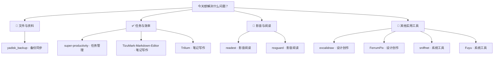

# 每日实用开源精选 · 2026-11-13

10 个实用开源项目。许可证与维护日期来自 GitHub API；中文介绍由 AI 辅助生成，安装前请核对项目说明。

## 🌟 今日首选 · [super-productivity](https://github.com/super-productivity/super-productivity)

> 一天的杂事排不开？把任务放进日程时间线，再记录实际用时。

**为什么先试：**待办、排程和计时覆盖常见的个人工作问题；网页版可直接尝试，无需先配置服务。

**工作流程：**列出今天要完成的事项 → 安排任务并记录用时 → 得到任务进度和用时记录

**适用平台：**Windows / macOS / Linux / Android / iOS

---

## 先按需求找工具

**📁 文件与资料**：[yadisk\_backup](https://github.com/PXSYS13/yadisk_backup)

**✅ 任务与效率**：[super-productivity](https://github.com/super-productivity/super-productivity) · [TizuMark-Markdown-Editor](https://github.com/tizuio/TizuMark-Markdown-Editor) · [Trilium](https://github.com/TriliumNext/Trilium)

**🎵 影音与阅读**：[readest](https://github.com/readest/readest) · [rssguard](https://github.com/martinrotter/rssguard)

**🧰 其他实用工具**：[excalidraw](https://github.com/excalidraw/excalidraw) · [FerrumPix](https://github.com/Bitpainter75/FerrumPix) · [sniffnet](https://github.com/GyulyVGC/sniffnet) · [Fuyu](https://github.com/TixXin/Fuyu)

---

## 01 · [super-productivity/super-productivity](https://github.com/super-productivity/super-productivity)

分类：任务管理

> 一天的杂事排不开？把任务放进日程时间线，再记录实际用时。

**工作流程：**列出今天要完成的事项 → 安排任务并记录用时 → 得到任务进度和用时记录

集待办清单、每日计划和时间记录于一体的个人工作工具。可用项目、子任务和标签整理事项，并在日程时间线上安排工作；提供网页版和桌面版。

- 平台：Windows、macOS、Linux、Android、iOS、网页；具体版本要求待核实
- 费用：软件费用待核实
- 安装：可直接打开网页版，或从项目下载页安装桌面版；上手较容易
- 注意：与 Jira 等服务的集成是可选功能，使用前需另行配置。
- [许可证 MIT](https://github.com/super-productivity/super-productivity/blob/master/LICENSE)
- [默认分支最近提交：2026-11-12T17:49:55Z](https://github.com/super-productivity/super-productivity/commit/68ad9657b32073def336a139d18c824120216814)
- 最近正式发布：[v20.0.0 · 2026-11-06T21:02:15Z](https://github.com/super-productivity/super-productivity/releases/tag/v20.0.0)
- [安装说明](https://github.com/super-productivity/super-productivity/blob/master/README.md)

## 02 · [tizuio/TizuMark-Markdown-Editor](https://github.com/tizuio/TizuMark-Markdown-Editor)

分类：笔记写作

> 写长篇说明总要翻找章节？用大纲定位段落，写完导出 PDF。

**工作流程：**准备一份 Markdown 草稿 → 按大纲修改并预览排版 → 导出可分享的 PDF

面向 Windows 的 Markdown 编辑器，提供所见即所得编辑、实时预览和大纲导航。支持在文档中编写公式与 Mermaid 图表，并可导出 PDF、HTML 和 Word 文档。

- 平台：Windows；macOS、Linux 尚在规划中
- 费用：项目说明为免费
- 安装：从 Releases 下载 Windows 安装包安装；较容易
- 注意：目前不要按跨平台软件选购；其他系统尚无正式支持依据。
- [许可证 GPL-3.0](https://github.com/tizuio/TizuMark-Markdown-Editor/blob/master/LICENSE)
- [默认分支最近提交：2026-11-12T17:18:32Z](https://github.com/tizuio/TizuMark-Markdown-Editor/commit/bac8d85c90c3cb4eb1a7ab408423e6de23dec9d4)
- 最近正式发布：[v1.2.5 · 2026-11-01T16:34:34Z](https://github.com/tizuio/TizuMark-Markdown-Editor/releases/tag/v1.2.5)
- [安装说明](https://github.com/tizuio/TizuMark-Markdown-Editor/blob/master/README.md)

## 03 · [TriliumNext/Trilium](https://github.com/TriliumNext/Trilium)

分类：笔记写作

> 资料越记越散？按主题建立多级笔记，再用全文搜索找回内容。

**工作流程：**准备课程资料和随手笔记 → 分层整理并补充笔记 → 得到可搜索的个人资料库

用于建立个人知识库的分层笔记应用。笔记可组成多级目录，并支持富文本编辑、全文搜索、版本记录和单篇笔记加密；需要时也可配置自托管同步。

- 平台：跨平台桌面应用；具体系统版本要求待核实
- 费用：项目说明为免费
- 安装：从 Releases 获取稳定版；桌面使用较容易，自托管同步需额外配置
- 注意：同步依赖另行配置的服务器，不是开始记笔记的必经步骤。
- [许可证 AGPL-3.0](https://github.com/TriliumNext/Trilium/blob/main/LICENSE)
- [默认分支最近提交：2026-11-12T15:43:18Z](https://github.com/TriliumNext/Trilium/commit/c21bcec4fe3e95f4a5bfd661123048d488ad97a8)
- 最近正式发布：[v0.107.0 · 2026-11-08T22:06:59Z](https://github.com/TriliumNext/Trilium/releases/tag/v0.107.0)
- [安装说明](https://github.com/TriliumNext/Trilium/blob/main/README.md)

## 04 · [readest/readest](https://github.com/readest/readest)

分类：影音阅读

> 读电子书时找不到前文？搜索书内关键词，给重要段落加书签。

**工作流程：**准备一本 EPUB 电子书 → 搜索段落并添加高亮 → 留下可回看的阅读标记

跨平台电子书阅读器，支持 EPUB、PDF、MOBI、TXT 等格式。可切换翻页或滚动阅读、搜索书内文字，并添加高亮、书签和笔记。

- 平台：Windows、macOS、Linux、Android、iOS、网页
- 费用：软件费用待核实
- 安装：可使用网页版，或从项目下载入口获取对应平台应用；较容易
- 注意：翻译等在线能力可能依赖外部服务；各平台的具体功能差异需核实。
- [许可证 AGPL-3.0](https://github.com/readest/readest/blob/main/LICENSE)
- [默认分支最近提交：2026-11-12T17:22:12Z](https://github.com/readest/readest/commit/a60b7eee0892f5533edbaca7d6391cd3609e4173)
- 最近正式发布：[v0.12.20 · 2026-11-05T22:40:01Z](https://github.com/readest/readest/releases/tag/v0.12.20)
- [安装说明](https://github.com/readest/readest/blob/main/README.md)

## 05 · [martinrotter/rssguard](https://github.com/martinrotter/rssguard)

分类：影音阅读

> 每天逐个打开博客太费事？添加订阅源，在一处查看新文章。

**工作流程：**准备常看网站的订阅地址 → 添加订阅并查看更新 → 得到集中的新文章列表

桌面订阅阅读器，可集中读取 RSS、Atom、JSON 等信息源，也能播放播客音视频。适合把常看的新闻网站、博客和节目放在一个地方查看。

- 平台：Windows、Linux、BSD、OS/2、macOS
- 费用：项目说明为免费
- 安装：从 Releases 下载对应平台版本；订阅信息源需自行添加，难度较低
- 注意：需有可用的订阅源；连接第三方在线服务时可能需要相应账号。
- [许可证 GPL-3.0](https://github.com/martinrotter/rssguard/blob/master/LICENSE.md)
- [默认分支最近提交：2026-11-12T15:37:21Z](https://github.com/martinrotter/rssguard/commit/e5349ad1ebb1367af339d99a1ed1a918a19c124b)
- 最近正式发布：[5.3.0 · 2026-11-12T13:45:34Z](https://github.com/martinrotter/rssguard/releases/tag/5.3.0)
- [安装说明](https://github.com/martinrotter/rssguard/blob/master/README.md)

## 06 · [excalidraw/excalidraw](https://github.com/excalidraw/excalidraw)

分类：设计创作

> 开会时讲不清流程？画出步骤和箭头，导出图片发给同事。

**工作流程：**准备要说明的流程 → 绘制步骤并连接箭头 → 得到可分享的流程图

可在浏览器中使用的手绘风格白板，提供形状、箭头、线条和自由绘制工具，适合画流程图与草图。作品可导出为 PNG、SVG 或项目文件。

- 平台：浏览器；可在 Windows 等有兼容浏览器的系统使用
- 费用：白板编辑器说明为免费；Excalidraw+ 费用待核实
- 安装：打开项目提供的网页应用即可使用；无需安装，较容易
- 注意：浏览器中的本地自动保存不等于异地备份，重要图稿宜另行导出。
- [许可证 MIT](https://github.com/excalidraw/excalidraw/blob/master/LICENSE)
- [默认分支最近提交：2026-11-12T17:58:27Z](https://github.com/excalidraw/excalidraw/commit/82d5847e57dcb6fb5982833ea9ec2137fe0b2bd5)
- 最近正式发布：[v0.18.1 · 2026-04-21T08:43:20Z](https://github.com/excalidraw/excalidraw/releases/tag/v0.18.1)
- [安装说明](https://github.com/excalidraw/excalidraw/blob/master/README.md)

## 07 · [Bitpainter75/FerrumPix](https://github.com/Bitpainter75/FerrumPix)

分类：设计创作

> 旅行照片太多难挑？按评分筛选，再裁剪调色并导出成片。

**工作流程：**准备相机照片文件夹 → 评分筛选并调整照片 → 得到整理后的成片

本机照片管理与编辑应用，可浏览文件夹、为照片评分和标记，并进行裁剪、调色、RAW 调整及批量导出。既能筛选照片，也能完成日常修图。

- 平台：Windows、Linux；macOS 和 ARM64 构建处于实验阶段
- 费用：项目说明为免费
- 安装：从 Releases 获取对应平台构建；具体安装步骤待核实
- 注意：保存编辑结果前应确认文件处理方式；macOS 与 ARM64 版本仍属实验性。
- [许可证 GPL-3.0](https://github.com/Bitpainter75/FerrumPix/blob/main/LICENSE)
- [默认分支最近提交：2026-11-12T16:56:51Z](https://github.com/Bitpainter75/FerrumPix/commit/5ce1381abc0b3fc7cc104a1af9970e516167d4d3)
- 最近正式发布：[latest · 2026-11-12T08:55:43Z](https://github.com/Bitpainter75/FerrumPix/releases/tag/latest)
- [安装说明](https://github.com/Bitpainter75/FerrumPix/blob/main/README.md)

## 08 · [GyulyVGC/sniffnet](https://github.com/GyulyVGC/sniffnet)

分类：系统工具

> 网络突然变慢？打开流量概览，查看当时的连接活动。

**工作流程：**发现电脑网络异常变慢 → 查看流量和连接概览 → 得到排查用的网络活动信息

图形化网络流量监测应用，用于查看电脑当前的网络活动。项目提供流量概览、连接检查和通知界面，便于排查网络使用情况。

- 平台：跨平台；具体支持系统及版本要求待核实
- 费用：项目说明为完全免费
- 安装：从项目下载入口获取应用；具体系统依赖和安装步骤待核实
- 注意：监测网络流量可能需要系统授予相关权限；它不是拦截或修复网络问题的工具。
- [许可证 Apache-2.0](https://github.com/GyulyVGC/sniffnet/blob/main/LICENSE-APACHE)
- [默认分支最近提交：2026-11-07T14:43:32Z](https://github.com/GyulyVGC/sniffnet/commit/f62af85e53253fd9983d4d04948c97cadf8a5356)
- 最近正式发布：[v1.5.1 · 2026-07-22T07:54:30Z](https://github.com/GyulyVGC/sniffnet/releases/tag/v1.5.1)
- [安装说明](https://github.com/GyulyVGC/sniffnet/blob/main/README.md)

## 09 · [TixXin/Fuyu](https://github.com/TixXin/Fuyu)

分类：系统工具

> 刚复制的文字被覆盖了？展开顶部悬浮岛，从剪贴板历史找回。

**工作流程：**需要找回之前复制的文字 → 打开岛上的剪贴板历史 → 重新取得所需文字

Windows 桌面顶部的悬浮工具，可展开查看待办、图文剪贴板历史、消息和日程，也能暂存待拖往其他程序的文件。各功能可在设置中调整。

- 平台：Windows；从源码构建说明要求 Windows 10 或 11
- 费用：软件费用待核实
- 安装：从 Releases 下载安装包；安装较容易，邮箱等功能需另行配置
- 注意：项目说明安装包未签名；启用消息、邮箱或插件前，应核对来源与所需权限。
- [许可证 GPL-3.0](https://github.com/TixXin/Fuyu/blob/main/LICENSE)
- [默认分支最近提交：2026-11-12T17:58:46Z](https://github.com/TixXin/Fuyu/commit/b98ddc8f0d0d61ff90c09db57eec573ce319a150)
- 最近正式发布：[v0.3.6 · 2026-11-10T17:58:48Z](https://github.com/TixXin/Fuyu/releases/tag/v0.3.6)
- [安装说明](https://github.com/TixXin/Fuyu/blob/main/README.md)

## 10 · [PXSYS13/yadisk_backup](https://github.com/PXSYS13/yadisk_backup)

分类：备份同步

> 想给网盘资料留一份本地副本？选定文件夹，下载到外接硬盘。

**工作流程：**准备网盘文件和本地空间 → 选择文件夹并执行下载 → 得到保留目录的本地副本

将 Yandex Disk 中的文件下载到本机的备份工具，可选择整个网盘或指定文件夹，并保留原有目录结构。下载中断后可在再次启动时继续，亦支持将文件保存到外接磁盘。

- 平台：Windows、macOS、Linux
- 费用：项目说明为免费
- 安装：下载 ZIP 并解压，Windows 双击启动脚本，再在浏览器完成授权和保存位置设置；初次配置需约 10 至 15 分钟
- 注意：仅适用于 Yandex Disk；需授权访问，下载完成前不要删除云端原文件。
- [许可证 MIT](https://github.com/PXSYS13/yadisk_backup/blob/main/LICENSE)
- [默认分支最近提交：2026-11-12T17:31:50Z](https://github.com/PXSYS13/yadisk_backup/commit/3cdc13f008d304a00303563ca960383190324718)
- 最近正式发布：[v2.8.9 · 2026-11-12T17:32:57Z](https://github.com/PXSYS13/yadisk_backup/releases/tag/v2.8.9)
- [安装说明](https://github.com/PXSYS13/yadisk_backup/blob/main/README.md)

---

## 🔥 今日热门

今日热榜暂时无法获取，实用精选正常发送。

[来源：GitHub Trending 日榜](https://github.com/trending?since=daily) ｜ 采集时间：2026-11-12T18:15:32.395Z

