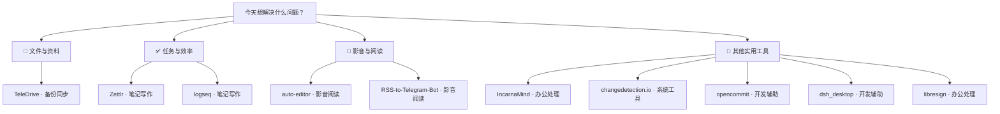

# 每日实用开源精选 · 2026-11-14

10 个实用开源项目。许可证与维护日期来自 GitHub API；中文介绍由 AI 辅助生成，安装前请核对项目说明。

## 🌟 今日首选 · [IncarnaMind](https://github.com/IncarnaMind/IncarnaMind)

> 报告资料太散？导入文件后生成带出处、可核对的 Word 报告。

**为什么先试：**Windows 可直接下载安装，能把本地资料整理、分析和核验集中在一个桌面工具中。

**工作流程：**准备 PDF、表格和会议记录 → 提问、写作并逐句核对来源 → 得到带引用的报告或 Word 文档

**适用平台：**Windows / macOS / Linux

---

## 先按需求找工具

**📁 文件与资料**：[TeleDrive](https://github.com/Mahmud0808/TeleDrive)

**✅ 任务与效率**：[Zettlr](https://github.com/Zettlr/Zettlr) · [logseq](https://github.com/logseq/logseq)

**🎵 影音与阅读**：[auto-editor](https://github.com/WyattBlue/auto-editor) · [RSS-to-Telegram-Bot](https://github.com/Rongronggg9/RSS-to-Telegram-Bot)

**🧰 其他实用工具**：[IncarnaMind](https://github.com/IncarnaMind/IncarnaMind) · [changedetection.io](https://github.com/dgtlmoon/changedetection.io) · [opencommit](https://github.com/di-sukharev/opencommit) · [dsh\_desktop](https://github.com/myYangyunfan/dsh_desktop) · [libresign](https://github.com/LibreSign/libresign)

---

## 01 · [IncarnaMind/IncarnaMind](https://github.com/IncarnaMind/IncarnaMind)

分类：办公处理

> 报告资料太散？导入文件后生成带出处、可核对的 Word 报告。

**工作流程：**准备 PDF、表格和会议记录 → 提问、写作并逐句核对来源 → 得到带引用的报告或 Word 文档

面向 macOS、Windows 和 Linux 的桌面应用，可从本地文件中提问、写作、分析表格、整理会议记录，并逐句核对文档内容、数字与引用来源，支持导出 Word。可连接 ChatGPT、Claude、Gemini 或 Ollama。

- 平台：Windows、macOS、Linux
- 费用：README称提供免费的开源测试版本；使用云端模型可能产生模型服务费用，具体费用待核实。
- 安装：从 Releases 下载 Windows EXE 后运行；测试版本未签名，可能触发系统安全提示。难度低。
- 注意：项目处于 Alpha/测试阶段，构建版本变化较快；使用云端模型时需注意文件隐私与 API 费用。
- [许可证 Apache-2.0](https://github.com/IncarnaMind/IncarnaMind/blob/main/LICENSE)
- [默认分支最近提交：2026-11-13T17:19:59Z](https://github.com/IncarnaMind/IncarnaMind/commit/eaf4d42861d29d879c67af66feb4b285821f61a9)
- 最近正式发布：无正式 Release
- [安装说明](https://github.com/IncarnaMind/IncarnaMind/blob/main/README.md)

## 02 · [Mahmud0808/TeleDrive](https://github.com/Mahmud0808/TeleDrive)

分类：备份同步

> 想把电脑文件随身带走？用私人 Telegram 频道备份并跨设备浏览。

**工作流程：**选择要备份的文件夹 → 上传文件并按文件夹整理 → 得到可跨设备访问的个人云盘

把私人 Telegram 频道作为个人云盘，支持 Windows、Linux、macOS、Android，提供文件上传备份、文件夹管理、搜索、预览、音视频播放、断点续传、多存储频道和可选 AES-256-GCM 加密。

- 平台：Windows 10+、Linux x86_64、macOS Apple Silicon、Android 8.0+
- 费用：软件费用待核实；需要 Telegram 账号和 Telegram 服务，云端存储限制及相关费用待核实。
- 安装：Windows 下载 Releases 中的 MSI，按提示安装，无需管理员权限；难度低。
- 注意：文件实际存储在私人 Telegram 频道中；启用加密时必须妥善保管密码，重要资料仍应保留独立备份。
- [许可证 Apache-2.0](https://github.com/Mahmud0808/TeleDrive/blob/master/LICENSE)
- [默认分支最近提交：2026-11-13T16:16:24Z](https://github.com/Mahmud0808/TeleDrive/commit/daf2662a7f000e167183a7e58afb6d899c17f5a9)
- 最近正式发布：[v1.5.0 · 2026-10-19T13:30:23Z](https://github.com/Mahmud0808/TeleDrive/releases/tag/v1.5.0)
- [安装说明](https://github.com/Mahmud0808/TeleDrive/blob/master/README.md)

## 03 · [Zettlr/Zettlr](https://github.com/Zettlr/Zettlr)

分类：笔记写作

> 论文资料难整理？用 Markdown 写作并搜索、引用和导出成稿。

**工作流程：**准备 Markdown 笔记和参考文献 → 编辑内容并插入引用 → 得到可导出的论文或长文初稿

面向写作者、学生和研究人员的 Markdown 写作工作台，支持全文搜索、Zettelkasten 知识管理、代码高亮、引用管理、LaTeX 与 Word 模板，以及通过 Pandoc、LaTeX 和 Textbundle 导出。

- 平台：Windows x64、macOS、Linux
- 费用：README称为免费开源软件；Pandoc、LaTeX 或参考文献工具的安装与使用费用待核实。
- 安装：从官网或 Releases 下载 Windows x64 安装包，也可使用 WinGet 或 Chocolatey；难度低。
- 注意：部分高级导出依赖 Pandoc、LaTeX 等外部工具；32 位 Windows 不支持。
- [许可证 GPL-3.0](https://github.com/Zettlr/Zettlr/blob/develop/LICENSE)
- [默认分支最近提交：2026-11-13T16:41:24Z](https://github.com/Zettlr/Zettlr/commit/92c73f8defd5f2eb7ef7a505ee6db0bbd8c76862)
- 最近正式发布：[v4.10.0 · 2026-11-13T16:40:54Z](https://github.com/Zettlr/Zettlr/releases/tag/v4.10.0)
- [安装说明](https://github.com/Zettlr/Zettlr/blob/develop/README.md)

## 04 · [logseq/logseq](https://github.com/logseq/logseq)

分类：笔记写作

> 知识越记越乱？把零散想法写成可链接、可检索的本地知识库。

**工作流程：**准备日常想法和项目资料 → 按页面与块记录并建立链接 → 得到可持续检索的个人知识库

隐私优先的开源知识管理和协作平台，支持本地知识图谱、页面与块级记录，并提供插件 API；README还介绍了新的数据库版本和移动端方向。

- 平台：Windows、macOS、Linux；移动端支持情况以当前发行版为准
- 费用：软件费用待核实；同步、插件或第三方服务可能产生额外费用。
- 安装：从 Releases 下载对应桌面安装包并运行；难度低。
- 注意：README同时包含旧版和数据库版本信息，具体功能与同步能力应以当前发行版文档为准；重要资料需自行备份。
- [许可证 AGPL-3.0](https://github.com/logseq/logseq/blob/master/LICENSE.md)
- [默认分支最近提交：2026-11-12T06:24:16Z](https://github.com/logseq/logseq/commit/a0f4399cbeaff24d92cb33bb9524f88626056fc4)
- 最近正式发布：[2.0.2 · 2026-10-07T14:18:57Z](https://github.com/logseq/logseq/releases/tag/2.0.2)
- [安装说明](https://github.com/logseq/logseq/blob/master/README.md)

## 05 · [WyattBlue/auto-editor](https://github.com/WyattBlue/auto-editor)

分类：影音阅读

> 网课录音空白太多？自动删掉静音段，再人工检查成片。

**工作流程：**准备含讲话的长视频 → 按音量检测并删除静音 → 得到节奏更紧凑的视频

命令行音视频自动剪辑工具，主要根据音量分析并删除静音或无效片段，也支持按运动量剪辑、调整节奏，以及导出 Premiere、DaVinci Resolve、Final Cut Pro、Shotcut 和 Kdenlive 等编辑器可用的项目文件。

- 平台：README未完整列出预编译平台；通过命令行使用，Windows 支持方式待核实
- 费用：项目代码费用待核实；在线应用和下载版可能有独立授权或费用，README未明确说明。
- 安装：README指向官方安装文档；可使用命令行安装，具体 Windows 安装步骤待核实。难度中等。
- 注意：自动剪辑结果需要人工检查；命令行参数较多，长视频处理时间和外部编解码依赖待核实。
- [许可证 Unlicense](https://github.com/WyattBlue/auto-editor/blob/master/LICENSE)
- [默认分支最近提交：2026-11-13T16:27:24Z](https://github.com/WyattBlue/auto-editor/commit/1fb5d4939ee2632674d2de117a434622443a0acb)
- 最近正式发布：[31.8.0 · 2026-10-30T01:50:12Z](https://github.com/WyattBlue/auto-editor/releases/tag/31.8.0)
- [安装说明](https://github.com/WyattBlue/auto-editor/blob/master/README.md)

## 06 · [dgtlmoon/changedetection.io](https://github.com/dgtlmoon/changedetection.io)

分类：系统工具

> 怕错过降价或补货？监控商品页变化并通过 Telegram 提醒。

**工作流程：**准备商品或公告网页地址 → 设置变化条件和通知渠道 → 收到相关页面变化提醒

用于监控网页变化的自托管工具，可跟踪价格、库存、公告和页面内容，按差异、条件或自然语言规则筛选变化，并通过 Discord、邮件、Slack、Telegram、Webhook 等方式通知。

- 平台：自托管 Web 应用；支持 Docker，Windows 使用方式取决于 Docker 或 Python 环境
- 费用：开源自托管版本的具体费用待核实；云端订阅为 8.99 美元/月，代理和模型服务可能另收费。
- 安装：可使用 Docker 部署并通过浏览器访问；Windows 需先准备 Docker，难度中等。
- 注意：监控登录页面、频繁请求或受限制网站前应确认权限；AI 摘要和代理可能产生额外费用。
- [许可证 Apache-2.0](https://github.com/dgtlmoon/changedetection.io/blob/master/LICENSE)
- [默认分支最近提交：2026-11-13T15:44:04Z](https://github.com/dgtlmoon/changedetection.io/commit/e36975798b3b12145ebf891eaa3a651e68031ae6)
- 最近正式发布：[0.70.3 · 2026-11-09T14:57:31Z](https://github.com/dgtlmoon/changedetection.io/releases/tag/0.70.3)
- [安装说明](https://github.com/dgtlmoon/changedetection.io/blob/master/README.md)

## 07 · [Rongronggg9/RSS-to-Telegram-Bot](https://github.com/Rongronggg9/RSS-to-Telegram-Bot)

分类：影音阅读

> 订阅太多网站？把重要 RSS 更新自动整理到 Telegram。

**工作流程：**准备 RSS 地址和 Telegram Bot → 配置订阅源并设置格式 → 得到集中推送的阅读消息

把 RSS、Atom 等订阅源的文章内容转发到 Telegram，保留富文本和媒体，支持图片、视频、音频、长消息拆分、Telegraph 发布、OPML 导入导出、代理和多用户配置。

- 平台：Docker、Python/PyPI；Windows 部署方式需依赖 Python 或 Docker，桌面安装包待核实
- 费用：开源软件费用待核实；Telegram、服务器、代理或第三方服务可能产生费用。
- 安装：可从 PyPI 安装或使用 Docker 部署；需要配置 Telegram Bot 和订阅源，难度中等。
- 注意：需要自行维护 Bot 和运行环境；RSS 源格式、版权和 Telegram 限制可能影响转发效果。
- [许可证 AGPL-3.0](https://github.com/Rongronggg9/RSS-to-Telegram-Bot/blob/dev/LICENSE)
- [默认分支最近提交：2026-11-13T16:49:44Z](https://github.com/Rongronggg9/RSS-to-Telegram-Bot/commit/9ecbb291ed04745bdc64d57ef430af416cdb5cf0)
- 最近正式发布：[v2.10.0 · 2025-03-22T16:23:59Z](https://github.com/Rongronggg9/RSS-to-Telegram-Bot/releases/tag/v2.10.0)
- [安装说明](https://github.com/Rongronggg9/RSS-to-Telegram-Bot/blob/dev/README.md)

## 08 · [di-sukharev/opencommit](https://github.com/di-sukharev/opencommit)

分类：开发辅助

> 提交说明总是写得乱？让工具根据暂存改动生成可读提交信息。

**工作流程：**准备已修改的 Git 文件 → 暂存改动并运行 oco → 得到待确认的提交说明

为 Git 提交生成有意义的提交说明的命令行工具，支持 OpenAI、Claude、其他兼容提供商以及本地 Ollama 和 llama.cpp，可配置 GitMoji、确认流程、模型与 API 地址。

- 平台：Node.js CLI；Windows 可通过 npm 使用
- 费用：工具本身费用待核实；云端模型按服务商计费，本地 Ollama 或 llama.cpp 可能无需 API 费用但需要本地资源。
- 安装：先安装 Node.js，再运行 `npm install -g opencommit`；配置模型密钥后执行 `oco`，难度低到中等。
- 注意：生成内容应在提交前人工检查；API 密钥保存在本地配置中，提交差异可能发送给所选模型服务。
- [许可证 MIT](https://github.com/di-sukharev/opencommit/blob/master/LICENSE)
- [默认分支最近提交：2026-11-13T17:05:47Z](https://github.com/di-sukharev/opencommit/commit/e6017762e38dee46decaaa53878abee29d6e5841)
- 最近正式发布：[github-action-v1.0.2 · 2023-05-21T09:13:16Z](https://github.com/di-sukharev/opencommit/releases/tag/github-action-v1.0.2)
- [安装说明](https://github.com/di-sukharev/opencommit/blob/master/README.md)

## 09 · [myYangyunfan/dsh_desktop](https://github.com/myYangyunfan/dsh_desktop)

分类：开发辅助

> 不想配置 Node 和插件？安装整合包后直接使用 DSH 工作台。

**工作流程：**准备需要处理的代码或文件任务 → 打开会话并调用内置开发插件 → 得到可继续修改的代码结果

面向 DeepSeek Harness 的 Windows、macOS 和 Linux 桌面整合客户端，内置 Node 运行时、DSH 及精选插件，提供文件工作台、会话管理、通知、插件启停、更新和便携版。

- 平台：Windows 10/11、macOS 12+ Apple Silicon、Linux x64
- 费用：README未明确商业收费；使用 DSH 及相关模型、API 或插件服务可能产生费用。
- 安装：Windows 可下载 NSIS 安装包，支持当前用户安装免管理员权限；也提供自带 Node 的便携版，难度低。
- 注意：项目是社区整合客户端，与 DeepSeek 官方不存在隶属或背书关系；需核对下载来源和 SHA256，模型费用另计。
- [许可证 MIT](https://github.com/myYangyunfan/dsh_desktop/blob/main/LICENSE)
- [默认分支最近提交：2026-11-13T16:57:52Z](https://github.com/myYangyunfan/dsh_desktop/commit/07ec3c87bcb243c04abf66886ace19314c712627)
- 最近正式发布：[v1.1.0 · 2026-11-13T15:28:40Z](https://github.com/myYangyunfan/dsh_desktop/releases/tag/v1.1.0)
- [安装说明](https://github.com/myYangyunfan/dsh_desktop/blob/main/README.md)

## 10 · [LibreSign/libresign](https://github.com/LibreSign/libresign)

分类：办公处理

> 合同审批常漏步骤？在 Nextcloud 中按顺序发起并追踪签署。

**工作流程：**准备待签署的合同和签署人 → 设置顺序并发送签署请求 → 得到可验证的签署文件和记录

面向 Nextcloud 的文档签署应用，可定义签署顺序、角色和规则，邀请内部或外部签署人，发送通知和提醒，跟踪签署状态，并验证签名文件、证书和完整操作记录。

- 平台：运行于 Nextcloud 的 Web 应用；Windows 可通过浏览器使用，服务器部署平台待核实
- 费用：开源软件费用待核实；需要 Nextcloud、服务器或托管环境，电子签名证书和相关服务费用待核实。
- 安装：在已有 Nextcloud 实例中安装应用并配置签署流程；需要服务器管理权限，难度中等到高。
- 注意：签署文件涉及法律和合规要求，正式使用前应确认当地法规、证书和审计要求。
- [许可证 AGPL-3.0](https://github.com/LibreSign/libresign/blob/main/COPYING)
- [默认分支最近提交：2026-11-13T17:15:42Z](https://github.com/LibreSign/libresign/commit/676d88ee7f0d610e9ef43306f180772f965530cd)
- 最近正式发布：[v15.0.12 · 2026-11-04T19:41:05Z](https://github.com/LibreSign/libresign/releases/tag/v15.0.12)
- [安装说明](https://github.com/LibreSign/libresign/blob/main/README.md)

---

## 🔥 今日热门

额外 5 项 · 从 GitHub Trending 日榜筛选，排除历史推荐与当天精选，不代表全网热度排名。

[来源：GitHub Trending 日榜](https://github.com/trending?since=daily) ｜ 采集时间：2026-11-13T17:26:01.178Z

### [open-code-review](https://github.com/alibaba/open-code-review)

**日榜第 1 位 · 今日新增 206 Star**

**这是什么：**这是一款供开发者使用的命令行工具，不是打开网页就能自动审查代码的服务。以往审查者需要逐一阅读改动、查找相关文件，再写下问题所在的行号；它把读取变更、补充代码上下文和生成逐行意见串成一次审查流程。还可用文件扫描功能检查没有可用变更记录的代码。

**适合谁：**适合开发者和代码审查人员；需要会使用命令行、Git，并配置模型接口，普通读者不能直接拿来审查文档。

**举个例子：**帮助理解的示例，并非亲测：假设你要审查同事提交的登录功能改动，先准备包含该改动的 Git 仓库，并配置可用的模型接口；运行审查后，工具读取变更及相关代码，输出指向具体行的意见。你再核对这些意见，决定哪些需要修改。

**工作流程：**Git 变更和模型接口 → 运行审查并核对意见 → 带代码行号的审查意见

一款命令行代码审查工具，读取 Git 变更并调用可配置的大语言模型，生成定位到具体代码行的审查意见。它也支持扫描完整文件，适合检查没有明显代码变更的目录。

- 平台：README 标注支持 Windows、macOS、Linux；通过命令行使用。
- 费用：候选资料未说明实际使用费用；模型接口及运行环境是否收费待核实。
- 安装：README 说明需配置模型接口；所给 README 在安装步骤前截断，具体安装命令和环境要求待核实。
- 注意：审查意见仍须由开发者核对。发送给模型的代码范围及数据处理方式，应在接入前核实。
- [许可证 Apache-2.0](https://github.com/alibaba/open-code-review/blob/main/LICENSE)
- [最近提交 2026-11-13T08:44:46Z](https://github.com/alibaba/open-code-review/commit/0e9060da66af36a96a15516e76a001953095318b)
- 最近正式发布：[v1.13.9 · 2026-11-13T09:47:57Z](https://github.com/alibaba/open-code-review/releases/tag/v1.13.9)
- [项目说明](https://github.com/alibaba/open-code-review/blob/main/README.md)

### [codex-security](https://github.com/openai/codex-security)

**日榜第 3 位 · 今日新增 754 Star**

**这是什么：**这是一套面向代码仓库的安全检查工具，包括可在终端运行的命令行程序和供开发者集成的工具包。以往团队需要自行安排扫描、整理疑似漏洞的代码证据，再跟进修复；它将扫描、保存发现、验证问题和检查补丁放进同一工作流程。它提供调查材料，不代替人工判断风险。

**适合谁：**适合软件开发、安全工程及维护代码仓库的团队；使用命令行需技术经验，集成工具包需要编程。

**举个例子：**帮助理解的示例，并非亲测：假设你要检查一个应用的身份验证代码，准备该应用的代码仓库和所需登录凭据，在仓库目录运行扫描，或指定相关路径；完成后打开保存的报告，查看代码证据及未覆盖范围，再请工具验证疑似问题或检查已有修复。

**工作流程：**代码仓库和扫描范围 → 扫描并核对代码证据 → 保存的报告与问题记录

提供命令行工具和 TypeScript 开发工具包，可扫描仓库、指定路径或 Git 变更，保存安全问题报告；还支持验证候选问题、生成补丁、检查修复，以及将结果导出或接入自动化流程。

- 平台：可在终端、Codex 工作流程或支持相应自动化的环境中使用；README 未在所给内容中明确列出操作系统。
- 费用：README 提及登录、API 密钥和成本限制，但未给出实际收费标准；使用费用待核实。
- 安装：需要 Node.js 22.13.0 及以上的 22.x，或 24.x、26.x，以及 Python 3.10 及以上；Python 3.10 另需 tomli。可用 npm 全局安装 @openai/codex-security，再运行 cs login。
- 注意：报告应结合代码证据和未覆盖范围阅读；部分网络安全请求或受保护发现需要额外访问权限。
- [许可证 Apache-2.0](https://github.com/openai/codex-security/blob/main/LICENSE)
- [最近提交 2026-11-13T05:50:46Z](https://github.com/openai/codex-security/commit/f26b669b56a4423abd773c81f6c6c9c2ebadc42a)
- 最近正式发布：[npm-v0.10.0 · 2026-11-12T02:18:52Z](https://github.com/openai/codex-security/releases/tag/npm-v0.10.0)
- [项目说明](https://github.com/openai/codex-security/blob/main/README.md)

### [sure](https://github.com/we-promise/sure)

**日榜第 5 位 · 今日新增 944 Star**

**这是什么：**这是一款可自行部署的个人财务应用，不是只供开发者调用的框架。原本想集中查看自己的财务状况，需要自己整理不同项目的数据和展示方式；它提供用于查看现金流、净资产与支出信息的应用界面，并允许通过浏览器等客户端访问。如何导入或同步账户数据，所给 README 未作说明。

**适合谁：**适合想自行管理财务资料、且有人能负责部署的个人或团队；使用界面不一定需要编程，自建服务需要技术支持。

**举个例子：**帮助理解的示例，并非亲测：假设你想在一个地方查看家庭财务状况，先由具备部署经验的人按项目指引运行 Sure，再准备要管理的财务资料；通过浏览器打开应用，查看现金流、净资产和支出等页面。资料怎样录入或连接账户，需进一步核对文档。

**工作流程：**待管理的财务资料 → 在应用中查看财务页面 → 现金流、净资产及支出视图

一款由社区维护的个人财务应用，可自行部署，并通过浏览器等客户端访问。所给 README 展示了现金流、净资产和支出信息的界面，但未提供这些数据的具体录入或同步步骤。

- 平台：可通过浏览器、macOS 桌面客户端、移动客户端及 API 客户端访问；服务端可用 Docker 自行部署。
- 费用：README 提及自行部署，未说明当前托管服务价格或部署成本；服务器等费用需自行核实。
- 安装：自行部署应参阅 README 指向的 Docker 托管指南；README 中的 Ruby、PostgreSQL、Redis 与 bin/setup 步骤是本地开发说明，不应直接当作普通用户的安装流程。
- 注意：项目是已归档 Maybe Finance 的社区分支。涉及个人财务资料，自行部署前应核实数据存储、备份和访问控制；所给 README 未说明账户同步细节。
- [许可证 AGPL-3.0](https://github.com/we-promise/sure/blob/main/LICENSE)
- [最近提交 2026-11-13T05:52:26Z](https://github.com/we-promise/sure/commit/d74ee9f284d293709a99056c32b5ec534ff9f4d7)
- 最近正式发布：[v0.7.6-hotfix.1 · 2026-11-12T21:54:09Z](https://github.com/we-promise/sure/releases/tag/v0.7.6-hotfix.1)
- [项目说明](https://github.com/we-promise/sure/blob/main/README.md)

### [plannotator](https://github.com/backnotprop/plannotator)

**日榜第 6 位 · 今日新增 100 Star**

**这是什么：**这是连接 AI 编程代理的本地浏览器审阅工具，并非独立完成开发任务的软件。原本使用代理时，你可能要在对话、文件和代码变更之间来回切换，逐条说明修改意见；它把计划、页面内容、代理消息及代码差异放到可批注的界面，再将你的反馈送回对应代理，方便保留人的决策环节。

**适合谁：**适合使用 AI 编程代理的开发者、产品设计或审阅人员；批注可不写代码，但需先配置兼容代理及其连接方式。

**举个例子：**帮助理解的示例，并非亲测：假设编程代理为新功能写了一份实施计划并生成 HTML 页面，你先准备这份代理产出；在浏览器审阅界面标出需要调整的段落和页面位置，写下意见后发送给代理。代理收到反馈后可继续处理，你仍需检查其后续结果。

**工作流程：**代理提交的计划或代码变更 → 在浏览器批注并发送反馈 → 返回对应代理的审阅意见

一个在本地浏览器中使用的 AI 编程代理审阅界面。可批注代理提出的计划、说明和 HTML 内容，审阅代码变更，并把反馈发送回代理；Inbox 用于集中处理多个代理留下的问题和文件。

- 平台：本地浏览器界面，配合 README 列出的多种 AI 编程代理；所给内容未明确列出操作系统要求。
- 费用：所给 README 未说明使用价格、代理费用或内置 AI 功能的费用；待核实。
- 安装：README 说明通过插件、钩子或命令连接代理，并展示 plannotator inbox 命令；所给内容未包含完整安装步骤和环境要求，待核实。
- 注意：它用于审阅和反馈，不代表代理产出已经正确；不同代理的连接方式及可用功能应按各自设置核实。
- [许可证 Apache-2.0](https://github.com/backnotprop/plannotator/blob/main/LICENSE-APACHE)
- [最近提交 2026-11-13T16:45:48Z](https://github.com/backnotprop/plannotator/commit/b2eb7d6931106ceea5454f788a00f21a7bf34bf1)
- 最近正式发布：[v0.28.64 · 2026-11-13T17:24:36Z](https://github.com/backnotprop/plannotator/releases/tag/v0.28.64)
- [项目说明](https://github.com/backnotprop/plannotator/blob/main/README.md)

### [uptime-kuma](https://github.com/louislam/uptime-kuma)

**日榜第 7 位 · 今日新增 61 Star**

**这是什么：**这是一款需要自行部署的服务监控软件，不是替你托管网站的服务。原本想知道网站或接口何时无法访问，需要自己定时检查并通知相关人员；它让你设置监控目标，持续记录检测状态，并在异常时通过所配置的渠道通知。它还提供图表与状态页，方便查看和分享服务状况。

**适合谁：**适合网站管理员、运维人员和维护线上服务的小团队；日常配置可用界面完成，首次部署仍需服务器或容器操作经验。

**举个例子：**帮助理解的示例，并非亲测：假设你负责一个商店网站，先准备网站地址和用于接收通知的渠道；自行部署 Uptime Kuma 后，在界面添加网站监控并设置通知。之后可查看访问状态和图表，在检测到异常时由已配置的渠道收到提醒。

**工作流程：**服务地址和通知渠道 → 设置监控目标与提醒 → 状态图表和异常通知

一款可自行部署的监控应用，可检查网站、网络端口、DNS 记录及容器等目标的状态，在界面查看图表和证书信息，并通过多种渠道发送通知或展示状态页。

- 平台：可使用 Docker 部署；非 Docker 安装支持 README 列出的主流 Linux 发行版及符合要求的 Windows，不支持所列 BSD 系统。
- 费用：所给 README 未列出软件使用价格；自行部署所需机器、网络和通知服务可能产生费用，具体待核实。
- 安装：README 提供 Docker Compose、Docker 命令及非 Docker 安装方式。非 Docker 方式需要 Node.js 20.4 及以上和 Git；如需后台运行，README 给出 PM2 步骤。
- 注意：README 提醒不要将 uptimekuma.co 当作项目官网；Docker 数据目录不支持 NFS。公开访问监控界面前，应核实网络暴露与访问保护设置。
- [许可证 MIT](https://github.com/louislam/uptime-kuma/blob/master/LICENSE)
- [最近提交 2026-11-13T17:16:10Z](https://github.com/louislam/uptime-kuma/commit/4f6661cfa83a06be0353d5536ef3d9ee0064f534)
- 最近正式发布：[2.5.11 · 2026-11-12T09:20:06Z](https://github.com/louislam/uptime-kuma/releases/tag/2.5.11)
- [项目说明](https://github.com/louislam/uptime-kuma/blob/master/README.md)
