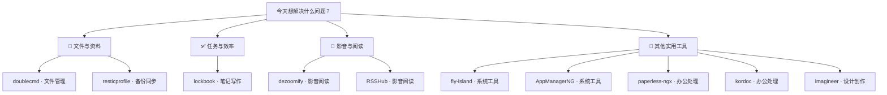

# 每日实用开源精选 · 2026-11-15

10 个实用开源项目。许可证与维护日期来自 GitHub API；中文介绍由 AI 辅助生成，安装前请核对项目说明。

## 🌟 今日首选 · [dezoomify](https://github.com/dezoomify/dezoomify)

> 想保存博物馆网页里的大图？粘贴展示页地址，拼接后保存图片。

**为什么先试：**网页免安装，输入展示页地址就能尝试；桌面版和扩展也有明确的适用场景，值得先试。

**工作流程：**准备可缩放图片的网页地址 → 粘贴地址并拼接图片 → 保存完整图片

**适用平台：**Windows / macOS / Linux

---

## 先按需求找工具

**📁 文件与资料**：[doublecmd](https://github.com/doublecmd/doublecmd) · [resticprofile](https://github.com/creativeprojects/resticprofile)

**✅ 任务与效率**：[lockbook](https://github.com/lockbook/lockbook)

**🎵 影音与阅读**：[dezoomify](https://github.com/dezoomify/dezoomify) · [RSSHub](https://github.com/DIYgod/RSSHub)

**🧰 其他实用工具**：[fly-island](https://github.com/flyl1u/fly-island) · [AppManagerNG](https://github.com/SysAdminDoc/AppManagerNG) · [paperless-ngx](https://github.com/paperless-ngx/paperless-ngx) · [kordoc](https://github.com/chrisryugj/kordoc) · [imagineer](https://github.com/foresterre/imagineer)

---

## 01 · [dezoomify/dezoomify](https://github.com/dezoomify/dezoomify)

分类：影音阅读

> 想保存博物馆网页里的大图？粘贴展示页地址，拼接后保存图片。

**工作流程：**准备可缩放图片的网页地址 → 粘贴地址并拼接图片 → 保存完整图片

将博物馆、图库或地图网站中的可缩放图片拼接成可保存的完整图片。可使用免安装网页、浏览器扩展或桌面应用；桌面版适合处理超过浏览器尺寸限制的图片。

- 平台：网页；桌面版支持 Windows、macOS、Linux；扩展支持 Chrome、Firefox
- 费用：使用费用待核实
- 安装：网页直接使用，无需安装；桌面版可从项目发布页下载，入门容易
- 注意：网页方式受浏览器图片尺寸限制；受限页面可能需要扩展，保存前应确认图片使用权限。
- [许可证 GPL-3.0](https://github.com/dezoomify/dezoomify/blob/main/LICENSE)
- [默认分支最近提交：2026-11-15T01:00:53Z](https://github.com/dezoomify/dezoomify/commit/9e2a3c21980c8d1bf0125e36cf67ec65831c1cf1)
- 最近正式发布：[26.11.14 · 2026-11-14T19:00:31Z](https://github.com/dezoomify/dezoomify/releases/tag/26.11.14)
- [安装说明](https://github.com/dezoomify/dezoomify/blob/main/README.md)

## 02 · [doublecmd/doublecmd](https://github.com/doublecmd/doublecmd)

分类：文件管理

> 整理两个文件夹总要来回切换？用双栏同时查看来源和目标目录。

**工作流程：**准备两个需要整理的目录 → 在双栏中分别打开目录 → 并排查看文件位置

双栏文件管理器，可并排查看两个目录，适合在不同文件夹之间整理文件。项目提供跨平台版本，并给出了下载页。

- 平台：跨平台；具体系统版本支持情况需查看项目支持列表
- 费用：项目说明为免费
- 安装：从项目提供的下载页获取对应系统版本；具体安装步骤待核实
- 注意：下载前先核对操作系统与处理器架构是否受支持。
- [许可证 GPL-2.0](https://github.com/doublecmd/doublecmd/blob/master/LICENSE.md)
- [默认分支最近提交：2026-11-14T22:11:31Z](https://github.com/doublecmd/doublecmd/commit/db3dc54ddbfd77a6fe648ae273e36467c151d438)
- 最近正式发布：[v1.2.11 · 2026-11-08T09:20:40Z](https://github.com/doublecmd/doublecmd/releases/tag/v1.2.11)
- [安装说明](https://github.com/doublecmd/doublecmd/blob/master/README.md)

## 03 · [lockbook/lockbook](https://github.com/lockbook/lockbook)

分类：笔记写作

> 想在电脑和手机上查看私人笔记？写入笔记后，在需要时同步访问。

**工作流程：**准备要记录的文字或草图 → 在加密笔记中记录 → 得到可离线查看的笔记

可写笔记、画草图和存放文件的加密笔记工具，支持离线访问及设备间同步。项目说明文件在离开设备前会加密。

- 平台：Windows、macOS、Linux、iOS、Android
- 费用：25MB 以内免费；项目列出的 30GB 方案为每月 2.99 美元
- 安装：可通过项目列出的应用商店或 Linux 软件渠道安装；难度较低
- 注意：跨设备使用涉及私钥转移，应妥善保管恢复短语；图片和 PDF 可能较快占用免费额度。
- [许可证 Unlicense](https://github.com/lockbook/lockbook/blob/master/UNLICENSE)
- [默认分支最近提交：2026-11-15T00:14:57Z](https://github.com/lockbook/lockbook/commit/b78ac0f37e993465776fa5338c11954a2ffe2336)
- 最近正式发布：[26.11.12 · 2026-11-12T21:28:16Z](https://github.com/lockbook/lockbook/releases/tag/26.11.12)
- [安装说明](https://github.com/lockbook/lockbook/blob/master/docs/README.md)

## 04 · [flyl1u/fly-island](https://github.com/flyl1u/fly-island)

分类：系统工具

> 工作时频繁切窗口查看复制内容？从悬浮岛找回剪贴板历史。

**工作流程：**准备此前复制过的文字 → 搜索剪贴板历史并重新复制 → 得到可粘贴的文字

Windows 顶部悬浮工具，将消息提示、剪贴板历史、媒体控制、翻译和每日待办集中在可收起的界面中。剪贴板历史与应用设置保存在本机。

- 平台：Windows
- 费用：使用费用待核实；部分翻译服务需要自行提供 API 密钥
- 安装：可从项目发布页下载；基础使用较容易，接入邮箱或翻译服务需另行配置
- 注意：微信、QQ 提醒依赖对应客户端及通知条件；使用翻译服务时，提交的原文会发送给所选服务。
- [许可证 GPL-3.0](https://github.com/flyl1u/fly-island/blob/main/LICENSE)
- [默认分支最近提交：2026-11-15T01:29:39Z](https://github.com/flyl1u/fly-island/commit/66a79758de06ad304e300081be82054ba6190962)
- 最近正式发布：[v3.2.4 · 2026-11-14T17:03:53Z](https://github.com/flyl1u/fly-island/releases/tag/v3.2.4)
- [安装说明](https://github.com/flyl1u/fly-island/blob/main/README.md)

## 05 · [SysAdminDoc/AppManagerNG](https://github.com/SysAdminDoc/AppManagerNG)

分类：系统工具

> 不清楚哪些应用获得了定位权限？按权限查看相关应用列表。

**工作流程：**准备检查的安卓手机 → 按敏感权限查看应用 → 得到应用权限清单

Android 应用管理工具，可查看已安装应用的权限、组件和软件包信息；在相应权限模式允许时，还能执行备份、冻结或卸载等操作。

- 平台：Android 5.0 及以上
- 费用：使用费用待核实
- 安装：从项目发布页下载 APK 安装；普通查看无需 root，高级操作需配置相应权限模式
- 注意：Shizuku、ADB 或 root 模式会扩大可执行操作范围；冻结和卸载前应核对目标应用。
- [许可证 GPL-3.0](https://github.com/SysAdminDoc/AppManagerNG/blob/main/LICENSE)
- [默认分支最近提交：2026-11-14T23:57:44Z](https://github.com/SysAdminDoc/AppManagerNG/commit/7ff61d2c3cc173383be7ea65290964872242d853)
- 最近正式发布：[v0.7.0 · 2026-11-08T16:44:51Z](https://github.com/SysAdminDoc/AppManagerNG/releases/tag/v0.7.0)
- [安装说明](https://github.com/SysAdminDoc/AppManagerNG/blob/main/README.md)

## 06 · [paperless-ngx/paperless-ngx](https://github.com/paperless-ngx/paperless-ngx)

分类：办公处理

> 旧票据扫描后找不到？归档扫描件，需要时在文档库中搜索。

**工作流程：**准备票据扫描件 → 导入文档库并搜索内容 → 找回所需票据

自托管文档管理系统，将纸质文件的扫描件整理为可搜索的在线档案，适合集中保存合同、票据等资料。

- 平台：自托管服务；具体客户端系统支持情况待核实
- 费用：软件使用费用待核实；自行部署可能产生设备或托管费用
- 安装：项目推荐使用 Docker Compose 部署；需要配置服务，难度中等
- 注意：公开演示站会定期重置内容，不应上传机密文件；正式使用需自行管理文档存储与备份。
- [许可证 GPL-3.0](https://github.com/paperless-ngx/paperless-ngx/blob/dev/LICENSE)
- [默认分支最近提交：2026-11-14T17:33:39Z](https://github.com/paperless-ngx/paperless-ngx/commit/4610171a94e5932e85a80e480032e397cdb6f309)
- 最近正式发布：[v3.4.2 · 2026-11-03T21:57:15Z](https://github.com/paperless-ngx/paperless-ngx/releases/tag/v3.4.2)
- [安装说明](https://github.com/paperless-ngx/paperless-ngx/blob/dev/README.md)

## 07 · [creativeprojects/resticprofile](https://github.com/creativeprojects/resticprofile)

分类：备份同步

> 总忘记备份照片目录？配置备份档案并安排定时运行。

**工作流程：**准备照片目录和备份目标 → 配置档案并安排定时备份 → 得到按计划执行的备份任务

为 restic 备份工具管理配置档案和定时任务，可把备份参数写入配置文件，并支持通过 Windows 任务计划程序等机制安排备份。

- 平台：Windows、macOS、Linux 及部分 BSD 系统
- 费用：使用费用待核实；备份目标的存储费用另计
- 安装：需先具备 restic 并编写配置文件，再设置调度；有一定命令行门槛
- 注意：它是 restic 的配置与调度工具，不应当作独立备份引擎；应定期检查备份结果和恢复能力。
- [许可证 GPL-3.0](https://github.com/creativeprojects/resticprofile/blob/master/LICENSE)
- [默认分支最近提交：2026-11-14T23:22:41Z](https://github.com/creativeprojects/resticprofile/commit/e83e5d50693e251376ac52c033a36fd043418852)
- 最近正式发布：[v0.34.0 · 2026-11-12T22:12:08Z](https://github.com/creativeprojects/resticprofile/releases/tag/v0.34.0)
- [安装说明](https://github.com/creativeprojects/resticprofile/blob/master/README.md)

## 08 · [chrisryugj/kordoc](https://github.com/chrisryugj/kordoc)

分类：办公处理

> 收到 HWPX 文件却想整理文字？将文档转换为 Markdown 后编辑。

**工作流程：**准备一份 HWPX 文档 → 将文档转换为 Markdown → 得到可编辑的文本文件

面向韩国文档格式的命令行工具，可将 HWP、HWPX、PDF、Office 文档及扫描图片转换为 Markdown；也支持由 Markdown 生成 HWPX。

- 平台：Windows、macOS、Linux
- 费用：使用费用待核实
- 安装：需要 Node.js 20 及以上；可通过 npm 安装或用 npx 运行，需使用命令行
- 注意：转换复杂表格或扫描件后，应核对内容和排版；部分格式能力受可选依赖影响。
- [许可证 MIT](https://github.com/chrisryugj/kordoc/blob/main/LICENSE)
- [默认分支最近提交：2026-11-14T23:45:06Z](https://github.com/chrisryugj/kordoc/commit/e94ce42254d7e27cc2378e1fa0b9f386fd6dc6f6)
- 最近正式发布：[v4.24.80 · 2026-11-15T00:31:57Z](https://github.com/chrisryugj/kordoc/releases/tag/v4.24.80)
- [安装说明](https://github.com/chrisryugj/kordoc/blob/main/README.md)

## 09 · [DIYgod/RSSHub](https://github.com/DIYgod/RSSHub)

分类：影音阅读

> 常看的站点没有明显的订阅入口？查找对应路由，加入 RSS 阅读器。

**工作流程：**准备想持续关注的网站 → 查找对应 RSSHub 路由 → 得到可订阅的地址

将多种网站内容转换为 RSS 订阅源的项目。用户可查找所需站点的路由，再把生成的订阅地址加入自己的 RSS 阅读器。

- 平台：通过网络服务提供订阅源；自托管平台要求待核实
- 费用：使用费用待核实；自托管可能产生服务器费用
- 安装：使用现有服务需查找对应路由；自托管需要部署服务，难度较高
- 注意：它提供订阅源，不是 RSS 阅读器；具体网站是否有可用路由及其稳定性需逐一确认。
- [许可证 AGPL-3.0](https://github.com/DIYgod/RSSHub/blob/master/LICENSE)
- [默认分支最近提交：2026-11-15T01:12:33Z](https://github.com/DIYgod/RSSHub/commit/1444dfbc37b3d5106c7aa593ae49fd41997f9d80)
- 最近正式发布：[v2026.11.15-8651.1444dfb · 2026-11-15T01:17:50Z](https://github.com/DIYgod/RSSHub/releases/tag/v2026.11.15-8651.1444dfb)
- [安装说明](https://github.com/DIYgod/RSSHub/blob/master/README.md)

## 10 · [foresterre/imagineer](https://github.com/foresterre/imagineer)

分类：设计创作

> 一批 PNG 图片需要转成 JPG？指定输入文件和输出目录批量转换。

**工作流程：**准备一批 PNG 图片 → 按文件匹配模式转换格式 → 得到一批 JPG 图片

命令行图片处理工具，可转换 PNG、JPEG、WebP、AVIF 等格式，也支持通过文件匹配模式批量处理图片。

- 平台：具体预编译包支持的平台待核实；资料明确提供 Cargo 和 Homebrew 安装方式
- 费用：使用费用待核实
- 安装：可从发布页获取预编译程序，或通过 Cargo、Homebrew 安装；需要使用命令行
- 注意：批量处理前应核对输入匹配范围与输出目录，并保留原图。
- [许可证 Apache-2.0](https://github.com/foresterre/imagineer/blob/main/LICENSE-APACHE)
- [默认分支最近提交：2026-11-14T23:30:53Z](https://github.com/foresterre/imagineer/commit/fb3f5925c06e9b587dc8efda649b6028d92d4b41)
- 最近正式发布：[v0.24.0 · 2025-06-22T16:41:59Z](https://github.com/foresterre/imagineer/releases/tag/v0.24.0)
- [安装说明](https://github.com/foresterre/imagineer/blob/main/README.md)

---

## 🔥 今日热门

额外 5 项 · 从 GitHub Trending 日榜筛选，排除历史推荐与当天精选，不代表全网热度排名。

[来源：GitHub Trending 日榜](https://github.com/trending?since=daily) ｜ 采集时间：2026-11-15T01:32:52.301Z

### [claude-trading-skills](https://github.com/tradermonty/claude-trading-skills)

**日榜第 3 位 · 今日新增 553 Star**

**这是什么：**这是一套供 Claude 使用的交易工作流程工具包，不是自动下单软件。过去，投资者可能要自行整理市场检查表、交易记录和复盘步骤；它把这些工作组织成可选择的流程，帮助用户定期审视市场环境、投资组合及交易纪律。是否买卖、投入多少资金，仍由用户决定。

**适合谁：**适合时间有限、想规范复盘的个人投资者；不是直接给出交易指令的软件。是否需要编程取决于所选流程，设置门槛待核实。

**举个例子：**以下仅是帮助理解的示例，并非亲测：假设你想每周回顾长期持有的基金和股息股，先准备持仓资料，再按项目的每周投资组合复盘流程逐项查看持仓与记录，最后得到一份供自己检查的复盘材料。该流程要求 Alpaca；手工 CSV 只是功能受限的替代方式。

**工作流程：**准备持仓与交易记录 → 按每周流程检查并复盘 → 形成投资组合复盘材料

一套基于 Claude Skills 的投资工作流程，帮助个人投资者按步骤检查市场、审视投资组合、规划交易并记录复盘。它强调先管理风险，再考虑交易机会，不提供买卖信号，也不代替用户决策。

- 平台：Claude Skills 工作环境；具体支持的平台与客户端要求待核实。
- 费用：基础每日市场检查流程不需要付费数据 API；其他流程可能需要 Alpaca 或 FMP。相关服务、模型及使用成本待核实。
- 安装：README 摘录建议新用户从入门指南和 workflows 目录选择流程；具体安装步骤未包含在所给摘录中，待核实。
- 注意：仅供教育、研究及改进决策流程，不是投资建议、信号服务或券商执行平台。交易可能损失本金，分析、筛选及回测不保证未来结果。
- [许可证 MIT](https://github.com/tradermonty/claude-trading-skills/blob/main/LICENSE)
- [最近提交 2026-11-14T14:33:41Z](https://github.com/tradermonty/claude-trading-skills/commit/fdfff010e1efe181ebe9c11a0109ef5f8b736147)
- 最近正式发布：无正式 Release
- [项目说明](https://github.com/tradermonty/claude-trading-skills/blob/main/README.md)

### [chrome-devtools-mcp](https://github.com/ChromeDevTools/chrome-devtools-mcp)

**日榜第 4 位 · 今日新增 664 Star**

**这是什么：**这是连接 AI 编程助手与 Chrome 开发者工具的服务，也提供命令行工具，不是一款面向普通用户的网页浏览器。原本开发者需要自己打开调试面板、逐项检查请求和报错、手动录制性能轨迹；接入后，编程助手可以在实际浏览器中执行这些检查，并把观察结果用于调试。

**适合谁：**适合开发、测试和排查网站性能的人员；需要配置客户端及运行环境，普通读者通常不能直接当作成品软件使用。

**举个例子：**以下仅是帮助理解的示例，并非亲测：假设你要排查一个页面加载缓慢的问题，先准备待检查的网址及可运行的 Chrome，在已配置该工具的编程助手中提出性能检查请求；助手可以打开页面、录制性能轨迹，再给出可供开发者进一步核对的性能分析信息。

**工作流程：**准备待检查网页网址 → 让助手录制并检查页面 → 获得调试或性能线索

让 AI 编程助手通过 MCP 服务或命令行操控、检查正在运行的 Chrome。它可查看网络请求和控制台消息、截图、自动执行浏览器操作，并录制性能轨迹以辅助排查网页问题。

- 平台：支持 Google Chrome 和 Chrome for Testing；运行需 Node.js LTS 与 npm。其他 Chromium 浏览器不保证可用。
- 费用：所给 README 未说明使用费用；相关客户端、服务或外部 API 的费用待核实。
- 安装：安装 Node.js LTS、npm 和当前稳定版或更新的 Chrome；在 MCP 客户端配置中以 npx 启动 chrome-devtools-mcp。也可按 README 全局安装后使用命令行工具。
- 注意：MCP 客户端能够接触浏览器中的内容，不要在不可信环境中暴露敏感资料。工具使用统计默认开启，可通过参数关闭；性能工具也可能向 Google CrUX API 发送轨迹网址。
- [许可证 Apache-2.0](https://github.com/ChromeDevTools/chrome-devtools-mcp/blob/main/LICENSE)
- [最近提交 2026-11-13T14:26:02Z](https://github.com/ChromeDevTools/chrome-devtools-mcp/commit/8ba2ac945ebaf1adb92208c29f3a30e73a920956)
- 最近正式发布：[chrome-devtools-mcp-v1.13.0 · 2026-11-11T12:40:09Z](https://github.com/ChromeDevTools/chrome-devtools-mcp/releases/tag/chrome-devtools-mcp-v1.13.0)
- [项目说明](https://github.com/ChromeDevTools/chrome-devtools-mcp/blob/main/README.md)

### [qwen-code](https://github.com/QwenLM/qwen-code)

**日榜第 6 位 · 今日新增 64 Star**

**这是什么：**这是可在终端等环境使用的 AI 编程助手，不是无需配置就能完成软件开发的成品应用。过去，开发者要自己阅读项目文件、梳理代码结构，再决定从哪里修改；它允许用户在项目中用自然语言提问，例如请求解释仓库及入手位置，并可连接不同模型来协助理解代码和开展工作。

**适合谁：**适合需要阅读或维护代码库的开发者；通常需要基本编程知识，并配置订阅账号、模型 API 或本地模型，普通读者不宜视为即开即用工具。

**举个例子：**以下仅是帮助理解的示例，并非亲测：假设你接手一个不熟悉的代码项目，先准备项目文件，在项目目录启动 qwen 并完成账号或模型服务配置，然后请它解释仓库结构、指出从哪里开始阅读；最终得到一份供你核对的代码导览，而不是自动完成开发决策。

**工作流程：**准备已有代码项目 → 提问并核对代码解释 → 获得项目结构导览

面向代码项目的 AI 编程助手，主版本可从终端启动，也介绍了编辑器、桌面和网页等使用方式。它支持接入不同模型服务或本地模型，让用户围绕现有代码库提出问题、开展编程工作。

- 平台：README 提供 Linux、macOS、Windows 的安装方式，并介绍终端、编辑器、桌面、网页及聊天集成。
- 费用：README 的快速入门提到 Plus 或 Pro 订阅，也允许配置模型服务 API 密钥；具体订阅、API 和本地运行成本待核实。
- 安装：主版本提供 Linux/macOS 与 Windows 安装脚本；也可通过 npm 安装，后者要求 Node.js 22 或更新版本。安装后在项目目录运行 qwen，并通过 /auth 配置账号或模型服务。
- 注意：所给 README 摘录没有说明各集成方式的完整配置及权限边界；让助手处理项目文件前，应核对所选模型服务和工作环境的设置。
- [许可证 Apache-2.0](https://github.com/QwenLM/qwen-code/blob/main/LICENSE)
- [最近提交 2026-11-14T19:12:32Z](https://github.com/QwenLM/qwen-code/commit/90be7c869f668789a05431b214d6491b424e2483)
- 最近正式发布：[sdk-typescript-v0.1.33 · 2026-11-13T01:14:28Z](https://github.com/QwenLM/qwen-code/releases/tag/sdk-typescript-v0.1.33)
- [项目说明](https://github.com/QwenLM/qwen-code/blob/main/README.md)

### [univer](https://github.com/dream-num/univer)

**日榜第 7 位 · 今日新增 495 Star**

**这是什么：**这是用于构建办公应用的软件开发工具包，提供开源的表格和文档基础，不是交给普通用户直接使用的完整办公软件。过去，团队若要在自己的产品中加入可编辑的表格或文档，需要自行搭建相关界面与编辑能力；它提供可扩展的基础，让开发者继续连接自有应用或 AI 助手。

**适合谁：**适合要开发内嵌表格、文档功能的产品团队和程序员；需要编程与集成，普通读者不能把它当作即装即用的办公软件。

**举个例子：**以下仅是帮助理解的示例，并非亲测：假设你在开发一款业务系统，希望用户直接在系统中编辑表格，先准备现有应用及需要呈现的数据，由开发者参考 README 所指的开源表格编辑器快速入门进行集成，最终在自己的产品里提供可编辑的表格界面。

**工作流程：**准备应用和表格数据 → 集成表格编辑基础 → 提供应用内编辑界面

供开发者构建办公功能的 Univer Office SDK。所给 README 介绍其开源表格和文档基础，以及将可编辑内容接入应用或 AI 助手的方向；它主要用于开发产品，不应当作安装后即可使用的办公套件。

- 平台：面向应用集成的开发工具包；具体运行平台及环境要求未见于所给 README 摘录，待核实。
- 费用：README 区分开源基础与商业扩展，但所给摘录未列出功能边界和价格；实际使用成本待核实。
- 安装：所给 README 摘录列有开源表格编辑器快速入门和开发文档入口，但未提供具体安装命令或环境要求，待核实。
- 注意：不要将开源基础与商业扩展视为相同范围；选型前需核对所需功能、适用条件和集成要求。
- [许可证 Apache-2.0](https://github.com/dream-num/univer/blob/dev/LICENSE)
- [最近提交 2026-11-14T09:10:02Z](https://github.com/dream-num/univer/commit/0d7923dd7a26e6bea56f1bc791a03618235a4618)
- 最近正式发布：[v1.5.0 · 2026-11-14T10:33:37Z](https://github.com/dream-num/univer/releases/tag/v1.5.0)
- [项目说明](https://github.com/dream-num/univer/blob/dev/README.md)

### [ag-ui](https://github.com/ag-ui-protocol/ag-ui)

**日榜第 8 位 · 今日新增 9 Star**

**这是什么：**这是一套面向开发者的交互协议，不是能直接聊天的 AI 助手。原本，团队把 AI 助手接进网页应用时，需要自行约定后端如何向界面发送运行进度、消息和状态变化；AG-UI 用标准事件及兼容输入来组织这类通信，并提供参考实现，帮助前后端建立可协作的交互流程。

**适合谁：**适合开发带 AI 助手功能的前后端团队；需要编程并接入助手后端，普通读者不能直接安装后使用。

**举个例子：**以下仅是帮助理解的示例，并非亲测：假设你要在现有应用中展示 AI 助手的实时回复，先准备应用界面和助手后端，由开发者让后端发出兼容 AG-UI 的事件、前端接收并呈现消息；最终用户可在界面中看到逐步传来的回复，并在需要时参与交互。

**工作流程：**准备界面与助手后端 → 传递并处理交互事件 → 呈现实时回复和状态

一套用于连接 AI 助手后端与用户界面的事件协议，并提供参考 HTTP 实现和默认连接器。它帮助开发团队传递实时消息、同步状态、接入前端工具及安排人工参与，重点是应用间的交互规范，而非独立聊天软件。

- 平台：面向用户界面与 AI 助手后端的集成；README 提到可适配 SSE、WebSocket、webhook 等事件传输方式。
- 费用：所给 README 未说明运行、模型服务或托管费用，待核实。
- 安装：README 给出以 npx create-ag-ui-app my-agent-app 创建新应用的入门命令；接入现有应用或其他框架的具体步骤需参照其快速入门资料。
- 注意：协议本身不提供现成的 AI 助手能力；团队仍需准备后端、界面及相应集成。所给 README 未说明生产环境部署要求。
- [许可证 MIT](https://github.com/ag-ui-protocol/ag-ui/blob/main/LICENSE)
- [最近提交 2026-11-14T16:00:53Z](https://github.com/ag-ui-protocol/ag-ui/commit/f77065ad109c40e60ecbdec9d8fa6fa09987c41e)
- 最近正式发布：[release/2026-11-13 · 2026-11-13T21:01:20Z](https://github.com/ag-ui-protocol/ag-ui/releases/tag/release/2026-11-13)
- [项目说明](https://github.com/ag-ui-protocol/ag-ui/blob/main/README.md)
