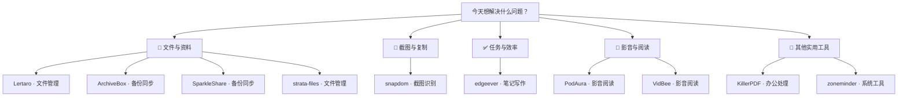

# 每日实用开源精选 · 2026-11-16

10 个实用开源项目。许可证与维护日期来自 GitHub API；中文介绍由 AI 辅助生成，安装前请核对项目说明。

## 🌟 今日首选 · [Lertaro](https://github.com/Lertaro/Lertaro)

> 忘了资料存在哪个文件夹？输入文件名线索，直接定位文件。

**为什么先试：**找文件是常见需求，Windows 安装包与便携版都有明确说明，适合先从基本搜索试起。

**工作流程：**记得部分文件名 → 输入线索搜索本地磁盘 → 找到并打开目标文件

**适用平台：**Windows

---

## 先按需求找工具

**📁 文件与资料**：[Lertaro](https://github.com/Lertaro/Lertaro) · [ArchiveBox](https://github.com/ArchiveBox/ArchiveBox) · [SparkleShare](https://github.com/hbons/SparkleShare) · [strata-files](https://github.com/cristipufu/strata-files)

**📸 截图与复制**：[snapdom](https://github.com/zumerlab/snapdom)

**✅ 任务与效率**：[edgeever](https://github.com/tianma-if/edgeever)

**🎵 影音与阅读**：[PodAura](https://github.com/SkyD666/PodAura) · [VidBee](https://github.com/nexmoe/VidBee)

**🧰 其他实用工具**：[KillerPDF](https://github.com/SteveTheKiller/KillerPDF) · [zoneminder](https://github.com/ZoneMinder/zoneminder)

---

## 01 · [Lertaro/Lertaro](https://github.com/Lertaro/Lertaro)

分类：文件管理

> 忘了资料存在哪个文件夹？输入文件名线索，直接定位文件。

**工作流程：**记得部分文件名 → 输入线索搜索本地磁盘 → 找到并打开目标文件

面向 Windows 的本地文件搜索工具，可按文件名和路径快速查找资料，并提供文件预览及磁盘占用图。提供安装版和便携版。

- 平台：Windows 10/11，提供 x64 和 ARM64 版本
- 费用：开源；软件使用费用待核实，可自愿捐赠
- 安装：从项目发布页获取安装包，按提示安装；也可解压便携版使用，较容易
- 注意：主要依靠本地磁盘索引；安装版会使用后台服务，首次使用需留意索引范围。
- [许可证 MIT](https://github.com/Lertaro/Lertaro/blob/main/LICENSE)
- [默认分支最近提交：2026-11-15T16:11:53Z](https://github.com/Lertaro/Lertaro/commit/ae00ba852ecafabead6b32baa7c0bddc7bc47301)
- 最近正式发布：[v5.13.3 · 2026-11-15T16:17:38Z](https://github.com/Lertaro/Lertaro/releases/tag/v5.13.3)
- [安装说明](https://github.com/Lertaro/Lertaro/blob/main/README.md)

## 02 · [SteveTheKiller/KillerPDF](https://github.com/SteveTheKiller/KillerPDF)

分类：办公处理

> 几份 PDF 要一起发给同事？合并页面后再检查顺序。

**工作流程：**准备几份 PDF 文件 → 合并并调整页面顺序 → 得到一份合并文档

Windows PDF 编辑器，可阅读、批注、合并和拆分文档，也支持对扫描件进行文字识别。项目提供安装版和便携版。

- 平台：Windows
- 费用：项目说明软件免费；额外服务费用待核实
- 安装：可从项目发布页获取安装版或便携版，安装较容易；OCR 语言模型需另行下载
- 注意：扫描页编辑前需要 OCR；导出 Office 格式后应检查排版。
- [许可证 GPL-3.0](https://github.com/SteveTheKiller/KillerPDF/blob/main/LICENSE)
- [默认分支最近提交：2026-11-15T16:13:13Z](https://github.com/SteveTheKiller/KillerPDF/commit/5b368df3c8f658f3e28c34bc2ceef410dacba01e)
- 最近正式发布：[v1.9.3 · 2026-11-15T16:05:57Z](https://github.com/SteveTheKiller/KillerPDF/releases/tag/v1.9.3)
- [安装说明](https://github.com/SteveTheKiller/KillerPDF/blob/main/README.md)

## 03 · [SkyD666/PodAura](https://github.com/SkyD666/PodAura)

分类：影音阅读

> 通勤时网络不稳定？提前下载订阅节目的单集离线收听。

**工作流程：**准备播客订阅源 → 订阅并下载想听的单集 → 获得可离线播放的节目

播客与 RSS 阅读应用，可订阅节目、播放音视频、下载单集供离线收听，也能导入和导出订阅列表。

- 平台：Android、iOS、Windows、macOS
- 费用：开源；各平台获取及使用费用待核实
- 安装：资料提供 F-Droid 和 Microsoft Store 入口；其他平台安装方式待核实，难度待核实
- 注意：自动下载单集的支持范围因平台而异；订阅内容需有可用的节目源。
- [许可证 GPL-3.0](https://github.com/SkyD666/PodAura/blob/master/LICENSE)
- [默认分支最近提交：2026-11-15T15:17:12Z](https://github.com/SkyD666/PodAura/commit/92e89cb80e661e24996b7b480f94995d877cb024)
- 最近正式发布：[31 · 2026-08-13T15:44:40Z](https://github.com/SkyD666/PodAura/releases/tag/31)
- [安装说明](https://github.com/SkyD666/PodAura/blob/master/README.md)

## 04 · [nexmoe/VidBee](https://github.com/nexmoe/VidBee)

分类：影音阅读

> 会议录像太长？导入文件并搜索转录文字，跳到相关发言。

**工作流程：**准备本地会议录像 → 生成转录并搜索发言 → 找到对应的播放位置

桌面音视频资料整理工具，可导入本地文件或下载受支持网站的媒体，在电脑上生成带时间点的转录文本，并搜索讲话内容。

- 平台：桌面平台；具体支持的操作系统待核实
- 费用：项目说明应用免费；选用第三方 AI 服务时费用待核实
- 安装：项目提供下载页面；对应系统的安装包及安装难度待核实
- 注意：仅下载有权保存的内容；本地转录需获取模型，使用云端 AI 时转录文本会发送给所选服务商。
- [许可证 MIT](https://github.com/nexmoe/VidBee/blob/main/LICENSE)
- [默认分支最近提交：2026-11-15T15:01:49Z](https://github.com/nexmoe/VidBee/commit/6542ebdc40de71b90845eb526b87c6f72ad1a992)
- 最近正式发布：[v2.4.0 · 2026-11-14T05:51:44Z](https://github.com/nexmoe/VidBee/releases/tag/v2.4.0)
- [安装说明](https://github.com/nexmoe/VidBee/blob/main/README.md)

## 05 · [ArchiveBox/ArchiveBox](https://github.com/ArchiveBox/ArchiveBox)

分类：备份同步

> 收藏的网页怕失效？把重要链接归档，留下可查阅的副本。

**工作流程：**准备重要网页链接 → 提交链接生成网页快照 → 得到本地归档副本

自托管网页归档工具，可收集网址或导入书签，将网页保存为 HTML、截图、PDF 等格式，便于日后查阅。

- 平台：资料明确说明可在 Linux、macOS 上通过 Docker 或 Python 安装；Windows 支持待核实
- 费用：开源；自托管资源及其他费用待核实
- 安装：通过 Docker 或 Python 安装并自行部署，需要一定技术基础
- 注意：归档效果取决于网页内容和所需依赖；私人内容的保存与分享需注意权限。
- [许可证 MIT](https://github.com/ArchiveBox/ArchiveBox/blob/dev/LICENSE)
- [默认分支最近提交：2026-11-15T16:10:53Z](https://github.com/ArchiveBox/ArchiveBox/commit/9b9f5a73c40457eae44a70622436c65d15e84ff1)
- 最近正式发布：[v0.9.77 · 2026-10-27T22:10:48Z](https://github.com/ArchiveBox/ArchiveBox/releases/tag/v0.9.77)
- [安装说明](https://github.com/ArchiveBox/ArchiveBox/blob/dev/README.md)

## 06 · [hbons/SparkleShare](https://github.com/hbons/SparkleShare)

分类：备份同步

> 多人共用一组文档？把共享文件夹连接到 Git 仓库同步改动。

**工作流程：**准备可访问的 Git 仓库 → 添加远端项目并修改文件 → 让参与者获得同步文件

基于 Git 仓库的文件共享与同步应用。把远端项目加入专用文件夹后，参与者对文件的增删改可同步到其他设备。

- 平台：Linux、macOS、Windows
- 费用：开源；自建服务器或使用第三方托管服务的费用待核实
- 安装：Linux 可通过 Flatpak 安装，macOS 提供发布包；Windows 安装方式待核实，配置远端仓库需要一定基础
- 注意：需要可访问的 Git 仓库；项目 README 提示关注其后续维护情况。
- [许可证 GPL-3.0](https://github.com/hbons/SparkleShare/blob/main/LICENSE.md)
- [默认分支最近提交：2026-11-15T13:54:44Z](https://github.com/hbons/SparkleShare/commit/1d4e7afdb58957874f0e71992e8740d7b25f9a8b)
- 最近正式发布：[3.38.1 · 2024-09-20T13:16:25Z](https://github.com/hbons/SparkleShare/releases/tag/3.38.1)
- [安装说明](https://github.com/hbons/SparkleShare/blob/main/README.md)

## 07 · [tianma-if/edgeever](https://github.com/tianma-if/edgeever)

分类：笔记写作

> 笔记散在不同主题里？建目录集中记录，按主题查找旧笔记。

**工作流程：**准备待整理的笔记内容 → 建立目录并编辑笔记 → 得到分类保存的笔记

自托管笔记与知识库应用，提供树状目录、笔记列表和编辑区，可用于集中整理日常记录，并提供网页剪藏与多端同步能力。

- 平台：网页端；资料称提供多平台客户端，具体系统支持待核实
- 费用：项目称可在 Cloudflare 免费额度内运行；超出额度或自备服务器的费用待核实
- 安装：可选择 Cloudflare 或 Docker 部署；需要配置服务，难度中等
- 注意：多端使用依赖自行配置的服务；不要把平台免费额度理解为任何用量都免费。
- [许可证 AGPL-3.0](https://github.com/tianma-if/edgeever/blob/main/LICENSE)
- [默认分支最近提交：2026-11-15T16:20:06Z](https://github.com/tianma-if/edgeever/commit/583a62c45d1040d8dc6e0a415d69616abe9bb62e)
- 最近正式发布：[v2.27.0 · 2026-11-14T17:10:58Z](https://github.com/tianma-if/edgeever/releases/tag/v2.27.0)
- [安装说明](https://github.com/tianma-if/edgeever/blob/main/README.md)

## 08 · [cristipufu/strata-files](https://github.com/cristipufu/strata-files)

分类：文件管理

> Mac 磁盘快满了？查看空间占用图，找到需要检查的大文件夹。

**工作流程：**准备检查磁盘空间 → 查看文件夹占用图 → 定位占空间的文件夹

面向 Mac 的文件管理器，支持按名称或条件搜索、查看文件夹大小和磁盘占用，并提供预览及文件复制操作。

- 平台：macOS 26 及以上，Apple 芯片 Mac
- 费用：开源；软件使用费用待核实
- 安装：项目提供发布页；具体安装步骤待核实
- 注意：仅适用于资料列出的较新 Mac；大量文件首次建立搜索索引需要时间。
- [许可证 MIT](https://github.com/cristipufu/strata-files/blob/main/LICENSE)
- [默认分支最近提交：2026-11-15T15:26:30Z](https://github.com/cristipufu/strata-files/commit/f0e57f1da5a8666f459a33745f5ca9fed91bd60d)
- 最近正式发布：[v0.8.6 · 2026-11-12T13:22:49Z](https://github.com/cristipufu/strata-files/releases/tag/v0.8.6)
- [安装说明](https://github.com/cristipufu/strata-files/blob/main/README.md)

## 09 · [zumerlab/snapdom](https://github.com/zumerlab/snapdom)

分类：截图识别

> 网页里的图表要放进汇报？截取对应元素并导出图片。

**工作流程：**准备网页中的目标元素 → 调用核心库截取该元素 → 得到可使用的图片

用于截取网页已渲染元素的工具，核心库可把指定页面区域导出为 PNG、SVG 等格式；项目也列出了 Chrome 扩展。

- 平台：浏览器网页环境；资料列出 Chrome 扩展
- 费用：开源核心库；扩展及相关服务费用待核实
- 安装：普通用户可查看项目列出的 Chrome 扩展；开发者可通过 npm 安装核心库，具体使用难度因方式而异
- 注意：核心库面向网页开发者；Chrome 扩展的具体操作能力和适用页面待核实。
- [许可证 MIT](https://github.com/zumerlab/snapdom/blob/main/LICENSE)
- [默认分支最近提交：2026-11-15T11:49:44Z](https://github.com/zumerlab/snapdom/commit/761490b42620750855ae795ad74606255bf02bc8)
- 最近正式发布：[v3.7.6 · 2026-11-15T11:54:29Z](https://github.com/zumerlab/snapdom/releases/tag/v3.7.6)
- [安装说明](https://github.com/zumerlab/snapdom/blob/main/README.md)

## 10 · [ZoneMinder/zoneminder](https://github.com/ZoneMinder/zoneminder)

分类：系统工具

> 想在家中查看摄像头录像？接入受支持的摄像头并集中管理记录。

**工作流程：**准备受支持的摄像头 → 接入并配置画面录制 → 获得可查看的监控录像

运行在 Linux 上的摄像头监控系统，可接入受支持的网络或 USB 摄像头，进行画面查看、分析与录像。

- 平台：Linux
- 费用：项目说明软件免费；摄像头、存储设备及运行环境费用另计
- 安装：可使用支持的 Linux 发行版软件包或官方 Docker 镜像；需配置摄像头与存储，难度较高
- 注意：接入摄像头前需核对兼容性，并妥善设置访问权限及录像保存空间。
- [许可证 GPL-2.0](https://github.com/ZoneMinder/zoneminder/blob/master/LICENSE)
- [默认分支最近提交：2026-11-15T16:31:58Z](https://github.com/ZoneMinder/zoneminder/commit/8af76cd18a3aa866f200cf1cb95370396dbdef2f)
- 最近正式发布：[1.38.6 · 2026-10-05T23:15:24Z](https://github.com/ZoneMinder/zoneminder/releases/tag/1.38.6)
- [安装说明](https://github.com/ZoneMinder/zoneminder/blob/master/README.md)

---

## 🔥 今日热门

额外 4 项 · 从 GitHub Trending 日榜筛选，排除历史推荐与当天精选，不代表全网热度排名。

[来源：GitHub Trending 日榜](https://github.com/trending?since=daily) ｜ 采集时间：2026-11-15T16:35:59.590Z

### [stitch-skills](https://github.com/google-labs-code/stitch-skills)

**日榜第 3 位 · 今日新增 248 Star**

**这是什么：**这是配合 Google Stitch 使用的代理技能库，不是打开就能画图的独立软件。原本需要开发者自行组织前端代码、设计资料和上传步骤；它把相关操作整理成可由编程代理调用的技能，例如将前端代码提取并转换为 Stitch 设计。MCP 是代理连接 Stitch 服务的接口，使用这些技能前必须先配置该服务。

**适合谁：**适合使用 Stitch 和编程代理的设计师、前端开发者；需配置服务，普通读者不能直接即装即用。

**举个例子：**以下是假设示例，并非亲测：假设你要把现有仪表盘界面整理到 Stitch，先准备 React 或 Vue 前端项目及目标 Stitch 项目，在已配置 Stitch MCP 的编程代理中调用代码转设计技能，按提示提取页面内容并上传，最终在 Stitch 中得到可继续处理的设计。

**工作流程：**现有前端代码与目标项目 → 调用代码转设计技能并上传 → Stitch 中的设计

为 Google Stitch 提供一组可供编程代理调用的设计技能和插件，涵盖设计、构建及辅助工作。资料明确列出将前端代码转换为 Stitch 设计的技能。使用前需在代理环境中配置 Stitch MCP 服务；MCP 是让代理连接外部工具的接口。

- 平台：支持 README 列出的 Codex、Claude Code、Cursor 等编程代理；OpenCode 需手动适配。运行平台取决于代理及 Stitch 服务配置。
- 费用：仓库使用费用及 Stitch 服务费用，所给资料未说明，待核实。
- 安装：先按 Stitch 文档配置 MCP 服务、凭据和环境变量，再在支持的代理中添加插件或选装技能；OpenCode 需手动复制技能并配置远程 MCP，部分技能名称还需调整。
- 注意：技能可能相互依赖，选装时须检查依赖；仅复制技能而未配置 Stitch MCP，无法完成依赖 Stitch 的操作。
- [许可证 Apache-2.0](https://github.com/google-labs-code/stitch-skills/blob/main/LICENSE)
- [最近提交 2026-08-17T20:20:22Z](https://github.com/google-labs-code/stitch-skills/commit/0337446dadde6f8c94210444e2aa9d546126480f)
- 最近正式发布：[v1.0 · 2026-05-18T18:02:32Z](https://github.com/google-labs-code/stitch-skills/releases/tag/v1.0)
- [项目说明](https://github.com/google-labs-code/stitch-skills/blob/main/README.md)

### [ggml](https://github.com/ggml-org/ggml)

**日榜第 8 位 · 今日新增 53 Star**

**这是什么：**这是机器学习程序使用的底层张量计算库，而不是已经训练好的模型。张量可理解为供程序计算的多维数字数组。开发者原本需要自行编写和适配矩阵运算、不同硬件上的执行代码；ggml 提供这些基础计算能力，并支持多种处理器、计算后端和低位量化格式，供开发者集成到自己的程序中。

**适合谁：**适合机器学习系统及 C/C++ 开发者；需要编程和构建源码，普通读者不能直接当作应用使用。

**举个例子：**以下是假设示例，并非亲测：假设你正在编写一个需要矩阵乘法的机器学习程序，先准备 C/C++ 开发环境和待计算的矩阵，参考仓库的 simple 示例构建并调用 ggml 的计算接口，最终让自己的程序得到矩阵运算结果，而不是获得一个现成的模型。

**工作流程：**程序中的矩阵等数字数据 → 调用张量运算接口 → 计算结果供程序使用

一个面向机器学习的 C/C++ 张量库，提供矩阵等张量运算、低位量化及多种计算后端支持。README 强调跨平台、较少依赖和运行时零内存分配，并提供矩阵乘法入门示例。它是开发者构建程序所用的底层库，不是面向普通用户的模型或聊天软件。

- 平台：README 列出 x86、ARM、RISC-V、LoongArch、PowerPC、s390x 和 WebAssembly，并提及 CPU、GPU、NPU 及浏览器后端；具体环境支持情况待核实。
- 费用：仓库本身的使用收费情况未说明；运行所需硬件或其他服务成本待核实。
- 安装：README 提供从源码构建方式：克隆仓库，创建 build 目录，通过 CMake 配置并编译；实际使用还需将库集成到程序中。
- 注意：它不提供可直接对话的成品应用。README 提示，核心库及 CMake 构建系统的改动应向 llama.cpp 提交贡献。
- [许可证 MIT](https://github.com/ggml-org/ggml/blob/master/LICENSE)
- [最近提交 2026-11-13T08:13:55Z](https://github.com/ggml-org/ggml/commit/417a024b4fb6bc3116d41af7c067166a039bdf12)
- 最近正式发布：[v1.0.0 · 2026-11-13T08:34:21Z](https://github.com/ggml-org/ggml/releases/tag/v1.0.0)
- [项目说明](https://github.com/ggml-org/ggml/blob/master/README.md)

### [Claude-BugHunter](https://github.com/elementalsouls/Claude-BugHunter)

**日榜第 9 位 · 今日新增 221 Star**

**这是什么：**这是供 Claude Code 调用的安全测试技能包，不是自动扫描任意网站的一键式软件。安全人员原本需要自行查阅漏洞类别、整理测试路径和报告要求；它把这些方法、公开报告中的模式、验证步骤与证据处理建议组织成技能，供代理在具体测试任务中调用。实际测试范围、结果复核和授权仍由使用者负责。

**适合谁：**适合有明确授权范围的漏洞研究员和红队人员；需使用 Claude Code 等代理并具备安全测试知识，普通读者不宜直接操作目标系统。

**举个例子：**以下是假设示例，并非亲测：假设你受托检查一套明确列入测试范围的 Web 应用，先准备授权说明、目标范围及已有测试线索，在 Claude Code 中描述要检查的功能并调用相关技能，随后人工核对发现、整理证据与报告，最终得到供委托方复核的测试记录。

**工作流程：**授权范围与待测功能 → 调用相关技能并人工验证 → 测试证据与报告草稿

面向 Claude Code 的安全测试技能包，提供漏洞测试方法、公开报告中整理的检测模式、企业身份与基础设施测试资料，以及验证、证据整理和报告指引。可通过插件或复制文件安装；README 还介绍了单独安装的命令行工具。它辅助专业人员开展获授权测试，不等于自动确认漏洞。

- 平台：README 明确提供 Claude Code 插件方式；复制安装脚本覆盖 macOS、Linux 和 Windows PowerShell。其他代理支持细节待核实。
- 费用：技能包及 Claude Code、相关工具的实际使用成本，所给资料未说明，待核实。
- 安装：可在 Claude Code 中添加仓库为插件市场并安装插件；也可克隆仓库后，在 macOS/Linux 运行 install.sh，或在 Windows PowerShell 运行 install.ps1。独立命令行工具需另行安装。
- 注意：只应在明确授权范围内使用；代理生成的发现与严重程度判断需要人工验证。README 中的演示对话为示意，不能当作实际检测结果。
- [许可证 MIT](https://github.com/elementalsouls/Claude-BugHunter/blob/main/LICENSE)
- [最近提交 2026-11-15T11:59:52Z](https://github.com/elementalsouls/Claude-BugHunter/commit/2cfe533df8efa2ced87c91299e1f62b88cb26108)
- 最近正式发布：[v2.1 · 2026-06-05T16:15:13Z](https://github.com/elementalsouls/Claude-BugHunter/releases/tag/v2.1)
- [项目说明](https://github.com/elementalsouls/Claude-BugHunter/blob/main/README.md)

### [SkillEvaluator](https://github.com/NVIDIA/SkillEvaluator)

**日榜第 12 位 · 今日新增 205 Star**

**这是什么：**这是评估 AI 代理技能的开发工具，不是替用户执行日常任务的代理。过去维护者可能只能人工阅读技能文件，或凭感觉判断技能是否有帮助；它先检查文件质量与问题，再在具备相应条件时比较代理使用和不使用技能的任务结果。代理技能是装有指令及辅助文件的目录，评估对象是这类目录。

**适合谁：**适合编写或维护代理技能的开发者及团队；命令行使用需要基本操作能力，接入持续集成或实时代理评估需要配置，普通读者不能直接当成应用使用。

**举个例子：**以下是假设示例，并非亲测：假设你维护一个用于分析文本的代理技能，先准备该技能目录，在命令行对目录运行基础质量检查并选择 JSON 报告，查看检查结果和待改进项；若还要判断它是否改变代理的任务表现，则需进一步配置实时评估环境。

**工作流程：**待评估的技能目录 → 运行质量检查并查看报告 → 质量结果与问题清单

用于检查 AI 代理技能质量并评估其对任务结果影响的工具。代理技能是包含指令及辅助文件的文件夹。README 提供命令行、持续集成和代理技能三种使用入口；基础静态检查无需 API 密钥，更深入的模型评分、安全检查或代理行为对比则有额外条件。

- 平台：提供 Python 命令行工具，可接入 GitHub 或 GitLab 持续集成，也可作为技能加入支持技能的代理；具体操作系统兼容性待核实。
- 费用：基础质量检查无需 API 密钥；模型服务、扫描器或实时评估可能涉及额外条件与费用。README 提及 NVIDIA Build 的受限免费原型额度，实际费用待核实。
- 安装：可用 pip 安装 skillevaluator；仓库示例使用 Git 和 uv 运行。接入代理可通过 npx skills 添加技能，接入持续集成则需按对应平台配置。
- 注意：基础静态检查通过不代表技能已完成安全验证或证明能改善代理表现；后两类结论需要相应扫描器或实时评估。
- [许可证 Apache-2.0](https://github.com/NVIDIA/SkillEvaluator/blob/main/LICENSE)
- [最近提交 2026-11-15T12:03:30Z](https://github.com/NVIDIA/SkillEvaluator/commit/f469462369404fa9d18c9372feccd32bfb9dbbbb)
- 最近正式发布：[v0.9.0 · 2026-11-13T11:03:05Z](https://github.com/NVIDIA/SkillEvaluator/releases/tag/v0.9.0)
- [项目说明](https://github.com/NVIDIA/SkillEvaluator/blob/main/README.md)
