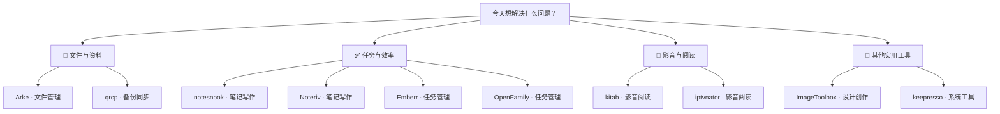

# 每日实用开源精选 · 2026-11-17

10 个实用开源项目。许可证与维护日期来自 GitHub API；中文介绍由 AI 辅助生成，安装前请核对项目说明。

## 🌟 今日首选 · [Arke](https://github.com/Koimsurai/Arke)

> 文件散落在多个目录？按名称或文档内容搜索，快速找到目标。

**为什么先试：**Windows 用户可直接用它浏览和搜索文件，README 对功能与平台说明较具体。

**工作流程：**要查找的名称或文档词句 → 搜索文件名或文档内容 → 找到匹配文件并打开预览

**适用平台：**Windows

---

## 先按需求找工具

**📁 文件与资料**：[Arke](https://github.com/Koimsurai/Arke) · [qrcp](https://github.com/claudiodangelis/qrcp)

**✅ 任务与效率**：[notesnook](https://github.com/streetwriters/notesnook) · [Noteriv](https://github.com/thejacedev/Noteriv) · [Emberr](https://github.com/emberr-app/Emberr) · [OpenFamily](https://github.com/NexaFlowFrance/OpenFamily)

**🎵 影音与阅读**：[kitab](https://github.com/t21dev/kitab) · [iptvnator](https://github.com/4gray/iptvnator)

**🧰 其他实用工具**：[ImageToolbox](https://github.com/T8RIN/ImageToolbox) · [keepresso](https://github.com/gyorgysh/keepresso)

---

## 01 · [Koimsurai/Arke](https://github.com/Koimsurai/Arke)

分类：文件管理

> 文件散落在多个目录？按名称或文档内容搜索，快速找到目标。

**工作流程：**要查找的名称或文档词句 → 搜索文件名或文档内容 → 找到匹配文件并打开预览

面向 Windows 的文件管理器，支持多标签、双栏浏览、文件预览、批量重命名，以及按名称或路径搜索文件；也可搜索 PDF 和 Office 文档内容。

- 平台：Windows 10/11
- 费用：待核实
- 安装：可从 GitHub Releases 下载；具体安装包形式待核实。
- 注意：全盘快速搜索依赖可选后台索引服务；网络位置支持情况有限。
- [许可证 AGPL-3.0](https://github.com/Koimsurai/Arke/blob/main/LICENSE)
- [默认分支最近提交：2026-11-16T16:13:06Z](https://github.com/Koimsurai/Arke/commit/1b2ee46fb07bd81801a170a6b7d2159e335b282a)
- 最近正式发布：[v0.5.2 · 2026-11-16T07:16:30Z](https://github.com/Koimsurai/Arke/releases/tag/v0.5.2)
- [安装说明](https://github.com/Koimsurai/Arke/blob/main/README.md)

## 02 · [claudiodangelis/qrcp](https://github.com/claudiodangelis/qrcp)

分类：备份同步

> 要把电脑里的照片发到手机？运行命令后扫码下载。

**工作流程：**电脑上的文件和同一 Wi-Fi 的手机 → 运行发送命令并扫描二维码 → 手机浏览器下载收到的文件

命令行文件传输工具，可通过同一 Wi-Fi 网络在电脑与手机之间发送或接收文件，并用二维码提供传输地址。

- 平台：Windows、Linux、macOS
- 费用：待核实
- 安装：可从 Releases 下载 Windows 压缩包，解压后将 exe 放入 PATH；也可用 winget 安装，难度低。
- 注意：电脑和手机需能通过局域网互相访问；传输时请确认网络环境可信。
- [许可证 MIT](https://github.com/claudiodangelis/qrcp/blob/main/LICENSE)
- [默认分支最近提交：2026-11-16T19:34:05Z](https://github.com/claudiodangelis/qrcp/commit/e9bdfd3ccaf5d7d303d06914326ad99ea4833255)
- 最近正式发布：[v0.11.7 · 2026-09-30T15:17:59Z](https://github.com/claudiodangelis/qrcp/releases/tag/v0.11.7)
- [安装说明](https://github.com/claudiodangelis/qrcp/blob/main/README.md)

## 03 · [streetwriters/notesnook](https://github.com/streetwriters/notesnook)

分类：笔记写作

> 想整理私人笔记又担心隐私？用加密笔记保存日常资料。

**工作流程：**要记录的想法或资料 → 创建笔记并整理内容 → 得到加密保存的个人笔记

注重隐私的笔记应用，提供端到端加密；项目包含网页、桌面和移动客户端，也提供浏览器剪藏扩展。

- 平台：网页、Windows/macOS/Linux 桌面、Android、iOS
- 费用：README称免费开源；具体付费功能与方案待核实。
- 安装：可从项目下载页获取客户端；Windows 安装包格式与具体步骤待核实。
- 注意：端到端加密不等于免除备份责任；使用同步服务前应了解其方案和限制。
- [许可证 GPL-3.0](https://github.com/streetwriters/notesnook/blob/master/LICENSE)
- [默认分支最近提交：2026-11-16T19:01:28Z](https://github.com/streetwriters/notesnook/commit/8bb25559ea7804007f618157b3d1f5dd105ce820)
- 最近正式发布：[v3.4.13 · 2026-11-10T08:42:20Z](https://github.com/streetwriters/notesnook/releases/tag/v3.4.13)
- [安装说明](https://github.com/streetwriters/notesnook/blob/master/README.md)

## 04 · [thejacedev/Noteriv](https://github.com/thejacedev/Noteriv)

分类：笔记写作

> 想把笔记留在本地文件夹？用 Markdown 编辑并随时打开原文件。

**工作流程：**已有 Markdown 文件或新笔记主题 → 编辑内容并查看实时预览 → 保存为可在其他编辑器打开的 md 文件

Markdown 桌面编辑器，支持实时预览、图谱视图、插件与主题；笔记以本地 Markdown 文件保存，可选用 Git、WebDAV 或云文件夹同步。

- 平台：Windows、macOS、Linux；移动端仍在开发
- 费用：待核实
- 安装：可从 GitHub Releases 下载桌面版本；Windows 安装包格式待核实。
- 注意：同步为可选功能；使用 Git 或 WebDAV 前需自行配置。
- [许可证 MIT](https://github.com/thejacedev/Noteriv/blob/main/LICENSE)
- [默认分支最近提交：2026-11-16T16:11:02Z](https://github.com/thejacedev/Noteriv/commit/aa8597b33285a675779a98cc26342b45dde1d119)
- 最近正式发布：[v3.0.3 · 2026-11-16T14:12:59Z](https://github.com/thejacedev/Noteriv/releases/tag/v3.0.3)
- [安装说明](https://github.com/thejacedev/Noteriv/blob/main/README.md)

## 05 · [emberr-app/Emberr](https://github.com/emberr-app/Emberr)

分类：任务管理

> 任务、日历和随手记分散？集中到一个个人工作区管理。

**工作流程：**待办事项、日期和要记录的内容 → 添加任务并安排日历提醒 → 得到集中查看的日程与待办

离线优先的个人与家庭工作区，结合任务、提醒和日历，也支持块状笔记、附件、日记及不同空间管理。

- 平台：Windows、Linux、Android
- 费用：待核实
- 安装：可从 GitHub Releases 下载；Windows 安装包格式和具体步骤待核实。
- 注意：项目注明仍处于测试阶段，可能存在缺陷；桌面端同步或加密细节需查阅文档。
- [许可证 AGPL-3.0](https://github.com/emberr-app/Emberr/blob/main/LICENSE)
- [默认分支最近提交：2026-11-16T18:54:41Z](https://github.com/emberr-app/Emberr/commit/e14e23a99a08a52357e3b5c604b07d9951c78db1)
- 最近正式发布：[v1.3.0 · 2026-11-11T22:57:37Z](https://github.com/emberr-app/Emberr/releases/tag/v1.3.0)
- [安装说明](https://github.com/emberr-app/Emberr/blob/main/README.md)

## 06 · [t21dev/kitab](https://github.com/t21dev/kitab)

分类：影音阅读

> PDF、电子书和 Markdown 文件混在一起？用同一阅读器打开。

**工作流程：**待阅读的 PDF、电子书或 Markdown → 在阅读器中打开并浏览文档 → 获得统一的桌面阅读界面

桌面阅读器，支持 PDF、电子书和 Markdown；Windows 版可从 Microsoft Store 安装，也提供独立安装包和便携包。

- 平台：Windows 10/11、macOS、Linux
- 费用：待核实
- 安装：可通过 Microsoft Store 安装，或下载 setup.exe/便携 ZIP；操作难度低。
- 注意：GitHub Releases 的下载包未签名，Windows SmartScreen 可能显示安全提示；优先考虑商店版本。
- [许可证 AGPL-3.0](https://github.com/t21dev/kitab/blob/main/LICENSE)
- [默认分支最近提交：2026-11-16T18:32:25Z](https://github.com/t21dev/kitab/commit/cf45e8e77e45e7dacc02174b64492fcc1f390c19)
- 最近正式发布：[v0.7.0 · 2026-11-16T18:30:45Z](https://github.com/t21dev/kitab/releases/tag/v0.7.0)
- [安装说明](https://github.com/t21dev/kitab/blob/main/README.md)

## 07 · [4gray/iptvnator](https://github.com/4gray/iptvnator)

分类：影音阅读

> 已有合法 IPTV 播放列表？导入后搜索频道并查看节目。

**工作流程：**自己持有的播放列表或服务信息 → 添加来源并选择频道播放 → 打开对应的直播或节目内容

跨平台 IPTV 播放器，可加载 M3U/M3U8 播放列表、Xtream Codes 或 Stalker/Ministra 来源，并提供频道收藏、节目指南及影片和剧集浏览。

- 平台：Windows、macOS、Linux、浏览器
- 费用：README称免费开源；其他收费情况待核实。
- 安装：可从项目下载页或 GitHub Releases 获取 Windows 安装版或便携版。
- 注意：软件不提供频道、播放列表或订阅；请只添加有权使用的来源。
- [许可证 MIT](https://github.com/4gray/iptvnator/blob/master/LICENSE.md)
- [默认分支最近提交：2026-11-16T17:30:03Z](https://github.com/4gray/iptvnator/commit/5712fda42f0dcada4d5f66e861757be8e5d7b5b1)
- 最近正式发布：[v0.25.0 · 2026-11-08T15:30:03Z](https://github.com/4gray/iptvnator/releases/tag/v0.25.0)
- [安装说明](https://github.com/4gray/iptvnator/blob/master/README.md)

## 08 · [T8RIN/ImageToolbox](https://github.com/T8RIN/ImageToolbox)

分类：设计创作

> 手机图片需要裁剪或识别文字？用图像工具完成基础处理。

**工作流程：**手机中的待处理图片 → 选择图片并执行裁剪或 OCR → 得到处理后的图片或识别文字

图像处理应用，README 描述包括裁剪、绘图、滤镜、OCR 和多种图像处理功能。

- 平台：Android；其他平台待核实
- 费用：待核实
- 安装：README 提供 Android 应用信息；具体安装渠道待核实。
- 注意：资料仅能确认 Android 平台，不能据此推荐 Windows 桌面安装。
- [许可证 Apache-2.0](https://github.com/T8RIN/ImageToolbox/blob/master/LICENSE)
- [默认分支最近提交：2026-11-16T18:58:50Z](https://github.com/T8RIN/ImageToolbox/commit/3a3928201e0a9c06b5b63f3aaea7353b56242fe9)
- 最近正式发布：[4.2.0 · 2026-09-04T20:59:32Z](https://github.com/T8RIN/ImageToolbox/releases/tag/4.2.0)
- [安装说明](https://github.com/T8RIN/ImageToolbox/blob/master/README.md)

## 09 · [NexaFlowFrance/OpenFamily](https://github.com/NexaFlowFrance/OpenFamily)

分类：任务管理

> 家人常漏买东西或忘记安排？共享清单和日历集中管理。

**工作流程：**家庭购物、家务和约会安排 → 添加清单事项并安排日历 → 得到全家可查看的计划

自托管家庭组织工具，集合购物清单、家务任务、共享日历、每周计划、食谱、膳食安排和家庭预算；提供 Android 客户端及网页应用。

- 平台：网页、Android；支持 Docker 部署，另有 Windows 安装器
- 费用：自托管版本费用待核实；托管服务方案待核实。
- 安装：README 称 Windows 提供无需 Docker 的安装器；具体安装步骤待核实，也可用 Docker 部署。
- 注意：家庭数据涉及隐私；自托管需负责服务器和备份，托管服务的数据条款需另行确认。
- [许可证 AGPL-3.0](https://github.com/NexaFlowFrance/OpenFamily/blob/main/licence.md)
- [默认分支最近提交：2026-11-16T19:25:33Z](https://github.com/NexaFlowFrance/OpenFamily/commit/484b76022d41ecc406cf9a989c0e35bbc45be761)
- 最近正式发布：[v2.2.0 · 2026-11-16T18:39:25Z](https://github.com/NexaFlowFrance/OpenFamily/releases/tag/v2.2.0)
- [安装说明](https://github.com/NexaFlowFrance/OpenFamily/blob/main/README.md)

## 10 · [gyorgysh/keepresso](https://github.com/gyorgysh/keepresso)

分类：系统工具

> Mac 正在下载或运行任务却快要休眠？设置条件让它暂时保持唤醒。

**工作流程：**正在进行的下载或运行任务 → 选择保持唤醒条件或计时 → 任务期间 Mac 不进入休眠

macOS 菜单栏工具，可按计时或条件触发阻止系统或显示器休眠，并支持按应用、网络、日历活动等条件控制保持唤醒。

- 平台：macOS 14 及以上
- 费用：待核实
- 安装：项目提供 GitHub Releases；具体安装步骤待核实。
- 注意：仅支持 macOS，不适用于 Windows；部分保持活跃方式可能需要辅助使用权限。
- [许可证 GPL-3.0](https://github.com/gyorgysh/keepresso/blob/main/LICENSE)
- [默认分支最近提交：2026-11-16T19:46:07Z](https://github.com/gyorgysh/keepresso/commit/2ad40ca7e35bd238565cde03c18d1620beef1091)
- 最近正式发布：[v1.30.0 · 2026-11-10T07:59:46Z](https://github.com/gyorgysh/keepresso/releases/tag/v1.30.0)
- [安装说明](https://github.com/gyorgysh/keepresso/blob/main/README.md)

---

## 🔥 今日热门

额外 5 项 · 从 GitHub Trending 日榜筛选，排除历史推荐与当天精选，不代表全网热度排名。

[来源：GitHub Trending 日榜](https://github.com/trending?since=daily) ｜ 采集时间：2026-11-16T19:52:38.461Z

### [arcane](https://github.com/getarcaneapp/arcane)

**日榜第 6 位 · 今日新增 31 Star**

**这是什么：**Arcane 是一个用于管理 Docker 的独立应用，不是 Docker 的替代品。原本用户需要通过命令行或其他管理方式操作 Docker；它旨在提供更易接近的管理入口。README 摘要没有说明具体覆盖哪些容器管理任务，因此功能范围与操作细节待核实。

**适合谁：**适合需要管理 Docker 环境的个人或团队；一般无需编程，但需具备部署自托管服务和配置 Docker 的能力，普通读者不能仅凭 README 直接使用。

**举个例子：**示例（帮助理解，非亲测）：假设你需要查看并管理一台机器上的 Docker 环境，可先按官方文档配置 Arcane 与 Docker 的连接，再通过其管理界面进行操作。README 未列出具体操作项目，最终可完成的任务需查证文档。

**工作流程：**准备 Docker 环境及部署配置 → 按官方文档配置并连接 Arcane → 通过管理入口操作 Docker 环境

Arcane 是用于管理 Docker 环境的自托管应用，目标是通过图形化界面简化日常操作。README 将项目定位为面向大众的 Docker 管理工具，但未在所提供的内容中列出具体功能、部署命令或运行要求；详细配置需查阅官方文档。

- 平台：面向 Docker 环境的自托管应用；具体操作系统和浏览器要求待核实。
- 费用：费用信息未在所提供的 README 中说明，需核实。
- 安装：README 引导用户查阅官方文档获取设置与配置说明；具体部署方式、依赖和最低环境要求待核实。
- 注意：项目 README 说明 main 分支为 v3，旧版 2.x 位于单独分支；部署前应查阅对应版本文档。具体功能和安全配置要求待核实。
- [许可证 BSD-3-Clause](https://github.com/getarcaneapp/arcane/blob/main/LICENSE)
- [最近提交 2026-11-16T18:45:39Z](https://github.com/getarcaneapp/arcane/commit/693a5f39a6da94ee6a56143ed0f905778b33f131)
- 最近正式发布：[v3.0.1 · 2026-11-15T17:05:31Z](https://github.com/getarcaneapp/arcane/releases/tag/v3.0.1)
- [项目说明](https://github.com/getarcaneapp/arcane/blob/main/README.md)

### [jiangshan-map](https://github.com/DeanChensj/jiangshan-map)

**日榜第 7 位 · 今日新增 285 Star**

**这是什么：**江山时序是一个交互式历史地图资料与浏览项目，不是传统静态地图集。原本查阅不同时期的疆域、政权和古地名，常需在地图、史书和资料之间来回比对；它将多个历史阶段放在同一可交互地图中，支持按时间切换并查看地点和事件。

**适合谁：**适合历史爱好者、教师、学生及文化内容创作者；可直接使用在线演示，无需编程或自建服务。

**举个例子：**示例（帮助理解，非亲测）：假设你想了解唐代安西四镇的地理位置，可打开在线地图，将时间轴切到相关历史阶段，再点击地图上的地点或时间节点查看疆域和事件信息，得到一段结合空间位置与年代的浏览线索。

**工作流程：**选择历史时期或地名 → 拖动时间轴并点击地图要素 → 查看对应疆域、地点与事件

江山时序是一款面向浏览器的中国历史交互地图，覆盖从战国时期到现代的多个历史阶段。用户可以拖动时间轴查看疆域和政权变化，浏览古城、关隘、历史事件与君主信息，并探索古今地名关联及诗词相关路线。README 提供在线演示，适合将地图与时间线结合起来浏览历史。

- 平台：README 提供网页在线演示；具体浏览器和设备兼容要求待核实。
- 费用：费用信息未在所提供的 README 中说明，在线演示是否长期可用待核实。
- 安装：普通读者可直接打开 README 提供的在线演示；本地部署或构建说明未包含在所提供的 README 摘录中。
- 注意：地图内容适合交互浏览；涉及疆域、政权与历史地名的解释，仍应结合可靠史料核对。
- [许可证 GPL-3.0](https://github.com/DeanChensj/jiangshan-map/blob/main/LICENSE)
- [最近提交 2026-11-16T10:21:14Z](https://github.com/DeanChensj/jiangshan-map/commit/897b9ad4e987fcface8728ffdfbe33e801a3dbae)
- 最近正式发布：[v1.3.0 · 2026-11-13T02:57:43Z](https://github.com/DeanChensj/jiangshan-map/releases/tag/v1.3.0)
- [项目说明](https://github.com/DeanChensj/jiangshan-map/blob/main/README.md)

### [last30days-skill](https://github.com/mvanhorn/last30days-skill)

**日榜第 9 位 · 今日新增 122 Star**

**这是什么：**last30days 是可安装到多种 AI 编程或代理工具中的技能，不是独立搜索网站。过去用户需要分别查阅社交平台、视频和社区讨论，再手动整理；它让 AI 助手并行搜索支持的平台，参考点赞、投票等互动信号，并生成主题摘要。部分数据源需要额外授权或密钥。

**适合谁：**适合研究、销售、内容策划及会前准备等需要追踪近期信息的任务；无需自己编程，但需使用兼容的 AI 助手，启用部分来源要配置密钥或登录会话。

**举个例子：**示例（帮助理解，非亲测）：假设你要准备一次关于某位行业人士的会谈，可向已安装该技能的 AI 助手输入姓名作为查询主题，让它搜索近期社交帖子、讨论和视频内容，再阅读汇总结果并回查重要出处，形成会前参考提纲。

**工作流程：**准备主题、人物或问题 → 让 AI 技能搜索并综合多平台内容 → 获得近期信息摘要及线索

last30days 是供 AI 助手使用的研究技能，可围绕一个主题搜索多个网络来源，再按互动信号整理并综合成摘要。README 提到 Reddit、X、YouTube、TikTok、Hacker News、Polymarket、GitHub 等来源；部分来源可直接使用，其他来源可能需要通过设置向导提供 API 密钥或浏览器会话。它更适合做近期信息摸底，不应替代对原始材料的核查。

- 平台：支持 Claude Code、Codex、Cursor、Copilot、Gemini CLI 等多种 Agent Skills 宿主；具体兼容情况以项目说明为准。
- 费用：费用信息未在所提供的 README 中完整说明；部分来源可能涉及平台账户、API 或服务成本，需核实。
- 安装：README 提供 Claude Code 插件市场安装方式，以及通过 npx skills add 安装到多种宿主的方式；也列有其他安装选项。
- 注意：不同来源的访问权限和配置要求不同；摘要应回查原始帖子、视频或数据，尤其是涉及个人或商业判断时。
- [许可证 MIT](https://github.com/mvanhorn/last30days-skill/blob/main/LICENSE)
- [最近提交 2026-11-16T16:41:03Z](https://github.com/mvanhorn/last30days-skill/commit/4f290893f223f44c2be38bbedb1ce9b78685c13b)
- 最近正式发布：[v4.2.1 · 2026-11-16T16:42:38Z](https://github.com/mvanhorn/last30days-skill/releases/tag/v4.2.1)
- [项目说明](https://github.com/mvanhorn/last30days-skill/blob/main/README.md)

### [paper-orchestra](https://github.com/google-research/paper-orchestra)

**日榜第 12 位 · 今日新增 306 Star**

**这是什么：**PaperOrchestra 是供研究者运行和调整的 AI 写作框架，不是无需配置的论文编辑器。原本研究者要从实验记录出发，手动查文献、搭建论文结构、撰写章节并制作图表；它将这些环节拆给不同的 AI 代理协同处理，输出符合指定 LaTeX 模板的稿件，仍需研究者审阅与核实。

**适合谁：**适合有实验材料和论文写作需求的研究人员或开发者；需要 Python 环境、模型/API 配置及命令行操作，普通读者不能直接即装即用。

**举个例子：**示例（帮助理解，非亲测）：假设你已完成一项实验并准备投稿，可整理研究想法和实验日志，提供目标会议的 LaTeX 模板及所需模型密钥，运行命令行流程并选择是否启用绘图，得到供研究者修改核验的论文草稿。

**工作流程：**整理研究想法、实验日志和论文模板 → 配置模型并运行写作流程 → 得到 LaTeX 论文草稿与可选图表

PaperOrchestra 是一个多代理研究论文写作框架，可将研究想法、实验记录等前期材料组织成 LaTeX 论文草稿。流程包含提纲生成、文献检索与综合、章节撰写、内容改进和绘图；用户需要提供目标会议模板，并可选择是否启用绘图流程。项目需要配置模型及相关 API，论文所用数据集未随代码仓库提供。

- 平台：README 要求 Python 3.11 和 Conda 环境；运行平台细节待核实。
- 费用：框架费用未在 README 中说明；模型 API、文献服务及其他外部服务是否产生费用需分别核实。
- 安装：README 给出创建 Python 3.11 Conda 环境、安装 requirements、配置 .env 密钥的步骤；也提供命令行脚本和 Python CLI 用法。
- 注意：数据集未包含在仓库中；生成内容需要检查事实、引用、实验结果和图表。README 特别说明该项目并非 Google 官方支持产品。
- [许可证 Apache-2.0](https://github.com/google-research/paper-orchestra/blob/main/LICENSE)
- [最近提交 2026-11-15T18:08:07Z](https://github.com/google-research/paper-orchestra/commit/d9bae997e793a015ed38bb1605be9eb58c00284f)
- 最近正式发布：无正式 Release
- [项目说明](https://github.com/google-research/paper-orchestra/blob/main/README.md)

### [svelte](https://github.com/sveltejs/svelte)

**日榜第 14 位 · 今日新增 58 Star**

**这是什么：**Svelte 是一个前端开发框架及编译器，不是独立的网页应用。传统开发中，开发者需要编写代码管理界面元素及其更新；Svelte 允许用声明式组件描述界面，再编译为 JavaScript，在数据变化时更新网页内容。它帮助完成界面构建与更新机制，网站业务逻辑仍由开发者实现。

**适合谁：**适合前端开发者及学习网页开发的人；需要编程和项目构建环境，普通读者不能直接把它当作现成应用使用。

**举个例子：**示例（帮助理解，非亲测）：假设你要制作一个可切换任务状态的网页，可用 Svelte 编写任务列表组件和状态交互，构建后把生成的前端代码接入网站，呈现可以响应操作的任务界面；具体功能由开发者编写。

**工作流程：**准备页面需求与界面状态 → 编写 Svelte 组件并构建 → 获得用于网页应用的前端代码

Svelte 是用于构建网页应用的前端框架。开发者用组件声明界面，再由 Svelte 编译器将其转换为 JavaScript，使页面内容能随状态变化更新。它属于软件开发工具，不是普通用户安装后即可直接使用的成品应用；具体项目仍需开发者编写代码并配置构建环境。

- 平台：用于构建网页应用；具体运行环境取决于项目及所选工具链，README 摘录未列详细要求。
- 费用：费用信息未在所提供的 README 中说明，需核实。
- 安装：所提供的 README 摘录未给出项目创建或安装步骤；请参考 Svelte 官方网站和文档确认。
- 注意：这是开发框架而非现成软件；使用者需自行编写应用代码。项目 README 指向官方文档和 Discord 获取更多信息。
- [许可证 MIT](https://github.com/sveltejs/svelte/blob/main/LICENSE.md)
- [最近提交 2026-11-15T07:47:25Z](https://github.com/sveltejs/svelte/commit/99c07450d2e093c0d637903dc2c94f28f264d70d)
- 最近正式发布：[svelte@5.57.3 · 2026-10-26T18:15:06Z](https://github.com/sveltejs/svelte/releases/tag/svelte%405.57.3)
- [项目说明](https://github.com/sveltejs/svelte/blob/main/README.md)

---

## 🏛️ 建筑与设计 · 今日补充

🏛️ 建筑与设计开源工具 · 2026-11-17 补充

今天单独补充3项，与已发送的每日开源精选分别发送。

1. FreeCAD｜参数化建筑建模

这是什么：这是一款能直接安装使用的参数化三维建模软件，也适用于建筑设计。你可以从带尺寸约束的二维草图建立三维对象，再修改历史参数调整方案，并从模型生成图纸。

适合谁：建筑设计学生、建筑师及 CAD 用户；基础操作不需要编程。

工作示例：例如设计一组入口构件：先画带尺寸约束的平面草图，再建立三维对象；方案调整时修改草图尺寸，检查模型与图纸变化。此为理解用途的示例，非亲测。

工作流程：带尺寸的二维草图 → 约束建模并修改参数 → 三维对象与图纸

平台：Windows / macOS / Linux

安装：下载官方稳定版安装包；无需自行编译。

费用：开源，可免费下载安装

注意：先用副本验证模型和图纸；已有商业 CAD 工作流的兼容性需要具体测试。

许可证：LGPL-2.1

默认分支最近维护（UTC）：2026-11-16T19:37:32Z

项目：https://github.com/FreeCAD/FreeCAD

官方说明：https://github.com/FreeCAD/FreeCAD/blob/main/README.md

2. IfcOpenShell｜BIM与IFC协作

这是什么：这是处理 IFC 建筑模型的开源库和工具生态。IFC 是不同 BIM 软件交换建筑信息的标准格式。它能读取模型及属性、处理几何，并提供格式转换工具；其中 Bonsai 是在 Blender 中使用的图形化 IFC 编辑插件。

适合谁：BIM 工程师、建筑师和开发者；Python 接口需要编程，Bonsai 图形操作门槛不同。

工作示例：例如收到其他团队导出的 IFC 模型：可通过 Bonsai 在 Blender 中浏览模型，或用 Python 读取构件信息；需要其他格式时研究 IfcConvert 的转换选项。此为用途示例，非亲测。

工作流程：协作方提供的IFC模型 → 浏览构件属性或转换格式 → 可检查的模型与构件信息

平台：依使用组件而定；Bonsai 需要兼容的 Blender

安装：普通用户从官方 Bonsai 安装指南入手；开发者按 IfcOpenShell Python 文档配置。

费用：开源；不同组件使用不同许可证，外部软件成本单独核对

注意：仓库含多个组件，根许可证不能代替各组件许可；Bonsai 标注 GPL-3.0-or-later。不能保证所有 IFC 导出结果完全一致。

许可证：LGPL-3.0

默认分支最近维护（UTC）：2026-11-16T20:56:18Z

项目：https://github.com/IfcOpenShell/IfcOpenShell

官方说明：https://github.com/IfcOpenShell/IfcOpenShell/blob/v0.9.0/README.md

3. ladybug｜建筑气候分析

这是什么：这是分析和可视化 EPW 气象文件的 Python 核心库。EPW 可以理解为建筑环境分析使用的逐时天气数据。它能读取气温等数据并计算太阳位置，是 Ladybug Grasshopper 插件的基础库，本仓库本身不是独立图形软件。

适合谁：做建筑气候分析、环境研究的设计师和开发者；直接使用核心库需要 Python。

工作示例：例如为场地分析整理气候信息：准备当地 EPW 文件，读取气温数据，并按日期和时刻计算太阳高度与方位，作为后续设计研究的依据。此为理解用途的示例，非亲测，也不是完整建筑能耗模拟。

工作流程：场地所在地区的EPW文件 → 读取气象并计算太阳位置 → 气候数据与太阳高度方位

平台：兼容的 Python 环境；Grasshopper 插件另行配置

安装：开发者可安装 ladybug-core；图形化使用请另看官方 Ladybug Grasshopper 插件文档。

费用：核心库开源；Rhino 等外部软件许可费用另计

注意：核心库不等于插件安装包，也不是完整能耗或采光模拟器；核对气象文件适用地区与年份。

许可证：AGPL-3.0

默认分支最近维护（UTC）：2026-11-12T20:55:53Z

项目：https://github.com/ladybug-tools/ladybug

官方说明：https://github.com/ladybug-tools/ladybug/blob/master/README.md

