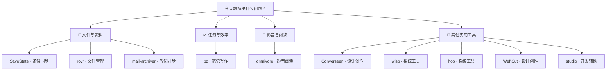

# 每日实用开源精选 · 2026-11-18

10 个实用开源项目。许可证与维护日期来自 GitHub API；中文介绍由 AI 辅助生成，安装前请核对项目说明。

## 🌟 今日首选 · [SaveState](https://github.com/Matteo842/SaveState)

> 游戏没有云存档？拖入启动快捷方式，备份本地进度。

**为什么先试：**Windows 可直接解压运行，备份与恢复的操作明确，适合先解决游戏进度丢失的风险。

**工作流程：**准备游戏启动快捷方式 → 拖入工具并备份存档 → 得到可恢复的存档压缩包

**适用平台：**Windows / Linux

---

## 先按需求找工具

**📁 文件与资料**：[SaveState](https://github.com/Matteo842/SaveState) · [rovr](https://github.com/NSPC911/rovr) · [mail-archiver](https://github.com/s1t5/mail-archiver)

**✅ 任务与效率**：[bz](https://github.com/yeshimei/bz)

**🎵 影音与阅读**：[omnivore](https://github.com/omnivore-app/omnivore)

**🧰 其他实用工具**：[Converseen](https://github.com/Faster3ck/Converseen) · [wisp](https://github.com/SumirSeth/wisp) · [hop](https://github.com/antonyshakirov/hop) · [WeftCut](https://github.com/WeftCut/WeftCut) · [studio](https://github.com/Automattic/studio)

---

## 01 · [Matteo842/SaveState](https://github.com/Matteo842/SaveState)

分类：备份同步

> 游戏没有云存档？拖入启动快捷方式，备份本地进度。

**工作流程：**准备游戏启动快捷方式 → 拖入工具并备份存档 → 得到可恢复的存档压缩包

面向游戏存档的图形化备份工具。可通过拖入游戏启动快捷方式查找存档位置，并将存档备份为 ZIP；支持恢复、保留多个备份版本，云端同步可选。

- 平台：Windows、Linux
- 费用：资料称软件免费；可选云存储的费用待核实
- 安装：Windows 下载压缩包解压运行，也可通过 WinGet 安装；较容易
- 注意：自动查找存档位置后，首次备份应核对找到的文件夹；云端同步并非必需。
- [许可证 GPL-3.0](https://github.com/Matteo842/SaveState/blob/main/LICENSE)
- [默认分支最近提交：2026-11-17T18:03:54Z](https://github.com/Matteo842/SaveState/commit/e35cbcf77ace5f1364603273d27385ed974c4320)
- 最近正式发布：[v3.3 · 2026-11-17T11:44:11Z](https://github.com/Matteo842/SaveState/releases/tag/v3.3)
- [安装说明](https://github.com/Matteo842/SaveState/blob/main/README.md)

## 02 · [Faster3ck/Converseen](https://github.com/Faster3ck/Converseen)

分类：设计创作

> 一批照片尺寸不统一？设置目标大小后批量调整。

**工作流程：**准备多张待处理照片 → 设置尺寸并批量转换 → 得到统一尺寸的图片

批量图片处理工具，可一次转换格式、调整尺寸、旋转或翻转多张图片，也能把 PDF 页面转换为图片。

- 平台：Windows、Linux、macOS、FreeBSD
- 费用：资料明确称软件免费
- 安装：按系统下载对应版本；Linux 另有 AppImage、Snap、Flatpak 等方式；较容易
- 注意：批量转换前应确认输出格式、尺寸和文件名设置，避免得到不符合用途的图片。
- [许可证 GPL-3.0](https://github.com/Faster3ck/Converseen/blob/main/COPYING.txt)
- [默认分支最近提交：2026-11-17T17:37:16Z](https://github.com/Faster3ck/Converseen/commit/0a1fc770b8c983e4f2a149830648568232fc8b49)
- 最近正式发布：[v0.15.2.9 · 2026-10-05T16:46:49Z](https://github.com/Faster3ck/Converseen/releases/tag/v0.15.2.9)
- [安装说明](https://github.com/Faster3ck/Converseen/blob/main/README.md)

## 03 · [SumirSeth/wisp](https://github.com/SumirSeth/wisp)

分类：系统工具

> 桌面窗口太多？按快捷键搜索窗口名称并切换。

**工作流程：**记下要找的应用或窗口 → 唤出启动器并搜索 → 打开目标应用或窗口

Windows 11 的快捷启动器，支持搜索并打开应用、文件和已打开的窗口；还提供可选的 Dock，用于展示和切换程序。

- 平台：Windows 11
- 费用：待核实
- 安装：从发布页下载压缩包，解压后运行程序；较容易
- 注意：程序未进行代码签名，可能出现 SmartScreen 提示；默认快捷键也可能与 PowerToys Run 冲突。替换任务栏的 Dock 是可选功能。
- [许可证 MIT](https://github.com/SumirSeth/wisp/blob/main/LICENSE)
- [默认分支最近提交：2026-11-17T18:39:28Z](https://github.com/SumirSeth/wisp/commit/de69c73f646ae5a348d9f2a22b4dbbdb1a24c667)
- 最近正式发布：[v0.8.1 · 2026-11-17T08:51:09Z](https://github.com/SumirSeth/wisp/releases/tag/v0.8.1)
- [安装说明](https://github.com/SumirSeth/wisp/blob/main/README.md)

## 04 · [antonyshakirov/hop](https://github.com/antonyshakirov/hop)

分类：系统工具

> 工作时总忘记休息？从菜单栏启动番茄计时器。

**工作流程：**确定一段专注时间 → 在菜单栏启动计时器 → 获得工作与休息提醒

macOS 菜单栏工具，将计时器、时间记录、保持唤醒、系统监控和剪贴板历史等模块集中在一个面板中，可按需启用。

- 平台：macOS 14 及以上
- 费用：资料明确称软件免费
- 安装：下载 DMG 后将应用拖入“应用程序”，或通过 Homebrew 安装；较容易
- 注意：仅适用于 Mac；剪贴板历史可能包含敏感内容，启用前应考虑隐私需求。
- [许可证 MIT](https://github.com/antonyshakirov/hop/blob/main/LICENSE)
- [默认分支最近提交：2026-11-17T16:36:41Z](https://github.com/antonyshakirov/hop/commit/d5a25f880b3d0947d8c09b19ea1a50337ec3a58a)
- 最近正式发布：[v2.5.2 · 2026-11-16T11:18:25Z](https://github.com/antonyshakirov/hop/releases/tag/v2.5.2)
- [安装说明](https://github.com/antonyshakirov/hop/blob/main/README.md)

## 05 · [NSPC911/rovr](https://github.com/NSPC911/rovr)

分类：文件管理

> 常在终端整理文件？用鼠标选择文件并查看预览。

**工作流程：**准备要整理的文件夹 → 在终端浏览并预览文件 → 找到需要处理的文件

支持鼠标操作的终端文件管理器，可浏览和选择文件，并预览文件、图片及处理压缩包；界面外观可配置。

- 平台：支持 Python 3.13 的系统；资料另提供 Windows 的 Scoop 安装方式
- 费用：待核实
- 安装：可用 pipx、uv 或 pip 安装；Windows 也可用 Scoop，需先具备相应工具；难度中等
- 注意：仍处于公开测试阶段，后续版本可能出现不兼容改动；需要接受终端界面。
- [许可证 MIT](https://github.com/NSPC911/rovr/blob/master/LICENSE)
- [默认分支最近提交：2026-11-17T11:21:14Z](https://github.com/NSPC911/rovr/commit/1e5492c1720b4d4584ac2a15914d6a5b5cfb21c6)
- 最近正式发布：[v0.10.3 · 2026-10-01T11:00:52Z](https://github.com/NSPC911/rovr/releases/tag/v0.10.3)
- [安装说明](https://github.com/NSPC911/rovr/blob/master/README.md)

## 06 · [yeshimei/bz](https://github.com/yeshimei/bz)

分类：笔记写作

> 零散想法总找不到？写进日记本，按月份回看。

**工作流程：**准备当天的想法 → 在日记本记录内容 → 得到按月份整理的日记

Obsidian 插件，提供日记、备忘、网页剪藏和链接收藏等记录入口，也包含阅读记录、复习计划等功能。

- 平台：Obsidian 桌面端及移动端；具体系统兼容性待核实
- 费用：待核实
- 安装：需要先安装 Obsidian；插件的具体安装步骤见项目教程，操作难度待核实
- 注意：不是独立笔记软件，依赖 Obsidian；功能较多，建议先确认自己需要的记录方式。
- [许可证 MIT](https://github.com/yeshimei/bz/blob/master/LICENSE)
- [默认分支最近提交：2026-11-17T18:18:48Z](https://github.com/yeshimei/bz/commit/9ceb3b6781d8c69528e46d8c23d50731ba63a054)
- 最近正式发布：[v1.44.4 · 2026-11-15T07:59:46Z](https://github.com/yeshimei/bz/releases/tag/v1.44.4)
- [安装说明](https://github.com/yeshimei/bz/blob/master/README.md)

## 07 · [WeftCut/WeftCut](https://github.com/WeftCut/WeftCut)

分类：设计创作

> 要剪去视频开头的等待画面？在时间线上裁切片段。

**工作流程：**准备待剪辑的视频素材 → 在时间线上裁切片段 → 导出剪辑后的视频

桌面视频编辑器，提供多轨时间线、片段裁切、字幕、音频混合与导出。也可选用外部 MCP 客户端驱动编辑操作，手动剪辑不依赖该功能。

- 平台：Windows、macOS、Linux
- 费用：资料明确称软件免费；外部 AI 服务费用待核实
- 安装：从发布页下载对应平台安装包；较容易
- 注意：项目仍在积极开发，功能和界面可能变化；macOS 安装包尚未完成验证。
- [许可证 MIT](https://github.com/WeftCut/WeftCut/blob/main/LICENSE)
- [默认分支最近提交：2026-11-17T16:27:21Z](https://github.com/WeftCut/WeftCut/commit/17bff2a4b78bc39fc98ccafa28581ef144d3484f)
- 最近正式发布：[v0.8.1 · 2026-11-17T08:28:46Z](https://github.com/WeftCut/WeftCut/releases/tag/v0.8.1)
- [安装说明](https://github.com/WeftCut/WeftCut/blob/main/README.md)

## 08 · [omnivore-app/omnivore](https://github.com/omnivore-app/omnivore)

分类：影音阅读

> 文章来不及读？保存后再打开，高亮重要段落。

**工作流程：**准备稍后阅读的文章 → 保存文章并标记重点 → 得到可回看的阅读记录

稍后阅读应用，可保存文章，阅读时添加高亮和笔记，也支持搜索、标签及 PDF。提供网页、移动端应用和浏览器扩展。

- 平台：自托管网页端、iOS、Android；提供 Chrome、Safari、Firefox、Edge 扩展
- 费用：软件使用费用待核实；自托管可能产生服务器费用
- 安装：需先按项目指南部署自托管服务，再使用客户端；难度较高
- 注意：原有云服务已停止，不能将安装客户端理解为无需部署即可使用。
- [许可证 AGPL-3.0](https://github.com/omnivore-app/omnivore/blob/main/LICENSE)
- [默认分支最近提交：2026-11-14T12:00:53Z](https://github.com/omnivore-app/omnivore/commit/047503870b3b3568da4776c68bdf029cb5e58476)
- 最近正式发布：[android-0.230.0 · 2026-10-14T14:42:00Z](https://github.com/omnivore-app/omnivore/releases/tag/android-0.230.0)
- [安装说明](https://github.com/omnivore-app/omnivore/blob/main/README.md)

## 09 · [s1t5/mail-archiver](https://github.com/s1t5/mail-archiver)

分类：备份同步

> 旧邮箱邮件难查？归档后按条件搜索往来记录。

**工作流程：**准备要归档的邮箱账号 → 归档邮件并按条件搜索 → 找到可查看或导出的邮件

自托管邮件归档网页应用，可从多个邮箱定期归档邮件，按条件搜索，查看附件，并将邮件导出为 mbox 或打包的 EML。

- 平台：自托管网页应用；服务器系统兼容性待核实
- 费用：软件使用费用待核实；自托管资源费用需自行考虑
- 安装：资料表明支持 Docker 部署；需要配置服务及邮箱连接，难度较高
- 注意：涉及邮箱访问凭据和私人邮件，应妥善限制访问；自动删除邮件是可配置功能，启用前须核对保留策略。
- [许可证 GPL-3.0](https://github.com/s1t5/mail-archiver/blob/main/LICENSE)
- [默认分支最近提交：2026-11-17T18:38:42Z](https://github.com/s1t5/mail-archiver/commit/928ccecea315cb37e21363457ba4e266ab5a2239)
- 最近正式发布：[2611.2 · 2026-11-07T11:53:50Z](https://github.com/s1t5/mail-archiver/releases/tag/2611.2)
- [安装说明](https://github.com/s1t5/mail-archiver/blob/main/README.md)

## 10 · [Automattic/studio](https://github.com/Automattic/studio)

分类：开发辅助

> 改网站又怕影响线上版本？先在本地站点测试。

**工作流程：**准备 WordPress 网站备份 → 导入本地站点并修改 → 得到可检查的本地版本

WordPress 本地开发桌面应用，可创建和管理本地网站、测试主题与插件、导入已有站点备份，并导出站点。基础本地使用无需另行配置 Docker、网页服务器或数据库。

- 平台：Windows、macOS、Linux
- 费用：资料明确称应用免费；可选 AI 功能受服务商额度及计费规则约束
- 安装：下载对应系统的桌面应用；Windows 提供 x64 和 ARM64 版本；较容易
- 注意：分享云端预览需要 WordPress.com 账号；本地建站不必使用 AI 或云端预览。
- [许可证 GPL-2.0](https://github.com/Automattic/studio/blob/trunk/LICENSE.md)
- [默认分支最近提交：2026-11-17T18:10:44Z](https://github.com/Automattic/studio/commit/0f7179ff00ec7251084f9235b546dabe6a73a419)
- 最近正式发布：[v2.2.0 · 2026-11-11T11:51:23Z](https://github.com/Automattic/studio/releases/tag/v2.2.0)
- [安装说明](https://github.com/Automattic/studio/blob/trunk/README.md)

---

## 🏛️ 建筑设计与表达工具

只关注概念方案、形态推敲、参数化造型、建模渲染与图纸表达。按许可证与近期维护核验，排除历史重复；不足 5 个时不凑数。

### [LuxCore](https://github.com/LuxCoreRender/LuxCore)

**这是什么：**这是渲染引擎及其源码，不是从草图开始制作建筑模型的软件。过去要把三维场景呈现为图像，需要另行准备渲染工具并处理光线与材质表现；LuxCoreRender 承担的是读取已配置场景、计算光线并生成渲染结果的环节。仓库还提供程序接口和示例程序，但设计师需要先准备场景，直接使用本仓库也有编译门槛。

**适合谁：**适合制作空间效果图的三维艺术家，以及集成渲染能力的开发者。直接使用本仓库需编译；普通读者不能把源码当成即装即用的建模软件。

**建筑工作示例：**帮助理解的示例：假设你要比较一个室内概念场景的光线呈现，先准备 LuxCore 可读取的场景配置，再按 README 的示例运行 LuxCoreUI 查看场景，或用 LuxCoreConsole 执行渲染。最终得到的是该场景的渲染结果，而不是自动生成的空间方案；场景如何制作仍需另行解决。

**工作流程：**准备可读取的三维场景配置 → 用示例程序打开并渲染场景 → 获得场景渲染结果

- 平台：README 列出 Windows、Linux、macOS Intel 和 macOS Arm 的编译要求。
- 费用：仓库提供源码；实际获取、编译和使用的费用情况，候选资料未完整说明，待核实。
- 安装：这是源码仓库。README 要求对应平台的编译工具，以及 Git、Python 3、Conan、CMake 等；其快速编译示例检出 for\_v2.10 分支，不能据此推定适用于其他版本，具体按构建文档核对。
- 注意：渲染前须有符合工具要求的场景配置；本仓库不负责建筑建模。README 的快速编译示例指定了旧分支，使用其他版本时应核对构建步骤。
- [许可证 Apache-2.0](https://github.com/LuxCoreRender/LuxCore/blob/main/COPYING.txt)
- [最近提交 2026-11-15T18:57:11Z](https://github.com/LuxCoreRender/LuxCore/commit/889e7ae027738e4d522f24591b85c068f01da0c0)
- [项目说明](https://github.com/LuxCoreRender/LuxCore/blob/main/README.md)

### [krita](https://github.com/KDE/krita)

**这是什么：**这是一款独立的数字绘画软件，面向希望从头到尾完成数字美术作品的创作者。原本用纸笔或其他绘画工具逐步表达空间构想时，创作者需要自行绘制和整理画面；Krita 提供在电脑上进行概念绘画、插画、背景及纹理绘制的工作环境。它帮助完成的是视觉表达，不会替你建立三维空间模型或决定设计方案。

**适合谁：**适合建筑与室内概念设计师、效果图绘制者。一般绘画使用不要求编程或自建服务；它不是建筑专用软件。

**建筑工作示例：**帮助理解的示例：假设你要向客户表达一个展厅的空间气氛，先准备手绘构思和参考画面，再用 Krita 绘制概念图，推敲色彩与背景表现。最后交付一张用于沟通视觉方向的数字绘画；空间尺寸、三维模型和图纸仍需在其他工具中处理。

**工作流程：**准备构思草图和视觉参考 → 绘制空间概念画面 → 得到数字概念图

- 平台：候选资料称其为跨平台应用；README 未逐一列明普通用户安装包支持的平台，待核实。
- 费用：README 将 Krita 描述为免费数字绘画应用；具体获取渠道是否收费，候选资料未说明。
- 安装：普通用户应查阅项目网站和用户手册获取安装指引；本仓库 README 另提供开发者构建文档。不要将开发构建或夜间版本视为普通用户的必经安装步骤。
- 注意：GitHub 仓库是镜像，README 指向 KDE 托管的实际代码仓库。它适合绘画表达，不承担三维建模或图纸制作。
- [许可证 GPL-3.0](https://github.com/KDE/krita/blob/master/COPYING)
- [最近提交 2026-11-17T15:17:58Z](https://github.com/KDE/krita/commit/a127065094bf96f997b1de2ea0a4afb50e451faa)
- [项目说明](https://github.com/KDE/krita/blob/master/README.md)

### [darktable](https://github.com/darktable-org/darktable)

**这是什么：**这是一款独立的摄影工作流软件，主要处理相机拍摄的数字照片。过去要从大量原始照片中挑选画面、调整影像再交付，需要分别管理文件和进行后期；darktable 把照片登记在数据库中，提供可缩放的灯箱供浏览，再以非破坏性方式处理 RAW 原始影像并导出。它帮助完成实景照片后期，不会制作三维空间模型。

**适合谁：**适合拍摄室内、展陈或建筑实景的摄影师与设计师；常规使用无需编程或自建服务，但需学习摄影后期操作。

**建筑工作示例：**帮助理解的示例：假设你拍摄了一组已完成的展厅照片，先准备相机的 RAW 文件，在 darktable 灯箱中浏览并挑选画面，进入暗房处理选中的照片，最后导出到本地或远程存储。得到的是整理和处理后的实景照片，不是由空间模型生成的效果图。

**工作流程：**准备室内实景 RAW 照片 → 浏览、挑选并处理照片 → 导出处理后的照片

- 平台：README 列出 Linux、FreeBSD、NetBSD、OpenBSD、Windows 10 及以后版本，以及运行 macOS 15 及以后版本的 Apple Silicon Mac。
- 费用：候选资料称其为开源软件，但未明确各获取渠道的费用，待核实。
- 安装：按 README 的安装章节选择适合系统的正式版本；开发快照和自行编译是不同路径。使用前核对系统及硬件要求。
- 注意：README 提醒不同平台可能存在额外问题，且 Windows 上目前未实现打印支持。它面向摄影后期，不是建筑设计或渲染软件。
- [许可证 GPL-3.0](https://github.com/darktable-org/darktable/blob/master/LICENSE)
- [最近提交 2026-11-17T17:24:23Z](https://github.com/darktable-org/darktable/commit/d7c0b1706661dbef93af2c64837128a7c4558e9f)
- [项目说明](https://github.com/darktable-org/darktable/blob/master/README.md)

### [RawTherapee](https://github.com/RawTherapee/RawTherapee)

**这是什么：**这是一款独立的照片处理软件，重点是把相机 RAW 原始文件处理为可用图像。原本摄影师需要借助专门工具读取相机原始数据，并逐项判断显影效果；RawTherapee 提供较细的解码与显影控制，帮助用户处理 RAW、HDR DNG 及所列普通图像格式。它负责照片处理这一环，不替代照片资产管理，也不生成建筑模型。

**适合谁：**适合拍摄空间实景的设计师、摄影爱好者和摄影师；使用界面无需编程，但愿意学习数字影像基础会更合适。

**建筑工作示例：**帮助理解的示例：假设你为一处室内改造项目拍了相机 RAW 照片，先准备原始文件，在 RawTherapee 中打开并检查显影效果，再根据画面需要调整处理设置，得到用于展示的照片版本。这个例子说明的是实景照片后期，不代表软件能够修改空间设计或自动生成效果图。

**工作流程：**准备相机 RAW 照片 → 打开并调整显影设置 → 得到处理后的照片版本

- 平台：README 称其跨平台，并分别提供 Linux、Windows、macOS 的编译资料。
- 费用：README 称其为自由软件；具体下载安装渠道的费用情况，候选资料未说明，待核实。
- 安装：README 指向项目下载页面供用户获取程序；若需自行编译，分别查阅 Linux、Windows 或 macOS 的 RawPedia 指南。
- 注意：它不以照片资产管理、打印或上传为核心目标。较细的显影控制需要学习；是否支持某台相机的 RAW 文件，应在使用前核对。
- [许可证 GPL-3.0](https://github.com/RawTherapee/RawTherapee/blob/dev/LICENSE)
- [最近提交 2026-11-09T01:10:22Z](https://github.com/RawTherapee/RawTherapee/commit/64c2d90a3248c7ad41842d9162368858b61aac6a)
- [项目说明](https://github.com/RawTherapee/RawTherapee/blob/dev/README.md)

### [chaiNNer](https://github.com/chaiNNer-org/chaiNNer)

**这是什么：**这是一款独立的节点式图像处理程序，不是专为建筑设计制作的软件。过去要对一批效果图反复执行相同的后期操作，用户需要逐张处理或自行编排工具；chaiNNer 让用户把处理步骤表示为节点并连接成可运行的流程。README 展示了图像放大及文件夹批处理，但具体可用操作取决于所配置的依赖和流程。

**适合谁：**适合需要重复处理效果图的视觉设计师；界面操作不要求编程或自建服务，但须理解节点连接，并配置所需依赖。

**建筑工作示例：**帮助理解的示例：假设你已有一批空间效果图，想用相同的放大流程处理它们，先准备图像文件夹和所需处理依赖，在 chaiNNer 中用“Load Images”等节点搭建输入、处理和保存的连接，再运行节点链。最终得到按所建流程处理的图像；放大效果取决于实际选择的模型与设置，并非保证改善细节。

**工作流程：**准备效果图文件夹 → 连接读取、处理和保存节点 → 得到流程处理后的图像

- 平台：README 列出 Windows、macOS 和 Linux。
- 费用：候选资料未说明安装包、处理依赖或模型的具体费用，待核实。
- 安装：从项目发布页面选择适合系统的安装程序。README 说明程序启动时可获取隔离的集成 Python；执行其示例放大流程前，还须通过依赖管理器安装所需神经网络框架。
- 注意：它不会生成空间方案。README 说明同一节点链不能同时使用两个执行批量迭代的输入节点；运行图像放大前也需配置相应依赖。
- [许可证 GPL-3.0](https://github.com/chaiNNer-org/chaiNNer/blob/main/LICENSE)
- [最近提交 2026-11-02T21:16:41Z](https://github.com/chaiNNer-org/chaiNNer/commit/f223edb6abaef9ba0343e025270c92bca7a5ffdf)
- [项目说明](https://github.com/chaiNNer-org/chaiNNer/blob/main/README.md)

---

## 🔥 今日热门

额外 3 项 · 从 GitHub Trending 日榜筛选，排除历史推荐与当天精选，不代表全网热度排名。

[来源：GitHub Trending 日榜](https://github.com/trending?since=daily) ｜ 采集时间：2026-11-17T19:24:47.404Z

### [superpowers](https://github.com/obra/superpowers)

**日榜第 9 位 · 今日新增 598 Star**

**这是什么：**这是一套安装到编程代理中的技能与开发流程，不是独立的编程软件。使用代理开发功能时，用户原本需要自己反复提醒它先确认需求、写计划、做测试和检查；Superpowers 把这些步骤组织成代理可遵循的流程，帮助用户把想法推进到经过确认的设计和实施任务。它仍需要用户提供目标并审核关键决定。

**适合谁：**适合使用编程代理开发软件的程序员或团队；需要现有代理和项目环境，不是普通读者即装即用的应用。

**举个例子：**以下是帮助理解的示例，并非亲测：假设你要给现有项目增加一项功能，先准备项目代码和需求说明，在已安装 Superpowers 的编程代理中提出目标。代理会与你讨论需求、展示设计并制定计划；你确认后，它再按计划处理编码任务并检查结果。

**工作流程：**项目代码与功能目标 → 讨论设计、确认计划并执行 → 代码改动与检查结果

Superpowers 是一套供编程代理使用的开发方法和技能集合。它引导代理先与用户澄清需求、分段确认设计，再制定实施计划；获准执行后，按任务推进编码、检查与评审。README 列出了多种编程代理的安装方式。

- 平台：适用于 README 所列的 Claude Code、Codex、Cursor、Gemini CLI 等编程代理；具体支持方式因代理而异。
- 费用：仓库使用费用及所依赖编程代理的费用，候选资料未说明，待核实；README 另提及可咨询商业支持。
- 安装：需先具备受支持的编程代理，并按对应方式分别安装。例如 Codex CLI 可在 /plugins 中搜索 superpowers 并选择安装；Codex App 可在 Plugins 中安装。使用多个代理时需分别安装。
- 注意：它是开发流程辅助工具，不能替代需求确认和代码评审。不同代理的安装步骤不同；候选 README 在安装说明中途截断，其他细节需查完整文档。
- [许可证 MIT](https://github.com/obra/superpowers/blob/main/LICENSE)
- [最近提交 2026-11-03T22:17:07Z](https://github.com/obra/superpowers/commit/22f0b463e7a5e579904dd6211a520321035526f7)
- 最近正式发布：[v7.0.2 · 2026-11-03T22:17:54Z](https://github.com/obra/superpowers/releases/tag/v7.0.2)
- [项目说明](https://github.com/obra/superpowers/blob/main/README.md)

### [ECC](https://github.com/affaan-m/ECC)

**日榜第 13 位 · 今日新增 902 Star**

**这是什么：**这是一套面向编程代理的工具与配置集合，不是打开就能完成任务的独立软件。开发者使用代理时，原本要分别整理工作规则、技能以及安全等方面的做法；ECC 试图将这些内容集中提供给代理使用。候选资料只展示了简介和部分安装入口，各项功能如何运作、能自动完成哪些工作，仍需查阅完整 README 核实。

**适合谁：**适合已使用编程代理的软件开发者；需要配置代理，普通读者不能将它当作免编程应用直接使用。

**举个例子：**以下是帮助理解的示例，并非亲测：假设你用 Claude Code 维护一个代码项目，先准备项目代码和要处理的问题，再按 README 提示安装 ecc@ecc 插件，在代理中提出开发任务。你可以据此考察它提供的技能与工作规则是否适合项目；具体执行效果需以完整文档和实际检查为准。

**工作流程：**项目代码与开发任务 → 让已配置的代理处理任务 → 待检查的代理工作结果

ECC 面向 Claude Code、Codex、OpenCode、Cursor 等编程代理。候选资料将其描述为涵盖技能、记忆、安全和先研究再开发等内容的工具集，并给出了 Claude Code 插件的安装提示。当前提供的 README 片段主要是项目入口及来源警告，具体功能和各平台操作需查完整文档。

- 平台：项目简介提及 Claude Code、Codex、OpenCode、Cursor 等；各平台的具体支持和安装步骤待核实。
- 费用：候选资料未说明使用费用；插件、关联服务及编程代理是否收费，待核实。
- 安装：README 片段提示 Claude Code 可通过引导安装或原生插件命令安装同一个 ecc@ecc 插件，二选一，不要再叠加完整的手动安装。其他平台步骤待查完整 README。
- 注意：README 警告仅从其列出的官方渠道安装，非官方镜像可能存在风险。当前片段未展示完整功能及配置细节，不宜据此推断安全效果。
- [许可证 MIT](https://github.com/affaan-m/ECC/blob/main/LICENSE)
- [最近提交 2026-11-17T06:41:46Z](https://github.com/affaan-m/ECC/commit/3f14a103a8694e51c1df9a806217a6d0b5f7a6f7)
- 最近正式发布：[v2.2.3 · 2026-10-01T23:00:36Z](https://github.com/affaan-m/ECC/releases/tag/v2.2.3)
- [项目说明](https://github.com/affaan-m/ECC/blob/main/README.md)

### [minimind](https://github.com/jingyaogong/minimind)

**日榜第 14 位 · 今日新增 188 Star**

**这是什么：**这是一套小型语言模型的源码、训练材料和学习教程，不只是一个可直接聊天的模型。想理解模型如何从零训练，学习者原本要自行拼接模型结构、数据处理、训练及评测代码；MiniMind 把这些环节放在同一项目中，供人阅读、运行和修改。训练仍需要编程能力与计算资源，聊天界面只是项目提供的使用方式之一。

**适合谁：**适合学习大模型原理的学生、研究者和开发者；从头训练需要会编程并准备计算资源，普通读者可了解项目但难以直接复现。

**举个例子：**以下是帮助理解的示例，并非亲测：假设你想学习小型语言模型的训练过程，先准备项目所需的数据和计算资源，阅读 MiniMind 的模型结构与训练代码，再按项目流程进行预训练或监督微调。完成后可用其评测或聊天界面观察模型输出，而不必把它视为现成的通用聊天服务。

**工作流程：**训练数据与计算资源 → 运行训练并进行评测 → 模型结果与评测输出

MiniMind 提供小型语言模型的结构代码、分词器、数据和训练链路，供学习者从头理解并实践模型训练。README 涵盖预训练、监督微调等阶段，也列出模型评测、聊天界面及兼容 OpenAI API 协议的服务端。它主要是代码与教程项目，而非面向普通用户的现成聊天产品。

- 平台：基于 PyTorch；README 提及个人 GPU、单机单卡及单机多卡训练，并提供 Streamlit 聊天 Web 界面。具体系统要求待查完整文档。
- 费用：项目 README 称代码免费；实际训练可能产生 GPU 租用、电力或存储费用。文中成本与耗时对应特定硬件和训练阶段，不能当作完整复现的固定费用。
- 安装：需要取得项目代码、配置 PyTorch 等运行环境并准备相应数据与计算资源。候选 README 在具体操作说明前截断，依赖版本、命令和硬件最低要求待查完整文档。
- 注意：README 所述耗时仅针对特定显卡上监督微调一个训练周期，并非从零完成全部训练的保证。模型较小，不宜预设其具备大型商用模型的能力。
- [许可证 Apache-2.0](https://github.com/jingyaogong/minimind/blob/master/LICENSE)
- [最近提交 2026-10-27T06:57:05Z](https://github.com/jingyaogong/minimind/commit/233d00fa068ec2b8c0d4f07b703934d6391a5a73)
- 最近正式发布：[v2 · 2025-10-21T14:37:05Z](https://github.com/jingyaogong/minimind/releases/tag/v2)
- [项目说明](https://github.com/jingyaogong/minimind/blob/master/README.md)
