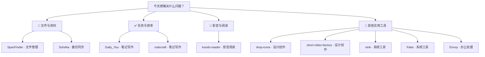

# 每日实用开源精选 · 2026-11-19

10 个实用开源项目。许可证与维护日期来自 GitHub API；中文介绍由 AI 辅助生成，安装前请核对项目说明。

## 🌟 今日首选 · [koodo-reader](https://github.com/koodo-reader/koodo-reader)

> 电子书散落在电脑里？导入书库，集中阅读并标记重要段落。

**为什么先试：**覆盖常见阅读格式，Windows 有明确的下载和包管理安装方式，不配置同步也能先从本地书籍开始。

**工作流程：**准备 EPUB 或 PDF 书籍 → 导入书库并高亮段落 → 得到带阅读标记的书籍

**适用平台：**Windows / macOS / Linux / Android / iOS

---

## 先按需求找工具

**📁 文件与资料**：[SpanFinder](https://github.com/LumiBearStudio/SpanFinder) · [Sshd4a](https://github.com/tfonteyn/Sshd4a)

**✅ 任务与效率**：[Daily\_You](https://github.com/Demizo/Daily_You) · [notecraft](https://github.com/AlienTechSoftware/notecraft)

**🎵 影音与阅读**：[koodo-reader](https://github.com/koodo-reader/koodo-reader)

**🧰 其他实用工具**：[drop-icons](https://github.com/genesistoxical/drop-icons) · [short-video-factory](https://github.com/YILS-LIN/short-video-factory) · [oink](https://github.com/oinkvm/oink) · [Pake](https://github.com/tw93/Pake) · [Envoy](https://github.com/regrevia/Envoy)

---

## 01 · [koodo-reader/koodo-reader](https://github.com/koodo-reader/koodo-reader)

分类：影音阅读

> 电子书散落在电脑里？导入书库，集中阅读并标记重要段落。

**工作流程：**准备 EPUB 或 PDF 书籍 → 导入书库并高亮段落 → 得到带阅读标记的书籍

跨平台电子书管理与阅读工具，支持 EPUB、PDF、TXT、漫画压缩包等多种格式，可导入书籍、调整排版，并在阅读时添加书签、笔记和高亮。云端同步与备份是可选功能。

- 平台：Windows、macOS、Linux、Android、iOS、网页
- 费用：软件收费情况待核实；使用第三方云存储等服务可能另有费用
- 安装：可从官网下载桌面版；Windows 也支持 Winget 或 Scoop 安装，难度较低
- 注意：部分 Kindle 格式仅支持无 DRM 文件；同步前需自行选择并配置存储服务。
- [许可证 AGPL-3.0](https://github.com/koodo-reader/koodo-reader/blob/dev/LICENSE)
- [默认分支最近提交：2026-11-19T01:04:33Z](https://github.com/koodo-reader/koodo-reader/commit/6e71c769a5c1e4f156f074fe07234da9b2a57e69)
- 最近正式发布：[v2.4.7 · 2026-11-08T06:44:36Z](https://github.com/koodo-reader/koodo-reader/releases/tag/v2.4.7)
- [安装说明](https://github.com/koodo-reader/koodo-reader/blob/dev/README.md)

## 02 · [LumiBearStudio/SpanFinder](https://github.com/LumiBearStudio/SpanFinder)

分类：文件管理

> 项目文件夹套得太深？用多列视图同时看清各级目录。

**工作流程：**准备一个多层文件夹 → 逐列展开子文件夹 → 找到目标文件及其路径

面向 Windows 的文件浏览器，以多列视图逐级展示文件夹层级，也提供标签页、双栏视图、文件预览和批量重命名，适合经常在深层目录间查找、整理文件的人。

- 平台：Windows
- 费用：待核实
- 安装：README 提供 Microsoft Store 下载入口及 Winget 安装方式，难度较低
- 注意：批量重命名前应先核对规则和目标文件；商店版本的具体收费情况待核实。
- [许可证 GPL-3.0](https://github.com/LumiBearStudio/SpanFinder/blob/main/LICENSE)
- [默认分支最近提交：2026-11-19T01:30:21Z](https://github.com/LumiBearStudio/SpanFinder/commit/02bcb1211914edcd43f2335284a6f0d30b1ee4e4)
- 最近正式发布：[v2.1.0 · 2026-11-15T04:48:04Z](https://github.com/LumiBearStudio/SpanFinder/releases/tag/v2.1.0)
- [安装说明](https://github.com/LumiBearStudio/SpanFinder/blob/main/README.md)

## 03 · [genesistoxical/drop-icons](https://github.com/genesistoxical/drop-icons)

分类：设计创作

> 想用自己的图片做 Windows 图标？拖入图片并转换成 ICO。

**工作流程：**准备一张 PNG 图片 → 拖入窗口并选择尺寸转换 → 得到可用的 ICO 文件

Windows 图片转图标工具。把 PNG、JPG、SVG 等图片拖入窗口，可一次转换多张，并选择图标包含的尺寸及保存位置，适合制作文件夹或快捷方式使用的 ICO 文件。

- 平台：Windows
- 费用：待核实
- 安装：可从 GitHub Releases 获取发行版；具体安装包形式待核实，难度较低
- 注意：README 标示使用 .NET Framework 4.8；转换前留意输出目录和尺寸选项。
- [许可证 MIT](https://github.com/genesistoxical/drop-icons/blob/main/LICENSE)
- [默认分支最近提交：2026-11-19T01:17:06Z](https://github.com/genesistoxical/drop-icons/commit/abf558ddb36ae7e13bcd83b100556c7da63fba8a)
- 最近正式发布：[3.6.1 · 2026-03-15T03:19:56Z](https://github.com/genesistoxical/drop-icons/releases/tag/3.6.1)
- [安装说明](https://github.com/genesistoxical/drop-icons/blob/main/README.md)

## 04 · [Demizo/Daily_You](https://github.com/Demizo/Daily_You)

分类：笔记写作

> 想回顾这周的情绪变化？每天记一段日记并选择心情。

**工作流程：**准备当天经历和心情 → 写日记并标记心情 → 留下可回顾的每日记录

Android 私人日记与心情记录应用，可写文字、添加照片等附件，使用标签整理记录，并查看心情变化。支持离线使用，另有加密备份和可选同步功能。

- 平台：Android
- 费用：README 称无付费墙、账户或订阅；捐赠自愿
- 安装：可通过 F-Droid、IzzyOnDroid 或 GitHub Releases 获取，难度较低
- 注意：换机前应自行确认备份文件及恢复方式；同步不是写日记的必经步骤。
- [许可证 GPL-3.0](https://github.com/Demizo/Daily_You/blob/master/LICENSE.txt)
- [默认分支最近提交：2026-11-19T01:16:59Z](https://github.com/Demizo/Daily_You/commit/97b785b89cc74712d847fca7a923f3e1de04dbd3)
- 最近正式发布：[v3.10.0 · 2026-11-11T01:56:34Z](https://github.com/Demizo/Daily_You/releases/tag/v3.10.0)
- [安装说明](https://github.com/Demizo/Daily_You/blob/master/README.md)

## 05 · [AlienTechSoftware/notecraft](https://github.com/AlienTechSoftware/notecraft)

分类：笔记写作

> 课程资料和随手笔记混在一起？按笔记本、分区和页面整理。

**工作流程：**准备课程笔记和图片 → 按分区建立页面并插入内容 → 得到分类清楚的本地笔记

以笔记本、分区和页面组织内容的本地笔记工具，可在页面中放入文字、图片和附件。笔记以设备上的普通文件夹和文件保存，不要求使用专属账户或同步服务器。

- 平台：Windows、Linux
- 费用：待核实
- 安装：README 提供 GitHub Releases 下载入口；具体安装包形式待核实
- 注意：项目版本仍处早期；本地保存不等于自动备份，重要笔记需自行备份。
- [许可证 Apache-2.0](https://github.com/AlienTechSoftware/notecraft/blob/main/LICENSE-APACHE)
- [默认分支最近提交：2026-11-19T00:15:56Z](https://github.com/AlienTechSoftware/notecraft/commit/200cb141745b72b461ad657c07fffc9f8b185272)
- 最近正式发布：[v0.0.15 · 2026-11-18T17:20:20Z](https://github.com/AlienTechSoftware/notecraft/releases/tag/v0.0.15)
- [安装说明](https://github.com/AlienTechSoftware/notecraft/blob/main/README.md)

## 06 · [YILS-LIN/short-video-factory](https://github.com/YILS-LIN/short-video-factory)

分类：设计创作

> 要为小店商品做短视频？备好分镜素材和主题，合成介绍视频。

**工作流程：**准备商品主题和分镜视频 → 生成文案并合成配音字幕 → 得到商品介绍短视频

用于制作产品介绍等短视频的桌面工具。根据提示词和分镜视频素材生成文案，结合语音、视频与字幕进行合成，并支持批量任务。

- 平台：Windows、macOS、Linux
- 费用：软件及所接入的 AI 服务费用待核实
- 安装：README 指向 GitHub Releases 下载桌面版本；具体安装步骤待核实
- 注意：文案生成使用兼容 OpenAI 的接口，可能需要自行配置服务；字幕特效的多样式支持仍列在路线图中。
- [许可证 AGPL-3.0](https://github.com/YILS-LIN/short-video-factory/blob/main/LICENSE)
- [默认分支最近提交：2026-11-19T01:19:19Z](https://github.com/YILS-LIN/short-video-factory/commit/b81b212f5f4a030debd8161f55e40684864c6666)
- 最近正式发布：[v1.4.0 · 2026-11-09T02:58:47Z](https://github.com/YILS-LIN/short-video-factory/releases/tag/v1.4.0)
- [安装说明](https://github.com/YILS-LIN/short-video-factory/blob/main/README.md)

## 07 · [oinkvm/oink](https://github.com/oinkvm/oink)

分类：系统工具

> 桌上两台电脑总要换鼠标？让一套键鼠控制两台设备。

**工作流程：**准备同一局域网内的两台电脑 → 连接设备并跨屏移动鼠标 → 用一套键鼠操作两台电脑

让局域网内的 Windows 和 Mac 电脑共享键盘、鼠标及触控板的工具，也支持跨设备剪贴板、拖放文件和集中播放设备音频，设备间通信默认加密。

- 平台：Windows 10 1809 及更新版本、Windows 11；macOS 14.2 及更新版本
- 费用：README 称个人及商业使用均无需购买许可
- 安装：从 GitHub Releases 下载各设备对应的安装包并分别安装，难度中等
- 注意：部分旧版 Windows 10 尚未测试；Windows 10 LTSC 可能需先安装 WebView2 Runtime。
- [许可证 GPL-3.0](https://github.com/oinkvm/oink/blob/main/LICENSE)
- [默认分支最近提交：2026-11-19T00:50:15Z](https://github.com/oinkvm/oink/commit/913b817bbf54889a76b793bb9c578af2ab8f341f)
- 最近正式发布：[v0.3.6 · 2026-11-11T23:20:54Z](https://github.com/oinkvm/oink/releases/tag/v0.3.6)
- [安装说明](https://github.com/oinkvm/oink/blob/main/README.md)

## 08 · [tw93/Pake](https://github.com/tw93/Pake)

分类：系统工具

> 常用网页总淹没在标签页里？把它封装成独立桌面窗口。

**工作流程：**准备常用网站的网址 → 将网址构建为桌面应用 → 得到独立打开的网站窗口

把常用网站封装为独立桌面窗口的工具。仓库提供免费命令行版本，也列出部分已制作好的 Windows、macOS 和 Linux 安装包；图形化桌面应用是单独下载的产品。

- 平台：Windows、macOS、Linux
- 费用：仓库中的命令行版本免费；单独的图形化桌面应用费用待核实
- 安装：可下载现成网站安装包直接使用；自制网站应用需安装命令行工具或使用文档所述在线构建，难度因方式而异
- 注意：封装后的网站仍依赖原网站；不要把命令行版本与单独的图形化应用混为一谈。
- [许可证 GPL-3.0](https://github.com/tw93/Pake/blob/main/LICENSE)
- [默认分支最近提交：2026-11-19T01:00:49Z](https://github.com/tw93/Pake/commit/89bbdf32f967178ceb202efa5dcc5a85f90335ce)
- 最近正式发布：[V3.19.0 · 2026-11-14T10:42:36Z](https://github.com/tw93/Pake/releases/tag/V3.19.0)
- [安装说明](https://github.com/tw93/Pake/blob/main/README.md)

## 09 · [tfonteyn/Sshd4a](https://github.com/tfonteyn/Sshd4a)

分类：备份同步

> 想从电脑备份手机文件？在手机开启服务后，通过 SFTP 传到电脑。

**工作流程：**准备手机文件和电脑端 SFTP 客户端 → 连接手机并下载所需文件 → 得到电脑上的文件副本

在 Android 设备上提供 SSH、SFTP、SCP 和经 SSH 使用的 rsync 服务，让电脑通过这些协议访问或备份手机文件。它提供的是连接服务，备份操作仍需由另一端发起。

- 平台：Android 11 及更新版本
- 费用：待核实
- 安装：可从 GitHub Releases 或 IzzyOnDroid 获取，安装后需配置连接与文件权限，难度中等
- 注意：访问手机全部文件需要手动授予特殊权限；应保护 SSH 连接凭据，且不要将服务直接暴露到不可信网络。
- [许可证 GPL-3.0](https://github.com/tfonteyn/Sshd4a/blob/dev/LICENSE)
- [默认分支最近提交：2026-11-18T21:39:15Z](https://github.com/tfonteyn/Sshd4a/commit/46162ce542a8ab84e1f7913f7a64cd58124ef9e4)
- 最近正式发布：[v1.13.2 · 2026-08-14T13:51:55Z](https://github.com/tfonteyn/Sshd4a/releases/tag/v1.13.2)
- [安装说明](https://github.com/tfonteyn/Sshd4a/blob/dev/README.md)

## 10 · [regrevia/Envoy](https://github.com/regrevia/Envoy)

分类：办公处理

> 长视频来不及看？提取指定片段，让 AI 整理带时间点的摘要。

**工作流程：**准备视频链接和关注的问题 → 提取片段并交给 AI 整理 → 得到标注时间点的摘要

将网页、PDF 或视频链接提取为带来源位置的材料，供已配置的 AI 助手继续整理摘要、报告或知识库。视频可使用已有字幕，缺少字幕时可按需安装本地转写组件。

- 平台：提供 Windows PowerShell 及类 Unix 系统安装方式；具体系统兼容范围待核实
- 费用：工具费用待核实；所用 AI 服务可能另行收费
- 安装：从 GitHub Release 获取 Python 包，或按文档接入支持的 AI 宿主；需配置运行环境，浏览器和转写组件按需另装，难度较高
- 注意：需要配合支持的 AI 宿主使用；登录限制、网络限制及未读取到的视频片段不会被自动补全。
- [许可证 Apache-2.0](https://github.com/regrevia/Envoy/blob/main/LICENSE)
- [默认分支最近提交：2026-11-19T01:30:29Z](https://github.com/regrevia/Envoy/commit/282616c8a099ee0ee17a5173f4d1dab86d54ec0a)
- 最近正式发布：[v0.1.60 · 2026-11-17T06:12:35Z](https://github.com/regrevia/Envoy/releases/tag/v0.1.60)
- [安装说明](https://github.com/regrevia/Envoy/blob/main/README.md)

---

## 🏛️ 建筑设计与表达工具

只关注概念方案、形态推敲、参数化造型、建模渲染与图纸表达。按许可证与近期维护核验，排除历史重复；不足 5 个时不凑数。

### [upscayl](https://github.com/upscayl/upscayl)

**这是什么：**Upscayl 是独立的 AI 图像放大软件，不是建筑建模或渲染工具。过去把低分辨率效果图用于展板或汇报时，通常需要重新渲染、手工修补，或依赖在线放大服务；它通过图像放大和增强模型完成其中的清晰度提升工作，帮助设计师把已有图片处理到更适合展示的尺寸。

**适合谁：**适合建筑设计师、效果图后期和作品集制作者。无需编程，可直接使用桌面界面，但需要兼容 Vulkan 的显卡。

**建筑工作示例：**假设你要把一张低分辨率的建筑概念效果图放进作品集：准备原始图片，在 Upscayl 中选择图像放大和增强处理，导出更大尺寸的版本，再用于排版。此例仅帮助理解，不代表亲测结果。

**工作流程：**准备低分辨率效果图 → 选择图像并执行 AI 放大 → 得到更大尺寸的增强图像

- 平台：Linux、macOS、Windows；需要 Vulkan 兼容 GPU，部分集成显卡可能不支持。
- 费用：README 将其描述为免费且开源；具体使用费用以项目页面和发行版本说明为准。
- 安装：从项目 Releases 下载对应系统版本。Linux 提供 Flathub 安装方式；运行前确认设备具备 Vulkan 兼容显卡。具体安装选项以 README 的系统分节为准。
- 注意：README 明确要求 Vulkan 兼容 GPU，许多集成显卡可能无法工作。它主要改善已有图像，不会替代建模、渲染或重新设计。
- [许可证 AGPL-3.0](https://github.com/upscayl/upscayl/blob/main/LICENSE)
- [最近提交 2026-03-27T16:33:02Z](https://github.com/upscayl/upscayl/commit/a00d55fee90e0f9435d5eaa86e76700df8199af8)
- [项目说明](https://github.com/upscayl/upscayl/blob/main/README.md)

### [krita-ai-diffusion](https://github.com/Acly/krita-ai-diffusion)

**这是什么：**Krita AI Diffusion 是 Krita 的插件，不是独立的三维建模软件。过去在概念图中修改局部、补画画面或尝试不同风格，往往要在多个工具间切换并手工处理；它把生成、局部重绘、扩图和参考控制接入 Krita 画布，帮助用户直接围绕现有图像完成概念方案和效果图推敲。

**适合谁：**适合建筑概念设计师、效果图后期和视觉设计师。需要会使用 Krita；不要求编程，但本地运行涉及模型和显卡配置。

**建筑工作示例：**假设你要探索一个建筑入口的不同立面表达：准备一张带线稿或草图的 Krita 画布，框选入口区域并输入文字描述，使用参考图或控制条件生成多个版本，最后在画布中继续绘制和整理。此例仅帮助理解，不代表亲测结果。

**工作流程：**准备 Krita 画布和参考图 → 框选区域并输入描述 → 得到可继续编辑的生成结果

- 平台：Windows、Linux、macOS；Krita 5.2.0 或更新版本。NVIDIA、AMD、Intel GPU、Apple Silicon 和 CPU 均有支持路径。
- 费用：README 描述本地开源且可免费使用，同时提供云端生成选项；云端具体费用未在候选资料中说明，待核实。
- 安装：先安装 Krita 5.2.0 或更新版本，再下载插件 ZIP，在 Krita 中通过 Tools ▸ Scripts ▸ Import Python Plugin from File 导入，重启后从 Settings ▸ Dockers 打开 AI Image Generation，并完成配置。
- 注意：本地运行建议至少 6 GB NVIDIA 显存，CPU 可用但很慢。插件使用 ComfyUI 后端，连接自定义服务器时还需准备兼容的模型和扩展。
- [许可证 GPL-3.0](https://github.com/Acly/krita-ai-diffusion/blob/main/LICENSE)
- [最近提交 2026-10-03T10:51:45Z](https://github.com/Acly/krita-ai-diffusion/commit/828b70c33c5c97f326e03170cd693beef798231e)
- [项目说明](https://github.com/Acly/krita-ai-diffusion/blob/main/README.md)

### [ComfyUI](https://github.com/Comfy-Org/ComfyUI)

**这是什么：**ComfyUI 是带节点图界面的 AI 内容生成软件与后端，不是建筑设计软件或三维 CAD。过去使用生成模型时，用户通常需要在脚本、参数面板或多个工具之间手工串联步骤；它把模型加载、提示词、图像处理、遮罩和输出连接成可视化流程，让设计师能保存、复用并逐步调整概念图和效果图生成过程。

**适合谁：**适合希望精细控制 AI 概念图和后期流程的设计师。基础工作流可不编程，但节点、模型和显卡配置需要学习；不属于即装即用的建筑软件。

**建筑工作示例：**假设你要从一张体块草图探索建筑外观：准备草图、文字描述和可用模型，在节点图中连接输入图、提示词、控制条件与输出节点，运行后比较不同结果并保存工作流。此例仅帮助理解，不代表亲测结果。

**工作流程：**准备草图、提示词和模型 → 连接节点并运行工作流 → 得到可复用的图像结果

- 平台：Windows、Linux、macOS；可本地桌面运行、手动安装或使用云端。手动安装支持 NVIDIA、AMD、Intel、Apple Silicon 等 GPU 类型。
- 费用：README 提供本地运行方式，并明确 Comfy Cloud 为官方付费云版本；本地硬件、模型和具体云端价格未在候选资料中完整说明。
- 安装：可选择 Windows 或 macOS 桌面应用，也可按 README 手动安装；另有云端版本。运行本地工作流前，需要准备相应模型和硬件环境，具体步骤以官方安装文档为准。
- 注意：节点工作流和模型配置有一定学习门槛，不应视为建筑建模软件。不同模型、显存和节点组合会影响可用性；云端版本为付费服务。
- [许可证 GPL-3.0](https://github.com/Comfy-Org/ComfyUI/blob/master/LICENSE)
- [最近提交 2026-11-18T21:41:27Z](https://github.com/Comfy-Org/ComfyUI/commit/a277b5bf213e8a44fa34817b7770b54f86ef4cea)
- [项目说明](https://github.com/Comfy-Org/ComfyUI/blob/master/README.md)

### [sverchok](https://github.com/nortikin/sverchok)

**这是什么：**Sverchok 是 Blender 插件和节点式视觉编程工具，不是独立建模软件。过去制作可调参数的复杂形体，常需要手写脚本、反复手工建模，或在多个修改器之间试错；它把几何数据和变换过程组织成节点网络，让用户通过参数、公式和节点连接生成、修改并重复使用三维形态。

**适合谁：**适合建筑师、参数化设计师和 Blender 用户。基础操作可用可视化节点完成，但复杂节点、脚本节点和依赖配置需要编程或技术学习。

**建筑工作示例：**假设你要推敲一组可调节的立面格栅：准备基础曲线或点阵，在 Blender 的 Sverchok 节点中连接分布、变换和网格生成节点，用参数控制间距与形态，输出可继续渲染的三维几何。此例仅帮助理解，不代表亲测结果。

**工作流程：**准备基础曲线或点阵 → 连接几何节点并调整参数 → 生成可继续编辑的三维形体

- 平台：Blender 插件；README 列出 Blender 5.1、4.5、3.6 和 2.8，另有 Blender 2.79 的特殊安装说明。
- 费用：候选资料未说明具体费用，待核实。
- 安装：下载项目 ZIP，在 Blender 的 Edit \> Preferences \> Add-ons 中选择 Install，启用 Node: Sverchok。部分可选节点还需要 scipy、geomdl、shapely 等额外库，安装方式见项目 Wiki。
- 注意：它依赖 Blender，学习节点式几何编程需要时间。不同节点可能需要额外第三方库；README 还列出若干超出基础功能的扩展能力，应按实际任务核对依赖。
- [许可证 GPL-3.0](https://github.com/nortikin/sverchok/blob/master/LICENSE)
- [最近提交 2026-11-18T18:06:38Z](https://github.com/nortikin/sverchok/commit/0257095a54365575fdd1741c0f9a35c916c4dfe0)
- [项目说明](https://github.com/nortikin/sverchok/blob/master/README.md)

---

## 🔥 今日热门

额外 5 项 · 从 GitHub Trending 日榜筛选，排除历史推荐与当天精选，不代表全网热度排名。

[来源：GitHub Trending 日榜](https://github.com/trending?since=daily) ｜ 采集时间：2026-11-19T01:34:31.311Z

### [CLI-Anything](https://github.com/HKUDS/CLI-Anything)

**日榜第 2 位 · 今日新增 389 Star**

**这是什么：**这是面向开发者的命令行工具及社区接口目录，目标是让智能体通过命令操作其他软件。过去要让智能体使用某款软件，开发者通常需要自行准备可调用的操作接口；它提供制作接口的项目和查找社区接口的途径。命令行接口就是通过输入命令来执行软件操作，具体支持范围应按所选接口核对。

**适合谁：**适合为智能体接入软件的开发者；需要使用命令行，不能当作普通读者即装即用的图形软件。

**举个例子：**以下是假设示例，并非亲测：假设你要让智能体操作一款已有社区接口的软件，先准备目标软件及其使用环境，再到 CLI-Hub 查找对应接口，按目录说明安装并交给智能体调用。最终得到的是一条可通过命令操作该软件的路径；是否支持所需动作，要查看该接口的说明。

**工作流程：**目标软件和希望执行的操作 → 在目录查找并核对对应接口 → 可供智能体调用的命令接口

CLI-Anything 帮助开发者为软件制作命令行接口，让智能体能够通过命令调用软件。README 还介绍了 CLI-Hub，可浏览、安装和管理社区制作的接口；具体软件是否已有可用接口，需要在目录中确认。

- 平台：命令行环境；各社区接口支持的平台取决于对应软件，待核实。
- 费用：项目及社区接口的具体费用、所连接软件的费用，候选资料未说明，待核实。
- 安装：README 给出 CLI-Hub 的安装方式：pip install cli-anything-hub；之后用 cli-hub install <name> 安装选定接口。目标软件及接口的其他要求需另查说明。
- 注意：“让所有软件可供智能体使用”是项目目标，不代表每款软件都已有接口或支持全部操作；所给 README 内容也未提供完整的接口制作步骤。
- [许可证 Apache-2.0](https://github.com/HKUDS/CLI-Anything/blob/main/LICENSE)
- [最近提交 2026-09-22T02:01:28Z](https://github.com/HKUDS/CLI-Anything/commit/34f519533bc175d2fe287ab8316b0dd99bb9cc43)
- 最近正式发布：[v0.4.0 · 2026-06-25T15:17:49Z](https://github.com/HKUDS/CLI-Anything/releases/tag/v0.4.0)
- [项目说明](https://github.com/HKUDS/CLI-Anything/blob/main/README.md)

### [nvm](https://github.com/nvm-sh/nvm)

**日榜第 6 位 · 今日新增 237 Star**

**这是什么：**这是一个命令行版本管理工具，用来在同一用户环境中安装和切换不同版本的 Node.js。Node.js 是运行 JavaScript 程序的环境。过去同时维护要求不同版本的项目时，开发者需要自己处理版本安装和切换；nvm 把这些操作集中到命令中，并允许在当前 shell 中选择要用的版本。

**适合谁：**适合维护 Node.js 项目的开发者；不一定要写脚本，但需会使用终端。普通读者通常没有直接使用需求。

**举个例子：**以下是假设示例，并非亲测：假设你要维护两个分别使用不同 Node.js 版本的项目，先确认各项目要求的版本，再用 nvm 安装所需版本。进入其中一个项目工作前执行 nvm use 切换，并用 node -v 检查当前版本，最终在该终端中使用符合项目要求的 Node.js。

**工作流程：**项目要求的 Node.js 版本 → 用 nvm 选择版本并检查 → 当前终端使用指定版本

nvm 是按用户安装、在命令行中使用的 Node.js 版本管理工具。它可以安装多个 Node.js 版本，并为当前 shell 切换正在使用的版本，适合需要在不同项目之间切换开发环境的人。

- 平台：Unix、macOS 和 Windows WSL 等支持的 shell 环境；不是原生 Windows 工具。
- 费用：候选资料未说明使用费用，待核实。
- 安装：README 建议运行官方安装脚本，也提供手动安装等方式；安装后按文档验证 nvm 命令是否可用。它按用户安装，并在 shell 中调用。
- 注意：nvm 的切换作用于当前 shell；Windows 用户应留意 README 所述的 WSL 使用方式和兼容性说明。
- [许可证 MIT](https://github.com/nvm-sh/nvm/blob/master/LICENSE.md)
- [最近提交 2026-11-16T23:13:13Z](https://github.com/nvm-sh/nvm/commit/ad42d9086090ec3e0c0fed12c74dd7f7f06b7758)
- 最近正式发布：[v0.41.0 · 2026-11-04T21:25:25Z](https://github.com/nvm-sh/nvm/releases/tag/v0.41.0)
- [项目说明](https://github.com/nvm-sh/nvm/blob/master/README.md)

### [uv](https://github.com/astral-sh/uv)

**日榜第 7 位 · 今日新增 258 Star**

**这是什么：**这是一个面向 Python 开发的命令行工具，可统一处理项目依赖、运行环境、脚本和 Python 版本。依赖是程序运行时需要的其他软件包；开发者原本可能分别使用多个工具安装包、创建环境并运行脚本。uv 帮助把这些步骤放进一套命令中，还能用锁文件记录项目所需的依赖版本。

**适合谁：**适合 Python 开发者或运行 Python 脚本的人；需要使用命令行，开发项目通常需要编程。

**举个例子：**以下是假设示例，并非亲测：假设你要建立一个使用 Ruff 检查代码的 Python 项目，先准备项目目录，再用 uv init 初始化、uv add ruff 添加工具，随后执行 uv run ruff check。最终得到已记录依赖的项目，并看到该次代码检查的结果。

**工作流程：**Python 项目与所需软件包 → 添加依赖并运行项目命令 → 依赖记录和命令运行结果

uv 是 Python 包和项目的命令行管理工具，支持管理项目依赖与环境、锁定依赖版本、运行脚本、管理 Python 版本，以及运行作为 Python 包发布的工具。它面向已有 Python 开发任务的人，而非直接完成业务工作的应用。

- 平台：macOS、Linux、Windows。
- 费用：候选资料未说明费用；使用第三方包或相关服务是否收费需另行核实。
- 安装：README 提供 macOS、Linux 和 Windows 的独立安装脚本，也可通过 pip install uv 或 pipx install uv 安装；独立安装方式不要求预先安装 Rust 或 Python。
- 注意：uv 管理开发环境和依赖，不会替你编写项目代码；添加的第三方包及其使用条件需分别确认。
- [许可证 Apache-2.0](https://github.com/astral-sh/uv/blob/main/LICENSE-APACHE)
- [最近提交 2026-11-18T18:50:42Z](https://github.com/astral-sh/uv/commit/469fe6513a86ebb59f64390669a64fd165b65b8a)
- 最近正式发布：[0.13.9 · 2026-11-17T09:57:55Z](https://github.com/astral-sh/uv/releases/tag/0.13.9)
- [项目说明](https://github.com/astral-sh/uv/blob/main/README.md)

### [jquery](https://github.com/jquery/jquery)

**日榜第 11 位 · 今日新增 266 Star**

**这是什么：**这是 JavaScript 开发库，即供其他程序调用的代码，而不是打开后就能操作的独立软件。开发者原本需要自行编写项目中的相关 JavaScript 代码；将库加入项目后，可以调用它提供的能力。所给 README 没有展开这些能力的具体用法，主要介绍版本支持、下载及自行构建，因此不宜把它描述成无须编程的现成工具。

**适合谁：**适合编写或维护 JavaScript 项目的开发者；需要编程，普通读者不能直接把它当成应用使用。

**举个例子：**以下是假设示例，并非亲测：假设你维护一个使用 jQuery 的网页项目，先确认项目现用版本和需要的构建文件，再从项目所指的下载页获取最新版本，或按 README 在源码目录运行构建命令。最终得到可供项目接入的库文件；实际调用方式还需查阅相应文档。

**工作流程：**现有项目和所需库版本 → 确认支持状态并取得库文件 → 供项目接入的 jQuery 文件

jQuery 是供开发者在项目中使用的 JavaScript 库，不是独立应用。所给 README 主要说明获取最新版本、版本支持状态，以及从源码构建标准版或按模块定制版本的方法；具体功能用法需查阅项目文档。

- 平台：浏览器；README 还提到 Node、浏览器扩展及其他非浏览器环境。
- 费用：候选资料未说明库本身的使用费用；README 提及旧版本有第三方商业支持，费用需另查。
- 安装：可从 README 指向的下载页获取最新版本。若自行构建，需准备 Node.js、npm 和 Git，克隆仓库后运行 npm install 与 npm run build；构建文件位于 dist/。
- 注意：README 标明旧分支的支持范围不同，部分已停止支持；升级前应检查现有项目的兼容性。源码构建步骤不等于网页项目的完整接入教程。
- [许可证 MIT](https://github.com/jquery/jquery/blob/main/LICENSE.txt)
- [最近提交 2026-11-17T19:00:42Z](https://github.com/jquery/jquery/commit/effd615f0009e927dfd1f41d04fb6073478076d4)
- 最近正式发布：[4.1.0 · 2026-11-17T18:59:37Z](https://github.com/jquery/jquery/releases/tag/4.1.0)
- [项目说明](https://github.com/jquery/jquery/blob/main/README.md)

### [appwrite](https://github.com/appwrite/appwrite)

**日榜第 12 位 · 今日新增 232 Star**

**这是什么：**这是供开发者构建应用的后端平台，可使用托管云服务，也可自行部署。后端是处理用户账户、数据和文件等工作的服务；开发者原本需要分别搭建或接入这些能力。Appwrite 将身份验证、数据库、存储、函数等功能放在同一平台，并提供让编码智能体连接项目的 MCP 接口，即供智能体调用项目能力的连接方式。

**适合谁：**适合开发应用的团队和开发者；通常需要编程。可用托管云服务，也可自行运行服务器，不是普通读者即装即用的应用。

**举个例子：**以下是假设示例，并非亲测：假设你要开发一个允许用户登录并保存文件的应用，先准备应用项目，选择注册 Appwrite Cloud 或部署自己的实例，再在项目中接入身份验证与文件存储能力。最终应用可以使用平台提供的登录和存储服务；界面与业务流程仍需开发。

**工作流程：**应用项目及账户、文件需求 → 配置验证和存储并接入应用 → 应用可调用的后端能力

Appwrite 为应用提供身份验证、数据库、文件存储、函数、消息、实时事件和托管等后端能力。开发者可选托管的 Appwrite Cloud，也可用 Docker 自建；README 还介绍了供编码智能体连接项目的 MCP 服务。

- 平台：托管云服务；自建可运行在支持 Docker CLI 的操作系统上。
- 费用：README 明确 Appwrite Cloud 有免费方案和付费方案；自建的服务器等资源费用需自行核算，具体价格待核实。
- 安装：最简入门方式是注册 Appwrite Cloud。自建需先安装 Docker，再按 README 对应系统的命令启动安装向导并完成设置。
- 注意：自建安装向导默认仅监听本机，并会输出一次性安装密钥；远程部署应遵循 README 的 SSH 隧道说明，不要直接将安装端口公开。
- [许可证 BSD-3-Clause](https://github.com/appwrite/appwrite/blob/main/LICENSE)
- [最近提交 2026-11-18T22:16:59Z](https://github.com/appwrite/appwrite/commit/e91e636235743d059e401b77efef4e388392d705)
- 最近正式发布：[2.7.3 · 2026-11-17T12:55:27Z](https://github.com/appwrite/appwrite/releases/tag/2.7.3)
- [项目说明](https://github.com/appwrite/appwrite/blob/main/README.md)
