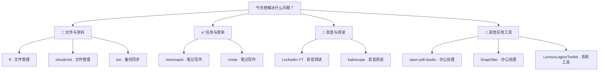

# 每日实用开源精选 · 2026-11-20

10 个实用开源项目。许可证与维护日期来自 GitHub API；中文介绍由 AI 辅助生成，安装前请核对项目说明。

## 🌟 今日首选 · [open-pdf-studio](https://github.com/OpenAEC-Foundation/open-pdf-studio)

> 装修图纸改了哪里？打开两个 PDF 版本，比较修订并标注问题。

**为什么先试：**浏览器里就能试用，Windows 也有安装版；标注和版本比较能解决明确的文档审阅问题。

**工作流程：**准备两个版本的图纸 → 比较修订并标注差异 → 得到带审阅标注的图纸

**适用平台：**Windows / macOS / Linux / Android

---

## 先按需求找工具

**📁 文件与资料**：[lf](https://github.com/gokcehan/lf) · [cloudcmd](https://github.com/coderaiser/cloudcmd) · [kei](https://github.com/rhoopr/kei)

**✅ 任务与效率**：[memospot](https://github.com/memospot/memospot) · [vnote](https://github.com/vnotex/vnote)

**🎵 影音与阅读**：[LockedIn-YT](https://github.com/KartikRashmin/LockedIn-YT) · [kaloscope](https://github.com/kaloscope/kaloscope)

**🧰 其他实用工具**：[open-pdf-studio](https://github.com/OpenAEC-Foundation/open-pdf-studio) · [SnapOtter](https://github.com/snapotter-hq/SnapOtter) · [LenovoLegionToolkit](https://github.com/LenovoLegionToolkit-Team/LenovoLegionToolkit)

---

## 01 · [OpenAEC-Foundation/open-pdf-studio](https://github.com/OpenAEC-Foundation/open-pdf-studio)

分类：办公处理

> 装修图纸改了哪里？打开两个 PDF 版本，比较修订并标注问题。

**工作流程：**准备两个版本的图纸 → 比较修订并标注差异 → 得到带审阅标注的图纸

面向图纸和文档审阅的 PDF 编辑器，可添加标注、按图纸比例测量、比较修订版本并整理页面。浏览器版可直接打开本地 PDF；桌面版另提供打印、OCR 等功能。

- 平台：Windows、macOS、Linux、Android、浏览器
- 费用：资料称免费、无订阅；其他费用待核实
- 安装：浏览器版无需安装；Windows 可下载用户安装包或免安装压缩包，容易上手
- 注意：浏览器版不支持桌面版的 OCR、打印等功能；刷新页面会清空当前打开的文档。
- [许可证 LGPL-3.0](https://github.com/OpenAEC-Foundation/open-pdf-studio/blob/main/LICENSE.md)
- [默认分支最近提交：2026-11-19T23:46:13Z](https://github.com/OpenAEC-Foundation/open-pdf-studio/commit/a7a812498d5b6ec1aef30277f416480e429c221c)
- 最近正式发布：[v2026.47.1 · 2026-11-18T02:37:26Z](https://github.com/OpenAEC-Foundation/open-pdf-studio/releases/tag/v2026.47.1)
- [安装说明](https://github.com/OpenAEC-Foundation/open-pdf-studio/blob/main/README.md)

## 02 · [memospot/memospot](https://github.com/memospot/memospot)

分类：笔记写作

> 临时想到一句话怕忘？离线记成短笔记，之后再翻看。

**工作流程：**准备要记下的想法 → 创建一条本地短笔记 → 得到可回看的记录

将 Memos 的日常短笔记体验做成独立桌面应用。可以离线记录想法，数据保存在本机；需要时也可选择连接远程 Memos 服务。

- 平台：Windows 10、macOS、Linux
- 费用：软件收费情况待核实；远程服务费用待核实
- 安装：从 GitHub Releases 下载对应安装包；Windows 可能需要补装 WebView2，难度较低
- 注意：Windows 版本未进行数字签名，可能触发 SmartScreen 警告；安装前应核对下载来源，并自行备份本地数据。
- [许可证 BlueOak-1.0.0](https://github.com/memospot/memospot/blob/main/LICENSE.md)
- [默认分支最近提交：2026-11-19T04:33:33Z](https://github.com/memospot/memospot/commit/ff0290df354e2309c2bc6cea221b9dabf2ed7a15)
- 最近正式发布：[v1.0.5 · 2026-10-10T19:39:20Z](https://github.com/memospot/memospot/releases/tag/v1.0.5)
- [安装说明](https://github.com/memospot/memospot/blob/main/README.md)

## 03 · [vnotex/vnote](https://github.com/vnotex/vnote)

分类：笔记写作

> 学习笔记散在多个文档里？用 Markdown 整理并随时预览排版。

**工作流程：**准备课程要点 → 编写并预览 Markdown 笔记 → 得到整理好的学习笔记

跨平台笔记应用，支持管理、编辑和预览 Markdown 笔记，也能编辑纯文本、Typst 文档和思维导图，并内置 PDF 阅读器。

- 平台：Windows、macOS、Linux
- 费用：资料明确称软件免费
- 安装：从项目的稳定版发布页下载对应版本；需满足 Qt 6.9 及以上要求，安装难度待核实
- 注意：不支持 Windows 7；具体发布包是否已包含所需 Qt 组件，资料未说明。
- [许可证 LGPL-3.0](https://github.com/vnotex/vnote/blob/master/COPYING.LESSER)
- [默认分支最近提交：2026-11-18T17:05:00Z](https://github.com/vnotex/vnote/commit/e2ada1279c15a9b3478070f0e942052f41e8ce78)
- 最近正式发布：[v4.15.0 · 2026-11-19T06:34:36Z](https://github.com/vnotex/vnote/releases/tag/v4.15.0)
- [安装说明](https://github.com/vnotex/vnote/blob/master/README.md)

## 04 · [snapotter-hq/SnapOtter](https://github.com/snapotter-hq/SnapOtter)

分类：办公处理

> 扫描的 PDF 不方便检索？在自己的服务器上运行 OCR 提取文字。

**工作流程：**准备扫描版 PDF → 在网页界面运行 PDF OCR → 得到识别后的文档

自托管的多格式文件处理工具，提供网页界面处理 PDF、图片、视频和音频。资料列出的操作包括 PDF 合并与 OCR、图片格式转换和压缩、音视频转换等。

- 平台：支持 AMD64、ARM64 的 Docker 主机；通过浏览器使用
- 费用：资料称软件免费；运行设备和资源成本需自行承担
- 安装：安装 Docker 后可用单容器启动，再通过浏览器访问；需要基本的容器使用能力
- 注意：快速启动示例使用默认管理员账号和密码，使用前必须更改；部分 AI 功能可能需要额外资源。
- [许可证 AGPL-3.0](https://github.com/snapotter-hq/SnapOtter/blob/main/LICENSE)
- [默认分支最近提交：2026-11-20T01:12:11Z](https://github.com/snapotter-hq/SnapOtter/commit/d0a3713bf86dfdfb5a11dcb5e9a945d50d4b6731)
- 最近正式发布：[v2.3.0 · 2026-11-03T12:30:14Z](https://github.com/snapotter-hq/SnapOtter/releases/tag/v2.3.0)
- [安装说明](https://github.com/snapotter-hq/SnapOtter/blob/main/README.md)

## 05 · [KartikRashmin/LockedIn-YT](https://github.com/KartikRashmin/LockedIn-YT)

分类：影音阅读

> 上 YouTube 查教程总被推荐视频带跑？隐藏推荐区再观看。

**工作流程：**准备要看的教程链接 → 隐藏推荐内容并播放教程 → 得到干扰更少的观看页面

用于 YouTube 的浏览器扩展，可分别隐藏首页信息流、Shorts、推荐视频和评论等干扰内容，也提供关闭自动播放的选项。

- 平台：Chrome、Firefox、Edge 浏览器；桌面操作系统待核实
- 费用：收费情况待核实
- 安装：资料提供 Chrome、Firefox 和 Edge 扩展商店入口；从对应商店安装，难度较低
- 注意：隐藏内容的效果依赖 YouTube 页面结构；关闭某些区域后，相关内容也可能不便查找。
- [许可证 AGPL-3.0](https://github.com/KartikRashmin/LockedIn-YT/blob/main/LICENSE)
- [默认分支最近提交：2026-11-20T00:46:19Z](https://github.com/KartikRashmin/LockedIn-YT/commit/c0094cdea3773c1bfa4f424cdcf592a3fa049616)
- 最近正式发布：[v1.2.5 · 2026-11-20T00:46:54Z](https://github.com/KartikRashmin/LockedIn-YT/releases/tag/v1.2.5)
- [安装说明](https://github.com/KartikRashmin/LockedIn-YT/blob/main/README.md)

## 06 · [kaloscope/kaloscope](https://github.com/kaloscope/kaloscope)

分类：影音阅读

> 本地影视资料难整理？建立工作流，刮削信息后收入媒体库。

**工作流程：**准备已有的影视文件 → 配置刮削与入库工作流 → 得到便于浏览的媒体库

本地媒体库管理工具，利用可视化工作流串联资源搜索、下载、元数据整理、入库和在线播放。还提供查看媒体与下载状态的 AI 助手。

- 平台：自托管服务及浏览器；宿主系统支持情况待核实
- 费用：软件收费情况待核实；外接 AI 服务可能产生费用
- 安装：资料提供 Docker 镜像和部署文档；需自行部署服务并配置工作流，难度较高
- 注意：下载资源时应确认来源和使用权限；AI 功能需另行配置模型服务。
- [许可证 GPL-3.0](https://github.com/kaloscope/kaloscope/blob/main/LICENSE)
- [默认分支最近提交：2026-11-19T23:40:13Z](https://github.com/kaloscope/kaloscope/commit/26eabf605481144acb83952537ebed1b1cd9e04b)
- 最近正式发布：[v1.1.1 · 2026-11-19T05:25:54Z](https://github.com/kaloscope/kaloscope/releases/tag/v1.1.1)
- [安装说明](https://github.com/kaloscope/kaloscope/blob/main/README.md)

## 07 · [gokcehan/lf](https://github.com/gokcehan/lf)

分类：文件管理

> 经常在终端里切换文件夹？用键盘浏览目录并选取文件。

**工作流程：**准备要整理的目录 → 在终端浏览并选取文件 → 找到需要操作的文件

运行在终端中的跨平台文件管理器，提供文件浏览界面、可配置快捷键和异步文件操作。它采用单文件程序形式，也能通过命令扩展。

- 平台：Windows、macOS、Linux、BSD
- 费用：收费情况待核实
- 安装：可从 Releases 获取预编译程序；也可使用 Go 编译安装。需要熟悉终端，入门有一定门槛
- 注意：它不提供内置文本编辑器，也没有内置标签页；部分文件操作依赖系统命令。
- [许可证 MIT](https://github.com/gokcehan/lf/blob/master/LICENSE)
- [默认分支最近提交：2026-11-19T22:51:06Z](https://github.com/gokcehan/lf/commit/8b8780299a834a589c4bcfdc54e59164bef89c8b)
- 最近正式发布：[r42 · 2026-07-31T07:16:17Z](https://github.com/gokcehan/lf/releases/tag/r42)
- [安装说明](https://github.com/gokcehan/lf/blob/master/README.md)

## 08 · [coderaiser/cloudcmd](https://github.com/coderaiser/cloudcmd)

分类：文件管理

> 想在浏览器里查看服务器文件？启动服务后打开网页浏览目录。

**工作流程：**准备需要查看的主机目录 → 在网页中浏览目录和文件 → 找到所需文件

通过浏览器使用的文件管理器，带有文件浏览、编辑器和控制台。启动本地服务后，可在网页中访问主机上授权给它的目录。

- 平台：运行 Node.js 的系统；Docker 镜像资料列出 Linux AMD64、ARM64；浏览器访问
- 费用：收费情况待核实
- 安装：可用 npm 全局安装并启动，也可运行 Docker 镜像；需要 Node.js 或 Docker，难度中等
- 注意：Docker 示例会挂载主机目录；部署时应限制可访问的目录，并避免将服务直接暴露到公网。
- [许可证 MIT](https://github.com/coderaiser/cloudcmd/blob/master/LICENSE)
- [默认分支最近提交：2026-11-19T21:52:02Z](https://github.com/coderaiser/cloudcmd/commit/7274521b3293985f967d9a4ada4fa57634de74a5)
- 最近正式发布：[v19.23.2 · 2026-11-15T20:35:56Z](https://github.com/coderaiser/cloudcmd/releases/tag/v19.23.2)
- [安装说明](https://github.com/coderaiser/cloudcmd/blob/master/README.md)

## 09 · [rhoopr/kei](https://github.com/rhoopr/kei)

分类：备份同步

> 担心云端照片只有一份？把 iCloud 照片下载到自己的硬盘。

**工作流程：**准备 iCloud 照片账号和目标文件夹 → 选择范围并运行照片备份 → 得到本地照片副本

用于将 iCloud 照片和视频备份到自选文件夹的命令行工具，支持相簿、实况照片、RAW 文件和中断后继续下载，也可检查已有文件以减少重复下载。

- 平台：Windows、macOS、Linux；也可在支持 Docker 的设备上运行
- 费用：工具收费情况待核实；存储空间等成本需自行承担
- 安装：Windows 可从 Releases 下载程序并在终端运行；需要配置目标文件夹和 Apple 账号，难度中等
- 注意：要求关闭 iCloud 高级数据保护，这会改变相关数据的保护方式；不愿关闭该功能的用户不适用。项目仍处于预发布阶段。
- [许可证 MIT](https://github.com/rhoopr/kei/blob/main/LICENSE)
- [默认分支最近提交：2026-11-20T01:05:38Z](https://github.com/rhoopr/kei/commit/213ef55573c0dd3ec3c5a33c948caa585bee518b)
- 最近正式发布：[v0.26.0 · 2026-10-23T17:30:45Z](https://github.com/rhoopr/kei/releases/tag/v0.26.0)
- [安装说明](https://github.com/rhoopr/kei/blob/main/README.md)

## 10 · [LenovoLegionToolkit-Team/LenovoLegionToolkit](https://github.com/LenovoLegionToolkit-Team/LenovoLegionToolkit)

分类：系统工具

> 想调整 Legion 笔记本的电池设置？在一个桌面工具里查看相关选项。

**工作流程：**准备受支持的 Legion 笔记本 → 打开电池页面调整设置 → 得到所需的设备配置

面向联想 Legion 游戏笔记本的 Windows 桌面管理工具，用于集中查看和调整设备相关设置。资料展示了电池、键盘与灯光、显示等页面，可作为同类预装管理软件的替代选择。

- 平台：Windows 10、11，x64；适用设备为受支持的联想游戏笔记本
- 费用：收费情况待核实
- 安装：资料提供 GitHub Releases 入口；具体安装包类型与安装步骤待核实
- 注意：并非联想官方项目；安装前应核对笔记本型号及功能兼容情况。
- [许可证 GPL-3.0](https://github.com/LenovoLegionToolkit-Team/LenovoLegionToolkit/blob/master/LICENSE)
- [默认分支最近提交：2026-11-19T20:27:53Z](https://github.com/LenovoLegionToolkit-Team/LenovoLegionToolkit/commit/ab16eb1b7972eee998cd845a7ca0b2c5c5e67997)
- 最近正式发布：[v2.38.0.0 · 2026-11-19T20:44:33Z](https://github.com/LenovoLegionToolkit-Team/LenovoLegionToolkit/releases/tag/v2.38.0.0)
- [安装说明](https://github.com/LenovoLegionToolkit-Team/LenovoLegionToolkit/blob/master/README.md)

---

## 🏛️ 建筑设计与表达工具

暂无通过核验且未重复的建筑工具，不凑数。

---

## 🔥 今日热门

额外 5 项 · 从 GitHub Trending 日榜筛选，排除历史推荐与当天精选，不代表全网热度排名。

[来源：GitHub Trending 日榜](https://github.com/trending?since=daily) ｜ 采集时间：2026-11-20T01:33:26.780Z

### [firecrawl](https://github.com/firecrawl/firecrawl)

**日榜第 6 位 · 今日新增 825 Star**

**这是什么：**这是将网站内容整理成可供程序或 AI 助手使用的数据的工具。原本要逐页打开网页、复制正文并清理页面杂项，现在可以用命令抓取单页或遍历站点，得到 Markdown 文件。Markdown 是便于阅读和后续处理的纯文本格式。本地版在自己的电脑运行，更多搜索与数据来源能力则依赖云服务。

**适合谁：**适合整理网站资料的开发者和研究人员；命令行可直接用，不一定要编程，自建服务器需要运维能力。

**举个例子：**以下是假设示例，并非亲测：假设你要整理一份产品文档，先准备文档站网址，再用本地版的 crawl 命令指定该网址、页面数量上限和输出目录。工具会按页面保存 Markdown 文件，供你阅读或交给其他程序处理。

**工作流程：**准备网站或具体网页网址 → 抓取单页或遍历站点 → 获得页面文本或网址列表

Firecrawl 提供本地工具、托管云服务和可自行部署的服务器，用于抓取网页、遍历网站并整理内容。本地版可输出 Markdown、列出站点网址，也能作为工具接入部分 AI 助手；云服务另提供搜索等能力。

- 平台：本地版运行于具备 Rust 和 C 编译器的电脑；云服务通过网络使用；服务器可自行部署。
- 费用：本地版的使用费用及云服务具体价格，所给 README 片段未说明，待核实；自行部署还需考虑基础设施成本。
- 安装：本地版需先安装 Rust 和 C 编译器，再运行 cargo install firecrawl-local。也可按 README 使用云端 CLI 抓取，无须编译本地版；自行部署完整服务器的步骤待查阅项目文档。
- 注意：本地版处理需运行 JavaScript 的页面时要有 Chrome 或 Chromium；没有浏览器仍可处理静态页，但相关页面会返回警告。搜索等部分工具会访问云服务。
- [许可证 AGPL-3.0](https://github.com/firecrawl/firecrawl/blob/main/LICENSE)
- [最近提交 2026-11-20T01:23:53Z](https://github.com/firecrawl/firecrawl/commit/484be117975ac7b8be085c25f1fbd54d005f17ff)
- 最近正式发布：[v2.11.0 · 2026-06-19T15:09:30Z](https://github.com/firecrawl/firecrawl/releases/tag/v2.11.0)
- [项目说明](https://github.com/firecrawl/firecrawl/blob/main/README.md)

### [nginx](https://github.com/nginx/nginx)

**日榜第 7 位 · 今日新增 73 Star**

**这是什么：**这是安装在服务器上的独立软件，不是面向普通读者的网页应用。原本网站管理者需要分别处理网页访问、把请求送到后端程序、分配流量及缓存内容等工作；NGINX 将这些功能集中在可配置的服务器软件中。反向代理指由它先接收访问请求，再转交给实际处理请求的服务。

**适合谁：**适合网站运维人员和后端开发者；需要会配置及管理服务器，普通读者不能直接拿来浏览内容。

**举个例子：**以下是假设示例，并非亲测：假设你维护一个已有后端程序的网站，先准备服务器、后端服务地址和所需证书，再按文档配置 NGINX 接收访问请求并转发给后端。配置完成后，访问者通过 NGINX 进入网站，后端继续处理业务请求。

**工作流程：**准备站点地址和后端地址 → 配置请求转发规则 → 访问请求到达后端服务

NGINX 是服务器软件，可提供网页、将请求转发给后端程序，并承担负载均衡、内容缓存等工作。它通过配置文件控制这些行为，适合部署和维护网站或网络服务。

- 平台：README 称主要操作系统及 Linux 发行版有安装包；具体兼容范围需查官方支持列表。
- 费用：README 明确 NGINX 开源版免费；企业发行版、商业支持和培训另有提供，具体费用待核实。
- 安装：可按官方文档安装相应系统的二进制包，或从仓库源码编译；README 建议使用官方软件包或本仓库源码。安装后仍需编写并检查配置。
- 注意：部署网站涉及服务器配置和证书管理；模块可用情况取决于所装版本或编译选项，具体指令应查官方文档。
- [许可证 BSD-2-Clause](https://github.com/nginx/nginx/blob/master/LICENSE)
- [最近提交 2026-11-18T16:40:13Z](https://github.com/nginx/nginx/commit/2e8440bcdc438f0f1cd03da778a3843ddb3c86d9)
- 最近正式发布：[release-1.31.9 · 2026-11-18T15:54:06Z](https://github.com/nginx/nginx/releases/tag/release-1.31.9)
- [项目说明](https://github.com/nginx/nginx/blob/master/README.md)

### [openvino](https://github.com/openvinotoolkit/openvino)

**日榜第 8 位 · 今日新增 246 Star**

**这是什么：**这是供开发者使用的 AI 模型优化与部署工具包，并非自带完整业务界面的聊天或识图软件。原本把训练好的模型放到实际设备运行，需要处理模型转换、运行环境和设备适配；OpenVINO 提供相关能力，让开发者将已有模型接入应用并执行推理。推理就是用训练完成的模型处理新输入、得到结果。

**适合谁：**适合开发图像、语音或文本应用的工程师；需要编程并准备模型，普通读者不能安装后直接完成业务任务。

**举个例子：**以下是假设示例，并非亲测：假设你要在应用中运行一个已有的图像识别模型，先准备模型文件及待处理图片，再参照 OpenVINO 的入门示例转换或加载模型并编写推理代码。运行后，应用得到模型对图片的输出，供后续业务逻辑使用。

**工作流程：**准备已有模型和待处理数据 → 加载模型并执行推理 → 取得模型处理结果

OpenVINO 帮助开发者优化并运行已有的深度学习模型，覆盖图像、语音和文本等任务。它支持多种训练框架产生的模型，可面向受支持的 CPU、Intel GPU 和 Intel NPU 部署。

- 平台：支持 x86、ARM CPU，Intel 集成或独立 GPU，以及 Intel NPU；具体设备与系统要求需查项目文档。
- 费用：所给 README 未说明部署及配套资源的全部费用，待核实；运行设备与基础设施成本需另计。
- 安装：README 给出的 Python 快速安装命令是 pip install -U openvino；安装后可导入 openvino 检查版本，并按文档核对系统和设备要求。
- 注意：它负责模型运行环节，不替代模型训练或应用开发；不同模型及设备的支持细节应查兼容性文档。
- [许可证 Apache-2.0](https://github.com/openvinotoolkit/openvino/blob/master/LICENSE)
- [最近提交 2026-11-19T21:42:36Z](https://github.com/openvinotoolkit/openvino/commit/c64f0fe07bbede1c83fba898c886e3c56b0543e0)
- 最近正式发布：[2026.4.1 · 2026-10-01T13:45:59Z](https://github.com/openvinotoolkit/openvino/releases/tag/2026.4.1)
- [项目说明](https://github.com/openvinotoolkit/openvino/blob/master/README.md)

### [diagram-design](https://github.com/cathrynlavery/diagram-design)

**日榜第 9 位 · 今日新增 271 Star**

**这是什么：**这是安装到兼容 AI 助手中的绘图技能，不是独立运行的画图软件。原本要自行选择图表形式、摆放元素并制作可展示的文件；使用它时，你向助手描述结构或关系，助手按技能说明生成可在浏览器打开的图。HTML 是网页文件格式，SVG 是其中用于绘制清晰图形的格式。

**适合谁：**适合需要架构图、流程图等图示的产品、设计及开发人员；使用须有兼容 AI 助手，不一定要会编程。

**举个例子：**以下是假设示例，并非亲测：假设你要向同事说明应用结构，先列出前端、后端、数据库和缓存之间的关系，再在已安装该技能的 AI 助手中用自然语言提出绘图请求。助手据此生成一个 HTML 文件，你可以在浏览器中打开查看图示。

**工作流程：**准备组件及其关系说明 → 向兼容助手提出绘图请求 → 获得可打开的图表文件

diagram-design 是供支持 Agent Skills 的 AI 助手调用的绘图技能。用户描述要表达的内容后，助手可选择图表类型并生成一个包含 HTML 和 SVG 的文件；README 还介绍了按网站配色和字体调整图表的方式。

- 平台：适用于 README 列出的支持 Agent Skills 的助手，包括 Claude Code、Codex、Cursor 等；生成的 HTML 可用浏览器打开。
- 费用：所给 README 未说明技能使用费或所选 AI 助手的费用，待核实。
- 安装：在兼容的助手环境中运行 npx skills add cathrynlavery/diagram-design；Claude Code 另有 README 所列的插件市场安装方式。
- 注意：它依赖兼容的 AI 助手；从网站读取配色和字体会涉及网络访问，具体数据行为应查项目隐私说明。
- [许可证 MIT](https://github.com/cathrynlavery/diagram-design/blob/main/LICENSE)
- [最近提交 2026-11-19T00:17:04Z](https://github.com/cathrynlavery/diagram-design/commit/d74d8c2d0c78a9e1efd43137f6a9a51182a8b5f0)
- 最近正式发布：无正式 Release
- [项目说明](https://github.com/cathrynlavery/diagram-design/blob/main/README.md)

### [opensre](https://github.com/Tracer-Cloud/opensre)

**日榜第 13 位 · 今日新增 38 Star**

**这是什么：**这是用于排查自动构建与测试失败的命令行代理，不是给普通用户修电脑的软件。原本工程师要打开失败记录、读日志、验证猜测并修改代码；OpenSRE 尝试接手其中的调查与修复准备工作，将结果交给人审查。命令行代理指在终端中运行、能按任务执行一系列操作的 AI 工具。

**适合谁：**适合维护代码仓库和自动化测试的开发者、运维人员；需要会用终端，完整工作流建议有 Git 仓库。

**举个例子：**以下是假设示例，并非亲测：假设代码仓库的一次自动测试失败，先准备该项目及失败任务的访问条件，再在项目终端启动 OpenSRE，让它读取失败记录、分析原因并尝试准备修复。最终由开发者检查它提出的更改，再决定是否采用。

**工作流程：**准备失败任务和代码仓库 → 分析日志并验证原因 → 得到待审查的修复建议

OpenSRE 是面向 CI/CD 故障的命令行 AI 助手。CI/CD 指自动构建、测试和交付代码的流程。它读取失败任务，分析日志和可能原因，并可提出修复供开发者审查；项目说明支持在自有基础设施上配合自选模型运行。

- 平台：README 提供 macOS、Linux 和 Windows 的安装命令；具体受支持环境需查安装文档。
- 费用：所给 README 未说明模型、运行基础设施或其他服务的具体费用，待核实。
- 安装：README 提供 macOS、Linux 的安装脚本和 Windows PowerShell 安装脚本；安装后在代码项目的终端运行 opensre。执行远程安装脚本前应核对来源及内容。
- 注意：项目标为公开测试阶段，功能和接口可能变化；自动提出的修复仍须人工审查，接入失败任务与模型的具体要求需查文档。
- [许可证 Apache-2.0](https://github.com/Tracer-Cloud/opensre/blob/main/LICENSE)
- [最近提交 2026-11-18T11:27:09Z](https://github.com/Tracer-Cloud/opensre/commit/29d9ba64ffe3d19abf1e02d0b8f711106a565a87)
- 最近正式发布：[v0.1.2026.11.20 · 2026-11-20T00:57:26Z](https://github.com/Tracer-Cloud/opensre/releases/tag/v0.1.2026.11.20)
- [项目说明](https://github.com/Tracer-Cloud/opensre/blob/main/README.md)
