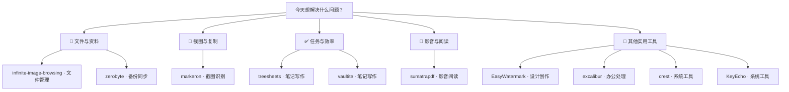

# 每日实用开源精选 · 2026-11-22

10 个实用开源项目。许可证与维护日期来自 GitHub API；中文介绍由 AI 辅助生成，安装前请核对项目说明。

## 🌟 今日首选 · [markeron](https://github.com/ifer47/markeron)

> 远程讲解时对方找不到按钮？在当前屏幕上画箭头指出位置。

**为什么先试：**有明确的 Windows 安装与便携方式，核心操作适合日常讲解，资料也清楚说明了功能边界。

**工作流程：**准备要讲解的应用界面 → 开启标注并画出箭头 → 让观众看清操作位置

**适用平台：**Windows / macOS

---

## 先按需求找工具

**📁 文件与资料**：[infinite-image-browsing](https://github.com/zanllp/infinite-image-browsing) · [zerobyte](https://github.com/nicotsx/zerobyte)

**📸 截图与复制**：[markeron](https://github.com/ifer47/markeron)

**✅ 任务与效率**：[treesheets](https://github.com/aardappel/treesheets) · [vaultite](https://github.com/Vaultite/vaultite)

**🎵 影音与阅读**：[sumatrapdf](https://github.com/sumatrapdfreader/sumatrapdf)

**🧰 其他实用工具**：[EasyWatermark](https://github.com/rosuH/EasyWatermark) · [excalibur](https://github.com/camelot-dev/excalibur) · [crest](https://github.com/andrealo20/crest) · [KeyEcho](https://github.com/ZacharyL2/KeyEcho)

---

## 01 · [ifer47/markeron](https://github.com/ifer47/markeron)

分类：截图识别

> 远程讲解时对方找不到按钮？在当前屏幕上画箭头指出位置。

**工作流程：**准备要讲解的应用界面 → 开启标注并画出箭头 → 让观众看清操作位置

一款用于演示、教学和会议的屏幕标注工具。按快捷键进入标注模式后，可以在桌面内容上画线、加箭头、突出重点，并在保留标注的同时操作下方窗口。

- 平台：Windows x64、macOS
- 费用：免费
- 安装：从项目发布页下载安装包；Windows 也提供便携压缩包和 Microsoft Store 版本，安装较简单。
- 注意：它主要用于实时屏幕标注，不要将其当作已确认具备截图保存功能的工具。
- [许可证 MIT](https://github.com/ifer47/markeron/blob/master/LICENSE)
- [默认分支最近提交：2026-11-21T16:14:33Z](https://github.com/ifer47/markeron/commit/b668b8707c21c556d88b6ec21fc999dc76e4c114)
- 最近正式发布：[v2.31.0 · 2026-11-21T16:04:56Z](https://github.com/ifer47/markeron/releases/tag/v2.31.0)
- [安装说明](https://github.com/ifer47/markeron/blob/master/README.md)

## 02 · [rosuH/EasyWatermark](https://github.com/rosuH/EasyWatermark)

分类：设计创作

> 必须提交证件照片？加上限定用途的文字水印再导出。

**工作流程：**准备要提交的证件照片 → 添加限定用途的水印 → 得到带水印的照片

为照片添加文字或图片水印的工具，可调整水印的颜色、透明度、角度与排布，并对多张照片批量使用同一水印。支持导出 JPEG 或 PNG，项目资料称导出时会移除 EXIF 信息。

- 平台：Android、iOS、Windows、Linux、macOS arm64
- 费用：F-Droid 提供免费 Android 版本；Google Play 为付费版本；其他渠道费用待核实。
- 安装：手机可通过相应应用商店安装；桌面版可从项目发布页获取，桌面构建未签名，安装时需留意系统提示。
- 注意：水印不能保证图片不会被滥用；发送证件照片前仍应检查水印文字及可见的敏感信息。
- [许可证 MIT](https://github.com/rosuH/EasyWatermark/blob/master/LICENSE)
- [默认分支最近提交：2026-11-21T15:41:24Z](https://github.com/rosuH/EasyWatermark/commit/b950dd1c43e4ff2e4da32d6c5b3aa2096ed5be47)
- 最近正式发布：[3.0.6 · 2026-11-17T13:37:53Z](https://github.com/rosuH/EasyWatermark/releases/tag/3.0.6)
- [安装说明](https://github.com/rosuH/EasyWatermark/blob/master/README.md)

## 03 · [aardappel/treesheets](https://github.com/aardappel/treesheets)

分类：笔记写作

> 计划里有很多子任务？用嵌套网格把事项按层级排清楚。

**工作流程：**列出项目和子任务 → 在网格中逐层整理 → 得到有层次的计划

用可嵌套的网格整理信息，兼具表格和大纲的组织方式。适合把待办事项、计划、研究资料或零散想法放进有层次的同一份文档。

- 平台：Windows、macOS、Linux
- 费用：待核实
- 安装：从项目发布页下载预编译版本；Windows 无需自行编译，安装难度较低。
- 注意：嵌套网格的操作方式需要适应；macOS 版本未签名，首次打开可能受到系统拦截。
- [许可证 Zlib](https://github.com/aardappel/treesheets/blob/master/ZLIB_LICENSE.txt)
- [默认分支最近提交：2026-11-21T15:47:07Z](https://github.com/aardappel/treesheets/commit/71a6efd3e5594c94c5e1a8a0493a03df9e2c18b8)
- 最近正式发布：[v2.24.2 · 2026-11-21T16:08:36Z](https://github.com/aardappel/treesheets/releases/tag/v2.24.2)
- [安装说明](https://github.com/aardappel/treesheets/blob/master/README.md)

## 04 · [Vaultite/vaultite](https://github.com/Vaultite/vaultite)

分类：笔记写作

> 笔记散在多个 Markdown 文件里？打开文件夹并用链接串起相关内容。

**工作流程：**准备已有的 Markdown 笔记 → 打开文件夹并链接笔记 → 得到可关联查找的笔记库

以本地 Markdown 文件夹为基础的笔记与知识库工具，提供页面编辑、链接关系、反向链接和知识图谱。可以新建笔记库，也可以打开已有的 Markdown 文件夹。

- 平台：Windows x64／ARM64、macOS、Linux
- 费用：项目称软件免费；可选云端及 AI 服务的费用待核实。
- 安装：Windows 可从项目发布页下载安装程序，macOS 提供 DMG，Linux 提供 AppImage 或 deb；直接使用笔记功能较容易。
- 注意：Windows 安装程序尚未签名；连接 AI 或远程服务属于额外配置，不是记笔记的必经步骤。
- [许可证 Apache-2.0](https://github.com/Vaultite/vaultite/blob/main/LICENSE)
- [默认分支最近提交：2026-11-21T15:13:44Z](https://github.com/Vaultite/vaultite/commit/1fe454e8d8107b910e9708774e431a6f5e60e75a)
- 最近正式发布：[v0.15.0 · 2026-11-19T14:14:42Z](https://github.com/Vaultite/vaultite/releases/tag/v0.15.0)
- [安装说明](https://github.com/Vaultite/vaultite/blob/main/README.md)

## 05 · [sumatrapdfreader/sumatrapdf](https://github.com/sumatrapdfreader/sumatrapdf)

分类：影音阅读

> 收到 PDF 和 EPUB 两种资料？用同一阅读器分别打开查看。

**工作流程：**准备 PDF 或 EPUB 文件 → 用阅读器打开文件 → 阅读文档或电子书

面向 Windows 的多格式阅读器，支持 PDF、EPUB、MOBI，以及 CBZ、CBR 等漫画文件格式，也支持 FB2、CHM、XPS 和 DjVu。

- 平台：Windows
- 费用：待核实
- 安装：项目提供发布版本；具体安装包形式与安装步骤待核实。
- 注意：给定资料确认了阅读格式，但未说明编辑 PDF 或文字识别能力。
- [许可证 GPL-3.0](https://github.com/sumatrapdfreader/sumatrapdf/blob/master/COPYING)
- [默认分支最近提交：2026-11-21T16:09:08Z](https://github.com/sumatrapdfreader/sumatrapdf/commit/b382e7fc5f0bd6e3c8b17f7f0a6279d2f1114289)
- 最近正式发布：[3.6.1rel · 2026-04-06T13:47:05Z](https://github.com/sumatrapdfreader/sumatrapdf/releases/tag/3.6.1rel)
- [安装说明](https://github.com/sumatrapdfreader/sumatrapdf/blob/master/readme.md)

## 06 · [camelot-dev/excalibur](https://github.com/camelot-dev/excalibur)

分类：办公处理

> PDF 里的表格复制后全乱了？框选表格并下载为 Excel。

**工作流程：**准备可选中文字的 PDF → 框选表格并提取数据 → 得到可整理的 Excel 表格

通过网页界面提取 PDF 中的表格，可自动检测表格，也可在页面上框选范围，并下载为 CSV、Excel、JSON 或 HTML。适合把可选中文字的 PDF 表格转成便于整理的数据。

- 平台：Windows、Linux；其他平台待核实
- 费用：待核实
- 安装：Windows 和 Linux 可从项目发布页获取可执行文件；也可用 Python 安装并启动本地网页服务，后者需要一定配置。
- 注意：只适用于文本型 PDF，不适用于扫描件；公开在线演示不宜上传机密文件。
- [许可证 MIT](https://github.com/camelot-dev/excalibur/blob/master/LICENSE)
- [默认分支最近提交：2026-11-21T16:00:28Z](https://github.com/camelot-dev/excalibur/commit/e4438f1a4ff89d019dbcbfcd715cd839d04aa791)
- 最近正式发布：[v1.2.0 · 2026-11-21T16:01:50Z](https://github.com/camelot-dev/excalibur/releases/tag/v1.2.0)
- [安装说明](https://github.com/camelot-dev/excalibur/blob/master/README.md)

## 07 · [zanllp/infinite-image-browsing](https://github.com/zanllp/infinite-image-browsing)

分类：文件管理

> 图片分散在多个文件夹？加入搜索路径后按文件名找回。

**工作流程：**准备存放图片的文件夹 → 添加路径并搜索文件名 → 找到要整理的图片

以图片和视频为重点的浏览整理工具，支持添加搜索路径、按文件名或标签查找、预览媒体，并进行多选复制、移动、删除等文件操作。也能查看部分 AI 绘图工具写入的生成信息。

- 平台：桌面应用具体系统待核实；另可作为 SD-webui 扩展或通过 Python 独立运行。
- 费用：待核实
- 安装：资料确认有桌面版、扩展和 Python 独立运行方式；各桌面系统的安装包与难度待核实。
- 注意：AI 绘图元数据支持因来源工具而异；移动或删除大量文件前应先核对所选内容。
- [许可证 MIT](https://github.com/zanllp/infinite-image-browsing/blob/main/LICENSE)
- [默认分支最近提交：2026-11-21T16:23:43Z](https://github.com/zanllp/infinite-image-browsing/commit/0b27ddb2100fe2623d845a4e4c5cc5c7ed6b2815)
- 最近正式发布：[v1.11.0 · 2026-11-14T19:33:26Z](https://github.com/zanllp/infinite-image-browsing/releases/tag/v1.11.0)
- [安装说明](https://github.com/zanllp/infinite-image-browsing/blob/main/README.md)

## 08 · [nicotsx/zerobyte](https://github.com/nicotsx/zerobyte)

分类：备份同步

> 家用服务器的资料怕丢？设定定期加密备份并查看任务状态。

**工作流程：**准备服务器上的资料目录 → 设置备份计划与存储 → 得到可监控的备份任务

面向自托管用户的备份管理工具，基于 Restic，通过网页界面设置备份计划、保留策略并查看运行情况。资料列出本地目录及 NFS、SMB、WebDAV、SFTP 等备份来源。

- 平台：需要可运行 Docker 和 Docker Compose 的服务器；Windows 原生运行待核实。
- 费用：软件及所用存储的费用待核实
- 安装：需在服务器上安装 Docker 和 Docker Compose，再配置项目提供的 Compose 文件；有一定部署难度。
- 注意：项目仍处于可能发生较大变动的阶段；不要未经保护就把管理界面暴露到公网，并妥善保存加密所需信息。
- [许可证 AGPL-3.0](https://github.com/nicotsx/zerobyte/blob/main/LICENSE)
- [默认分支最近提交：2026-11-21T16:34:44Z](https://github.com/nicotsx/zerobyte/commit/6d28ed7e9606c8e5bd8e862e9480a9ec80cc4603)
- 最近正式发布：[v0.44.2 · 2026-11-09T21:21:42Z](https://github.com/nicotsx/zerobyte/releases/tag/v0.44.2)
- [安装说明](https://github.com/nicotsx/zerobyte/blob/main/README.md)

## 09 · [andrealo20/crest](https://github.com/andrealo20/crest)

分类：系统工具

> 想随时看计时器和电脑状态？展开屏幕顶部工具区域查看。

**工作流程：**准备正在使用的电脑 → 展开顶部区域查看状态 → 看到计时器和系统信息

在 Windows 或 macOS 屏幕顶部提供可展开的工具区域，用来查看音乐、计时器及部分系统状态。Windows 版还提供自有任务栏；项目资料说明 Microsoft Store 版本暂不包含任务栏替代功能。

- 平台：Windows、Windows on Arm、macOS
- 费用：项目称免费且无需账户
- 安装：可从项目发布页下载，Windows 也提供 Microsoft Store 渠道；安装较简单。
- 注意：是否能替代 Windows 任务栏取决于安装版本；安装前应确认自己需要的功能在哪个版本中。
- [许可证 GPL-3.0](https://github.com/andrealo20/crest/blob/main/LICENSE)
- [默认分支最近提交：2026-11-21T16:36:18Z](https://github.com/andrealo20/crest/commit/ce9ab3087988db1338908d2cc4865a8adcbeab22)
- 最近正式发布：[v1.3.0 · 2026-11-21T11:16:32Z](https://github.com/andrealo20/crest/releases/tag/v1.3.0)
- [安装说明](https://github.com/andrealo20/crest/blob/main/README.md)

## 10 · [ZacharyL2/KeyEcho](https://github.com/ZacharyL2/KeyEcho)

分类：系统工具

> 打字时想要按键反馈？开启本地按键音并选择喜欢的声音。

**工作流程：**准备日常打字的电脑 → 启用并选择按键音 → 打字时听到声音反馈

在敲击键盘时播放本地按键音的桌面工具，支持自定义声音包。项目资料说明基础应用及随附声音包免费，另有可选的付费声音包。

- 平台：Windows x64／ARM64、macOS、Linux
- 费用：基础应用和随附声音包免费；可选声音包需单独付费。
- 安装：Windows 可通过 winget、Microsoft Store 或项目发布页安装；其他平台也有安装包，安装较简单。
- 注意：需要系统授予监听全局键盘事件的相应权限；介意这类权限时应先评估再安装。
- [许可证 AGPL-3.0](https://github.com/ZacharyL2/KeyEcho/blob/main/LICENSE)
- [默认分支最近提交：2026-11-13T10:36:06Z](https://github.com/ZacharyL2/KeyEcho/commit/ca489a22aabd71733e24864672eb84a8c7811aa6)
- 最近正式发布：[v1.2.0 · 2026-11-13T10:50:36Z](https://github.com/ZacharyL2/KeyEcho/releases/tag/v1.2.0)
- [安装说明](https://github.com/ZacharyL2/KeyEcho/blob/main/README.md)

---

## 🏛️ 建筑设计与表达工具

暂无通过核验且未重复的建筑工具，不凑数。

---

## 🔥 今日热门

暂无通过核验且未重复的热门项目，不凑数。

[来源：GitHub Trending 日榜](https://github.com/trending?since=daily) ｜ 采集时间：2026-11-21T16:58:19.833Z

