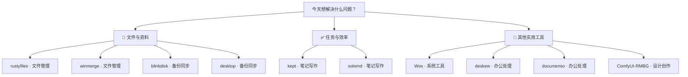

# 每日实用开源精选 · 2026-11-24

10 个实用开源项目。许可证与维护日期来自 GitHub API；中文介绍由 AI 辅助生成，安装前请核对项目说明。

## 🌟 今日首选 · [Wox](https://github.com/Wox-launcher/Wox)

> 桌面窗口太多？调出输入框搜索应用名称，直接打开要用的程序。

**为什么先试：**Windows 有明确的安装途径，核心用途直观，适合作为今天先尝试的日常工具。

**工作流程：**想打开的应用名称 → 在启动框搜索并选择应用 → 打开目标应用

**适用平台：**Windows / macOS / Linux

---

## 先按需求找工具

**📁 文件与资料**：[rustyfiles](https://github.com/gelenmedya/rustyfiles) · [winmerge](https://github.com/WinMerge/winmerge) · [blinkdisk](https://github.com/blinkdisk/blinkdisk) · [desktop](https://github.com/Sync-in/desktop)

**✅ 任务与效率**：[kept](https://github.com/ericerkz/kept) · [solomd](https://github.com/zhitongblog/solomd)

**🧰 其他实用工具**：[Wox](https://github.com/Wox-launcher/Wox) · [deskew](https://github.com/galfar/deskew) · [documenso](https://github.com/documenso/documenso) · [ComfyUI-RMBG](https://github.com/1038lab/ComfyUI-RMBG)

---

## 01 · [Wox-launcher/Wox](https://github.com/Wox-launcher/Wox)

分类：系统工具

> 桌面窗口太多？调出输入框搜索应用名称，直接打开要用的程序。

**工作流程：**想打开的应用名称 → 在启动框搜索并选择应用 → 打开目标应用

跨平台快捷启动器，把打开应用、查找本地文件和执行操作集中在一个输入框中，也可通过插件扩展功能。

- 平台：Windows、macOS、Linux
- 费用：软件费用待核实；第三方插件或服务费用待核实
- 安装：Windows 可通过 Winget 等包管理器安装，也可从发布页下载；较容易
- 注意：插件来自不同开发者，安装前留意其来源和权限。
- [许可证 GPL-3.0](https://github.com/Wox-launcher/Wox/blob/master/LICENSE)
- [默认分支最近提交：2026-11-24T01:16:04Z](https://github.com/Wox-launcher/Wox/commit/c0df07f436b46094f5482d28e9fae0f39c124d7f)
- 最近正式发布：[v2.5.0 · 2026-11-09T06:12:08Z](https://github.com/Wox-launcher/Wox/releases/tag/v2.5.0)
- [安装说明](https://github.com/Wox-launcher/Wox/blob/master/README.md)

## 02 · [gelenmedya/rustyfiles](https://github.com/gelenmedya/rustyfiles)

分类：文件管理

> 照片和文档散在多个文件夹？用双栏查看两处目录，再整理文件。

**工作流程：**两个待整理的文件夹 → 用双栏浏览并移动文件 → 得到整理后的目录

面向 Windows 和 macOS 的文件管理器，提供标签页、双栏浏览、空格键预览、批量重命名和文件名搜索索引，方便整理本地资料。

- 平台：Windows 11；Apple 芯片 macOS 26 测试版
- 费用：项目称软件免费；其他费用待核实
- 安装：发布页提供 Windows 安装程序和 macOS 安装包；较容易
- 注意：macOS 版本仍为测试版；勿把项目展示的速度数据视为自己设备上的结果。
- [许可证 MIT](https://github.com/gelenmedya/rustyfiles/blob/main/LICENSE)
- [默认分支最近提交：2026-11-23T21:55:13Z](https://github.com/gelenmedya/rustyfiles/commit/7269d076cf44800055fb9af3aa208168e4b6b995)
- 最近正式发布：[v0.9.9 · 2026-11-23T22:35:31Z](https://github.com/gelenmedya/rustyfiles/releases/tag/v0.9.9)
- [安装说明](https://github.com/gelenmedya/rustyfiles/blob/main/README.md)

## 03 · [WinMerge/winmerge](https://github.com/WinMerge/winmerge)

分类：文件管理

> 两份资料夹不知差在哪？并排对比，找出缺失和修改过的文件。

**工作流程：**两份需要核对的资料夹 → 对比文件列表和差异 → 得到差异清单

Windows 文件与文件夹对比工具，可并排标出文本差异，找出两个目录中不同或缺失的文件，并选择性合并改动。

- 平台：Windows
- 费用：软件费用待核实
- 安装：项目提供发布页及安装程序相关资料；具体安装步骤待核实
- 注意：合并会修改文件，操作前保留原件；压缩包对比需要 7-Zip。
- [许可证 GPL-2.0](https://github.com/WinMerge/winmerge/blob/master/LICENSE.md)
- [默认分支最近提交：2026-11-23T23:12:20Z](https://github.com/WinMerge/winmerge/commit/de2d48f7e91420191a452126823f8a3e75d00e83)
- 最近正式发布：[v2.16.60 · 2026-10-27T13:00:05Z](https://github.com/WinMerge/winmerge/releases/tag/v2.16.60)
- [安装说明](https://github.com/WinMerge/winmerge/blob/master/README.md)

## 04 · [ericerkz/kept](https://github.com/ericerkz/kept)

分类：笔记写作

> 买菜时总漏掉东西？在手机建清单，到店后逐项勾选。

**工作流程：**准备购买的物品 → 建立清单并逐项勾选 → 得到未购买物品清单

简洁的便笺应用，支持文字、清单、图片、标签和提醒。iOS 与 Android 应用可不注册账号、离线保存在本机；跨设备同步和协作需要服务器。

- 平台：iOS、Android；连接服务器后可通过网页使用
- 费用：本机模式费用待核实；云端服务费用待核实
- 安装：手机可从 App Store 或 Google Play 安装并选择仅在本机使用；较容易。自托管需 Docker
- 注意：仅存本机时，卸载应用或丢失设备可能造成笔记丢失，应另存备份。
- [许可证 AGPL-3.0](https://github.com/ericerkz/kept/blob/master/LICENSE)
- [默认分支最近提交：2026-11-24T00:38:31Z](https://github.com/ericerkz/kept/commit/1efe1f1395756e88be9a1ec573b5decfb93f8df0)
- 最近正式发布：[v1.9.8 · 2026-11-24T00:07:19Z](https://github.com/ericerkz/kept/releases/tag/v1.9.8)
- [安装说明](https://github.com/ericerkz/kept/blob/master/README.md)

## 05 · [zhitongblog/solomd](https://github.com/zhitongblog/solomd)

分类：笔记写作

> 写好的 Markdown 要交给不用编辑器的同事？导出成 Word 文档。

**工作流程：**本地 Markdown 文稿 → 编辑内容并导出 Word → 得到可发送的文档

以本地文件夹保存笔记的 Markdown 编辑器，提供多种写作视图和 PDF、Word、网页等格式导出；另有可选的 AI 与同步功能。

- 平台：资料称支持 Windows、macOS、Linux、Android；第五个平台待核实
- 费用：项目称软件免费、无需订阅；外部 AI 服务及存储服务费用待核实
- 安装：可从项目发布页下载桌面安装包；具体各平台步骤待核实
- 注意：使用云端 AI 或第三方同步时，先核对相应服务的费用与数据设置。
- [许可证 MIT](https://github.com/zhitongblog/solomd/blob/main/LICENSE)
- [默认分支最近提交：2026-11-23T23:46:30Z](https://github.com/zhitongblog/solomd/commit/1b44a25ca399d0fbc91e0a0d0d0dce88fc5f53d7)
- 最近正式发布：[v5.3.5 · 2026-11-23T14:02:45Z](https://github.com/zhitongblog/solomd/releases/tag/v5.3.5)
- [安装说明](https://github.com/zhitongblog/solomd/blob/main/README.md)

## 06 · [blinkdisk/blinkdisk](https://github.com/blinkdisk/blinkdisk)

分类：备份同步

> 担心电脑故障丢照片？选中照片文件夹，备份到外接硬盘。

**工作流程：**照片文件夹和外接硬盘 → 选择存储位置并备份 → 得到照片备份副本

桌面备份工具，可选择重要文件夹，备份到外接硬盘、NAS 或受支持的远程存储，并在需要时恢复文件；资料还说明支持加密和去重。

- 平台：Windows 10/11（64 位）、macOS、Linux
- 费用：项目称使用自有存储免费；托管云存储有免费档及订阅方案，外部存储可能收费
- 安装：官网提供下载入口；安装后选择备份文件夹和存储位置，难度取决于存储配置
- 注意：妥善保管加密密码，并定期确认备份能否恢复；远程存储费用另行核对。
- [许可证 AGPL-3.0](https://github.com/blinkdisk/blinkdisk/blob/main/LICENSE)
- [默认分支最近提交：2026-11-23T21:39:22Z](https://github.com/blinkdisk/blinkdisk/commit/2a19c2a42d8f745c3e09e4e76b844e2cf06eeeb9)
- 最近正式发布：[v1.11.1 · 2026-11-22T16:53:30Z](https://github.com/blinkdisk/blinkdisk/releases/tag/v1.11.1)
- [安装说明](https://github.com/blinkdisk/blinkdisk/blob/main/README.md)

## 07 · [Sync-in/desktop](https://github.com/Sync-in/desktop)

分类：备份同步

> 家里和办公室都要改同一批文件？连接已有服务器，同步指定文件夹。

**工作流程：**本地文件夹和服务器账号 → 预览并执行双向同步 → 得到同步后的文件夹

Sync-in Server 的桌面同步客户端，可在本地文件夹与服务器之间设置单向或双向同步，并提供同步预览、定时任务及文件筛选。

- 平台：Windows、macOS、Linux
- 费用：客户端及所需服务器的使用费用待核实
- 安装：官网提供下载入口和配置向导；需有可连接的 Sync-in Server，整体难度中等
- 注意：它不是无需服务器的独立网盘；首次双向同步前先预览将执行的操作。
- [许可证 AGPL-3.0](https://github.com/Sync-in/desktop/blob/main/LICENSE)
- [默认分支最近提交：2026-11-23T22:19:19Z](https://github.com/Sync-in/desktop/commit/0b148cddce68f71ea2c6a31c724c1136f767c048)
- 最近正式发布：[v2.3.2 · 2026-11-09T21:33:04Z](https://github.com/Sync-in/desktop/releases/tag/v2.3.2)
- [安装说明](https://github.com/Sync-in/desktop/blob/main/README.md)

## 08 · [galfar/deskew](https://github.com/galfar/deskew)

分类：办公处理

> 扫描的合同歪了一点？放入图片，校正后再发给同事。

**工作流程：**倾斜的扫描文档图片 → 检测文字行并校正 → 得到文字水平的图片

扫描文档图片的倾斜校正工具，通过检测文字行旋转页面，使文字恢复水平；提供命令行、图形界面和无需安装的网页版。

- 平台：Windows、Linux、macOS；现代浏览器
- 费用：软件及网页版费用待核实
- 安装：可直接打开网页版，或下载对应平台压缩包使用图形界面；较容易
- 注意：空白页或缺少文字行的图片可能无法校正；资料说明网页版在本机处理图片。
- [许可证 MPL-2.0](https://github.com/galfar/deskew/blob/master/LICENSE)
- [默认分支最近提交：2026-11-24T00:33:12Z](https://github.com/galfar/deskew/commit/992b1d8fc5b83f0a0dc1ac981febaf9e4d76bfd5)
- 最近正式发布：[v1.35 · 2026-11-24T01:26:34Z](https://github.com/galfar/deskew/releases/tag/v1.35)
- [安装说明](https://github.com/galfar/deskew/blob/master/Readme.md)

## 09 · [documenso/documenso](https://github.com/documenso/documenso)

分类：办公处理

> 文件需要异地签署？通过网页发起电子签署流程。

**工作流程：**待签署的文件 → 通过应用发起签署 → 得到已签署的文件

面向文档电子签署的应用，可选择使用其网站服务或自行托管。适合需要在线完成文件签署流程的人。

- 平台：网页应用；自托管服务器平台待核实
- 费用：网站服务及自托管所需资源的费用待核实；另有企业方案
- 安装：可在项目提供的网站注册使用；自行托管的安装步骤与难度待核实
- 注意：正式签署前，核对当地电子签名规则、文件内容及服务条款。
- [许可证 AGPL-3.0](https://github.com/documenso/documenso/blob/main/LICENSE)
- [默认分支最近提交：2026-11-23T03:55:33Z](https://github.com/documenso/documenso/commit/e745c9ec339f1b16d2f8d181b6457323fb33ebe5)
- 最近正式发布：[v2.22.0 · 2026-11-13T01:34:30Z](https://github.com/documenso/documenso/releases/tag/v2.22.0)
- [安装说明](https://github.com/documenso/documenso/blob/main/README.md)

## 10 · [1038lab/ComfyUI-RMBG](https://github.com/1038lab/ComfyUI-RMBG)

分类：设计创作

> 商品照背景太杂？在 ComfyUI 工作流中去掉背景，取得主体图。

**工作流程：**一张商品照片 → 在工作流中运行去背景节点 → 得到去背景的主体图

ComfyUI 的图像处理自定义节点，提供图片去背景，以及物体、人脸和服装等区域分割能力，供已有 ComfyUI 工作流使用。

- 平台：依赖 ComfyUI；具体系统支持范围待核实
- 费用：节点费用待核实；所需模型及运行设备成本待核实
- 安装：需先安装 ComfyUI，再添加自定义节点和所需模型；难度较高
- 注意：它不是独立的一键抠图软件；不同模型的依赖和硬件要求需另行核对。
- [许可证 GPL-3.0](https://github.com/1038lab/ComfyUI-RMBG/blob/main/LICENSE)
- [默认分支最近提交：2026-11-24T00:04:00Z](https://github.com/1038lab/ComfyUI-RMBG/commit/f871167b325835b627e233d5792c93f3cfb79b18)
- 最近正式发布：无正式 Release
- [安装说明](https://github.com/1038lab/ComfyUI-RMBG/blob/main/README.md)

---

## 🏛️ 建筑设计与表达工具

暂无通过核验且未重复的建筑工具，不凑数。

---

## 🔥 今日热门

暂无通过核验且未重复的热门项目，不凑数。

[来源：GitHub Trending 日榜](https://github.com/trending?since=daily) ｜ 采集时间：2026-11-24T01:33:04.029Z

