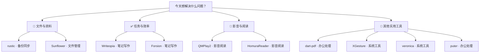

# 每日实用开源精选 · 2026-11-25

10 个实用开源项目。许可证与维护日期来自 GitHub API；中文介绍由 AI 辅助生成，安装前请核对项目说明。

## 🌟 今日首选 · [dart-pdf](https://github.com/ben-milanko/dart-pdf)

> 收到需要签字的PDF表格？在浏览器中填写、签名，再保存副本。

**为什么先试：**网页即可尝试，填写和签名对应常见需求，项目也明确说明了使用方式与性能限制，值得先试。

**工作流程：**准备待填写的PDF → 填写字段并添加签名 → 保存已填写的PDF副本

**适用平台：**Windows / macOS / Linux / Android

---

## 先按需求找工具

**📁 文件与资料**：[rustic](https://github.com/rustic-rs/rustic) · [Sunflower](https://github.com/MeanEYE/Sunflower)

**✅ 任务与效率**：[Writeopia](https://github.com/Writeopia/Writeopia) · [Forsion](https://github.com/Changan-Su/Forsion)

**🎵 影音与阅读**：[QMPlay2](https://github.com/zaps166/QMPlay2) · [HomuraReader](https://github.com/Leon-Ning-san/HomuraReader)

**🧰 其他实用工具**：[dart-pdf](https://github.com/ben-milanko/dart-pdf) · [XGesture](https://github.com/qpst4/XGesture) · [veronica](https://github.com/namannn04/veronica) · [puter](https://github.com/HeyPuter/puter)

---

## 01 · [ben-milanko/dart-pdf](https://github.com/ben-milanko/dart-pdf)

分类：办公处理

> 收到需要签字的PDF表格？在浏览器中填写、签名，再保存副本。

**工作流程：**准备待填写的PDF → 填写字段并添加签名 → 保存已填写的PDF副本

DartPDF 是面向日常文档的 PDF 编辑器，可在设备上填写表单、添加批注和签名，也支持插入其他 PDF 的页面及压缩文件。提供浏览器版本和应用下载入口。

- 平台：Windows、macOS、Linux、Android、iPhone、iPad及网页
- 费用：项目说明编辑器可免费使用；其他服务费用待核实
- 安装：可直接打开网页版本，或从项目提供的入口下载应用；网页试用难度低
- 注意：默认查看器的交互性能尚未达到项目所比较的 PDFium 水平；重要文件编辑后应检查保存结果。
- [许可证 Apache-2.0](https://github.com/ben-milanko/dart-pdf/blob/main/LICENSE)
- [默认分支最近提交：2026-11-25T00:12:45Z](https://github.com/ben-milanko/dart-pdf/commit/af45c622de0954d36acfe7164c0fb051d03d6c38)
- 最近正式发布：[app-v16.1.1 · 2026-11-16T10:08:12Z](https://github.com/ben-milanko/dart-pdf/releases/tag/app-v16.1.1)
- [安装说明](https://github.com/ben-milanko/dart-pdf/blob/main/README.md)

## 02 · [zaps166/QMPlay2](https://github.com/zaps166/QMPlay2)

分类：影音阅读

> 电脑里的视频打不开？用播放器尝试播放FFmpeg支持的格式。

**工作流程：**准备本地音视频文件 → 用播放器打开文件 → 观看视频或收听音频

QMPlay2 是音视频播放器，可播放 FFmpeg 支持的格式，并支持音频 CD、原始音频文件和芯片音乐。Windows 用户可从发布页下载安装程序。

- 平台：Windows、Linux；macOS 的具体安装方式待核实
- 费用：软件费用待核实
- 安装：Windows 可从 GitHub Releases 下载安装程序，难度低；Linux 提供多种发行版安装方式
- 注意：播放 YouTube 视频需要外部 yt-dlp，项目说明播放器可能自动下载它；硬件加速默认关闭。
- [许可证 LGPL-3.0](https://github.com/zaps166/QMPlay2/blob/master/LICENSE)
- [默认分支最近提交：2026-11-25T00:39:19Z](https://github.com/zaps166/QMPlay2/commit/6583c55965a07491fd3fa7d93e1225101b9966e9)
- 最近正式发布：[26.08.02 · 2026-08-02T11:24:01Z](https://github.com/zaps166/QMPlay2/releases/tag/26.08.02)
- [安装说明](https://github.com/zaps166/QMPlay2/blob/master/README.md)

## 03 · [Leon-Ning-san/HomuraReader](https://github.com/Leon-Ning-san/HomuraReader)

分类：影音阅读

> 漫画和电子书散落在文件夹？导入本地书架，按上次进度续读。

**工作流程：**准备本地漫画或电子书 → 导入书架并开始阅读 → 获得可续读的本地书架

HOMURA 是本地漫画与小说阅读器，可导入 EPUB、CBZ、PDF、TXT、Markdown 等文件，提供漫画单双页阅读、小说分页和本地进度记忆。WebDAV 进度同步为可选功能。

- 平台：Windows、macOS、Linux、Android
- 费用：应用收费情况待核实
- 安装：从 GitHub Releases 下载对应安装包；Windows 提供 MSI 和安装程序，难度低
- 注意：不支持 DRM、AZW3 和加密 PDF；PDF 不支持文字重排。WebDAV 同步有服务器要求，且不是阅读的必需步骤。
- [许可证 MIT](https://github.com/Leon-Ning-san/HomuraReader/blob/main/LICENSE)
- [默认分支最近提交：2026-11-25T00:19:06Z](https://github.com/Leon-Ning-san/HomuraReader/commit/a13b7063bddae9171b22ce9a6ca239a7115f3883)
- 最近正式发布：[v2.3.3 · 2026-11-22T16:40:37Z](https://github.com/Leon-Ning-san/HomuraReader/releases/tag/v2.3.3)
- [安装说明](https://github.com/Leon-Ning-san/HomuraReader/blob/main/README.md)

## 04 · [Writeopia/Writeopia](https://github.com/Writeopia/Writeopia)

分类：笔记写作

> 想在电脑上写私人草稿？用离线优先的编辑器整理文字。

**工作流程：**准备文章思路或笔记 → 在编辑器中撰写修改 → 得到整理好的文字草稿

Writeopia 是注重离线使用和隐私的文字编辑应用，适合写草稿或笔记。项目说明可选择本地 AI 模型辅助写作，同时提供独立的编辑器 SDK。

- 平台：Windows、macOS、Linux
- 费用：项目称应用免费；使用自选模型可能产生的费用待核实
- 安装：从项目下载页获取桌面应用，难度待核实
- 注意：本地 AI 功能需要选择模型；具体模型要求和各平台安装细节，现有资料未说明。
- [许可证 AGPL-3.0](https://github.com/Writeopia/Writeopia/blob/main/LICENSE)
- [默认分支最近提交：2026-11-24T23:10:30Z](https://github.com/Writeopia/Writeopia/commit/c9ccde847b3662430bf5619c7870558849682d2d)
- 最近正式发布：[sdk-0.14.0 · 2026-08-20T17:13:22Z](https://github.com/Writeopia/Writeopia/releases/tag/sdk-0.14.0)
- [安装说明](https://github.com/Writeopia/Writeopia/blob/main/README.md)

## 05 · [Changan-Su/Forsion](https://github.com/Changan-Su/Forsion)

分类：笔记写作

> 活动计划和待办分散？把笔记放进同一工作区，按项目查看。

**工作流程：**准备活动计划和待办 → 写入笔记并整理项目 → 得到可继续维护的项目资料

Forsion 是本地优先的笔记与项目工作台。它以磁盘上的 Markdown 文件保存笔记，提供块编辑、双向链接、任务及日历视图；内置代理可在授权范围内读取项目文件并回答问题。

- 平台：Windows、macOS、Linux、Android及网页
- 费用：应用及可选模型服务的具体费用待核实
- 安装：可从 GitHub Releases 下载应用，也有网页入口；首次配置模型的难度待核实
- 注意：让代理处理文件前，应核对授权范围及其列出的文件改动；普通记笔记不必启用代理。
- [许可证 Apache-2.0](https://github.com/Changan-Su/Forsion/blob/main/LICENSE)
- [默认分支最近提交：2026-11-25T00:41:11Z](https://github.com/Changan-Su/Forsion/commit/1fffd8c5f602a80a1bc978fbe9fd8d6e202d554f)
- 最近正式发布：[v2.14.2 · 2026-11-16T22:51:31Z](https://github.com/Changan-Su/Forsion/releases/tag/v2.14.2)
- [安装说明](https://github.com/Changan-Su/Forsion/blob/main/README.md)

## 06 · [rustic-rs/rustic](https://github.com/rustic-rs/rustic)

分类：备份同步

> 担心电脑资料误删？定期生成加密备份快照，并检查能否恢复。

**工作流程：**准备要保护的文件夹 → 备份到已配置的仓库 → 得到可恢复的备份快照

rustic 是命令行备份工具，可对文件进行加密、去重并生成快照，备份目标可选本地或云存储。它读写 restic 仓库格式，便于使用兼容工具检查备份。

- 平台：Windows、macOS、Linux、BSD
- 费用：工具及备份存储的具体费用待核实
- 安装：从发布页获取二进制文件并按文档配置备份仓库；需要使用命令行，难度中等
- 注意：备份不能只看命令是否成功；应妥善保存解密凭据，并实际验证快照能否恢复。
- [许可证 Apache-2.0](https://github.com/rustic-rs/rustic/blob/main/LICENSE-APACHE)
- [默认分支最近提交：2026-11-24T15:35:43Z](https://github.com/rustic-rs/rustic/commit/8584d2579fa0c0232972cc2a956ccc09b6cf5c54)
- 最近正式发布：[v0.12.0 · 2026-11-17T23:34:49Z](https://github.com/rustic-rs/rustic/releases/tag/v0.12.0)
- [安装说明](https://github.com/rustic-rs/rustic/blob/main/README.md)

## 07 · [MeanEYE/Sunflower](https://github.com/MeanEYE/Sunflower)

分类：文件管理

> 整理两个文件夹总要切窗口？在双栏界面中对照并移动文件。

**工作流程：**准备两个待整理目录 → 双栏对照并移动文件 → 得到整理后的文件夹

Sunflower 是 Linux 双栏文件管理器，支持标签页、书签、压缩包浏览及后台文件操作。两栏布局便于对照目录整理本地文件，也可通过 GIO 浏览受支持的远程位置。

- 平台：Linux
- 费用：项目说明为免费软件
- 安装：提供 DEB、RPM、Flatpak、独立可执行文件等下载方式；选择对应发行版安装，难度较低
- 注意：资料只说明 Linux 支持，不应当作 Windows 文件管理器推荐；移动或删除大量文件前需核对目标目录。
- [许可证 GPL-3.0](https://github.com/MeanEYE/Sunflower/blob/develop/LICENSE)
- [默认分支最近提交：2026-11-25T00:20:06Z](https://github.com/MeanEYE/Sunflower/commit/491ec4adb545a73ac2b7708bed5b4399602ebcd1)
- 最近正式发布：[0.7-65 · 2026-11-22T20:22:24Z](https://github.com/MeanEYE/Sunflower/releases/tag/0.7-65)
- [安装说明](https://github.com/MeanEYE/Sunflower/blob/develop/README.md)

## 08 · [qpst4/XGesture](https://github.com/qpst4/XGesture)

分类：系统工具

> 大屏手机单手够不到顶部？设置边缘手势，减少伸手操作。

**工作流程：**确定常用的手机操作 → 为边缘滑动设置动作 → 用单手手势触发操作

XGesture 是 Android 单手操作与手势工具，可设置屏幕边缘滑动动作，并提供悬浮指针等辅助操作。项目还提供离线 OCR 功能及不同体积的安装包。

- 平台：Android 12及以上
- 费用：应用收费情况待核实
- 安装：从 GitHub Releases 下载完整版或精简版 APK 安装；需配置相关系统权限，难度中等
- 注意：核心功能依赖无障碍服务；部分高级操作涉及 Shizuku、Root 或其他可选集成，授权前应核对所需权限。
- [许可证 AGPL-3.0](https://github.com/qpst4/XGesture/blob/main/LICENSE)
- [默认分支最近提交：2026-11-25T00:28:44Z](https://github.com/qpst4/XGesture/commit/61417b448ae6c7915e316871bc5c55baafeace18)
- 最近正式发布：[v1.80.0 · 2026-11-23T14:18:11Z](https://github.com/qpst4/XGesture/releases/tag/v1.80.0)
- [安装说明](https://github.com/qpst4/XGesture/blob/main/README.md)

## 09 · [namannn04/veronica](https://github.com/namannn04/veronica)

分类：系统工具

> 想查看电脑负载又要找剪贴板记录？在同一控制中心切换查看。

**工作流程：**发现电脑变慢 → 查看CPU和进程信息 → 找到需要进一步排查的进程

Veronica 是 Ubuntu 桌面控制中心，将 CPU、内存、磁盘和进程信息与音频控制、剪贴板历史等工具集中在一处，并提供 GNOME 顶栏集成。

- 平台：Ubuntu 24.04及以上，x86_64，GNOME Shell 46至50
- 费用：项目说明无付费层级
- 安装：提供 Debian 包安装脚本、Flatpak、AppImage 等方式；完整顶栏集成还需启用扩展并重新登录，难度中等
- 注意：AppImage 仅含桌面应用，不含命令行工具和 Shell 扩展；安装前须核对 Ubuntu 与 GNOME 版本。
- [许可证 GPL-3.0](https://github.com/namannn04/veronica/blob/main/LICENSE)
- [默认分支最近提交：2026-11-25T01:09:54Z](https://github.com/namannn04/veronica/commit/3e042cd252381bb87d735ad85ab3e50d7ac20e06)
- 最近正式发布：[v0.1.26 · 2026-11-23T21:31:47Z](https://github.com/namannn04/veronica/releases/tag/v0.1.26)
- [安装说明](https://github.com/namannn04/veronica/blob/main/README.md)

## 10 · [HeyPuter/puter](https://github.com/HeyPuter/puter)

分类：办公处理

> 临时换电脑要写文档？打开浏览器，使用在线办公应用。

**工作流程：**准备要撰写的文档内容 → 在网页办公应用中编辑 → 得到编辑好的在线文档

Puter 是可通过浏览器使用、也可自行部署的在线工作环境，提供记事本、Office 套件等应用。需要从不同电脑访问工作应用时，可先使用其托管网站；自行部署是另一种选择。

- 平台：网页；自托管说明涉及 Windows、Linux、macOS
- 费用：托管服务的使用限制与费用、自托管资源费用均待核实
- 安装：可直接访问托管网站；自行部署需按平台说明操作，难度较高
- 注意：托管网站与自行部署的存储位置不同；处理敏感资料前应核对所选方式及服务条款。
- [许可证 AGPL-3.0](https://github.com/HeyPuter/puter/blob/main/LICENSE.txt)
- [默认分支最近提交：2026-11-25T00:36:19Z](https://github.com/HeyPuter/puter/commit/a53319baac81e2f9a5b5da6601b4090de02b591d)
- 最近正式发布：[26.11 · 2026-11-02T06:53:31Z](https://github.com/HeyPuter/puter/releases/tag/26.11)
- [安装说明](https://github.com/HeyPuter/puter/blob/main/README.md)

---

## 🏛️ 建筑设计与表达工具

暂无通过核验且未重复的建筑工具，不凑数。

---

## 🔥 今日热门

暂无通过核验且未重复的热门项目，不凑数。

[来源：GitHub Trending 日榜](https://github.com/trending?since=daily) ｜ 采集时间：2026-11-25T01:33:12.896Z

