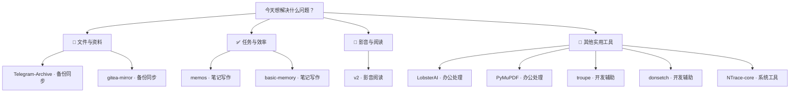

# 每日实用开源精选 · 2026-11-26

10 个实用开源项目。许可证与维护日期来自 GitHub API；中文介绍由 AI 辅助生成，安装前请核对项目说明。

## 🌟 今日首选 · [LobsterAI](https://github.com/netease-youdao/LobsterAI)

> 要整理表格并生成报告？让它读取文件后产出可编辑文档。

**为什么先试：**Windows 可直接安装，能把文件分析、办公编辑和结果预览串成完整流程。

**工作流程：**准备表格和报告要求 → 让代理分析数据并编辑文档 → 得到可继续修改的报告

**适用平台：**Windows / macOS

---

## 先按需求找工具

**📁 文件与资料**：[Telegram-Archive](https://github.com/GeiserX/Telegram-Archive) · [gitea-mirror](https://github.com/RayLabsHQ/gitea-mirror)

**✅ 任务与效率**：[memos](https://github.com/usememos/memos) · [basic-memory](https://github.com/basicmachines-co/basic-memory)

**🎵 影音与阅读**：[v2](https://github.com/miniflux/v2)

**🧰 其他实用工具**：[LobsterAI](https://github.com/netease-youdao/LobsterAI) · [PyMuPDF](https://github.com/pymupdf/PyMuPDF) · [troupe](https://github.com/gnoviawan/troupe) · [donsetch](https://github.com/dondai44423/donsetch) · [NTrace-core](https://github.com/nxtrace/NTrace-core)

---

## 01 · [netease-youdao/LobsterAI](https://github.com/netease-youdao/LobsterAI)

分类：办公处理

> 要整理表格并生成报告？让它读取文件后产出可编辑文档。

**工作流程：**准备表格和报告要求 → 让代理分析数据并编辑文档 → 得到可继续修改的报告

面向桌面的开源 AI 助手，可读取本地文件、运行工具、浏览网页，并编辑 Word、Excel、PowerPoint、PDF 等内容；支持任务审批、定时任务和从微信、飞书、钉钉、Telegram 等渠道发送任务。

- 平台：Windows、macOS；支持 Windows x64 桌面操作
- 费用：开源软件；可登录使用内置模型，也可使用自有 API 密钥，模型费用待核实
- 安装：提供 Windows/macOS 下载页面；直接下载安装包，难度低
- 注意：会读取文件、运行脚本和操作桌面，敏感操作需仔细确认；模型和外部服务费用待核实
- [许可证 MIT](https://github.com/netease-youdao/LobsterAI/blob/main/LICENSE)
- [默认分支最近提交：2026-11-20T12:10:36Z](https://github.com/netease-youdao/LobsterAI/commit/c9e2b07a9597ad8f7bca6bc90d812e6e9e4940c2)
- 最近正式发布：[2026.11.20 · 2026-11-21T01:09:59Z](https://github.com/netease-youdao/LobsterAI/releases/tag/2026.11.20)
- [安装说明](https://github.com/netease-youdao/LobsterAI/blob/main/README.md)

## 02 · [pymupdf/PyMuPDF](https://github.com/pymupdf/PyMuPDF)

分类：办公处理

> PDF 表格难以复制？提取文字并转成可编辑 Markdown。

**工作流程：**准备待整理的 PDF 文件 → 提取页面文字和版面结构 → 得到带页面依据的 Markdown

面向 PDF 和文档处理的 Python 工具包，支持文本与版面提取、渲染、注释、涂黑、合并、拆分和格式转换，并可输出 Markdown、JSON 等结构化内容；可选 Office 支持和 OCR。

- 平台：Windows、macOS、Linux；Python 3.11–3.15 提供 Windows wheels
- 费用：开源软件；AGPL-3.0，商业使用或其他授权需求需核对条款；可选组件可能另有费用
- 安装：安装 Python 后执行 pip install --upgrade pymupdf；难度中等
- 注意：部分版面分析依赖 ONNX Runtime；无预编译 wheel 时需要 C/C++ 工具链
- [许可证 AGPL-3.0](https://github.com/pymupdf/PyMuPDF/blob/main/COPYING)
- [默认分支最近提交：2026-11-26T01:00:45Z](https://github.com/pymupdf/PyMuPDF/commit/d75364bc2083442098ee8e2b0eec22eea805943f)
- 最近正式发布：[2.2 · 2026-11-25T23:55:37Z](https://github.com/pymupdf/PyMuPDF/releases/tag/2.2)
- [安装说明](https://github.com/pymupdf/PyMuPDF/blob/main/README.md)

## 03 · [usememos/memos](https://github.com/usememos/memos)

分类：笔记写作

> 零散想法总找不到？按时间和标签集中记录、回看。

**工作流程：**准备想法、链接或待办内容 → 用 Markdown 写入时间线并加标签 → 得到可检索的个人笔记

自托管的时间线笔记应用，适合记录日常想法、项目进展和可公开分享的内容；支持 Markdown、标签、时间线、私密或公开发布，并提供网页剪藏、API 与 MCP 集成。

- 平台：浏览器访问；可部署在 Windows 可运行 Docker 的环境
- 费用：MIT 开源软件；自托管软件本身无订阅费用，服务器、域名和备份成本另计
- 安装：安装 Docker 后运行官方 Docker 镜像；难度低到中等
- 注意：需要自行管理账户、数据目录、升级和备份；公开分享前检查笔记隐私
- [许可证 MIT](https://github.com/usememos/memos/blob/main/LICENSE)
- [默认分支最近提交：2026-11-26T00:23:46Z](https://github.com/usememos/memos/commit/fe700aa90f4bcff5540b47d53dbd55a97dcee17e)
- 最近正式发布：[26.11.2 · 2026-11-22T09:22:22Z](https://github.com/usememos/memos/releases/tag/26.11.2)
- [安装说明](https://github.com/usememos/memos/blob/main/README.md)

## 04 · [miniflux/v2](https://github.com/miniflux/v2)

分类：影音阅读

> 信息源太分散？订阅 RSS，在一个时间线集中阅读。

**工作流程：**准备博客和新闻的 RSS 地址 → 订阅来源并按主题分类 → 得到去干扰的集中阅读列表

极简自托管 RSS 阅读器，支持 Atom、RSS 和 JSON Feed，可导入导出 OPML，按分类和书签整理文章，提供全文搜索、原文提取、YouTube 播放和多种第三方保存及通知集成。

- 平台：浏览器访问；可部署在 Windows 可运行 Docker 的环境
- 费用：Apache-2.0 开源软件；自托管本身无订阅费用，服务器和外部集成费用待核实
- 安装：项目称易于安装，具体可用部署方式需查看官方文档；难度待核实
- 注意：抓取完整正文可能受网站反爬、Cookie、代理和自定义规则影响；需自行维护服务
- [许可证 Apache-2.0](https://github.com/miniflux/v2/blob/main/LICENSE)
- [默认分支最近提交：2026-11-26T01:28:55Z](https://github.com/miniflux/v2/commit/e98157c80c5be873d49fbb8cce5181d94feb9c75)
- 最近正式发布：[2.3.5 · 2026-11-02T04:29:21Z](https://github.com/miniflux/v2/releases/tag/2.3.5)
- [安装说明](https://github.com/miniflux/v2/blob/main/README.md)

## 05 · [GeiserX/Telegram-Archive](https://github.com/GeiserX/Telegram-Archive)

分类：备份同步

> 担心聊天记录丢失？定期备份并在本地搜索历史消息。

**工作流程：**准备 Telegram API 凭据和存储目录 → 认证账号并执行增量备份 → 得到可搜索的本地聊天档案

将一个或多个 Telegram 账号的消息、媒体、编辑和删除记录备份到自有设备，使用 SQLite 或 PostgreSQL 保存，并提供仿 Telegram 的本地网页查看器、搜索、导入桌面导出和分享功能。

- 平台：Docker 或 Python；Windows 可通过 Docker 使用，原生 Windows 支持待核实
- 费用：GPL-3.0 开源软件；自托管无订阅费用，存储、转录或服务器成本另计
- 安装：需要 Docker Compose、Telegram API ID 和 API Hash；先认证再启动查看器，难度中等
- 注意：涉及 Telegram 登录凭据和私密聊天数据；分享链接、账号权限及合规性需谨慎检查
- [许可证 GPL-3.0](https://github.com/GeiserX/Telegram-Archive/blob/main/LICENSE)
- [默认分支最近提交：2026-11-26T00:54:45Z](https://github.com/GeiserX/Telegram-Archive/commit/54569c82a4c1c1978292b8a09c21932573074475)
- 最近正式发布：[v9.11.0 · 2026-11-26T00:55:43Z](https://github.com/GeiserX/Telegram-Archive/releases/tag/v9.11.0)
- [安装说明](https://github.com/GeiserX/Telegram-Archive/blob/main/README.md)

## 06 · [RayLabsHQ/gitea-mirror](https://github.com/RayLabsHQ/gitea-mirror)

分类：备份同步

> 怕 GitHub 项目丢失？定时镜像到自己的 Gitea 服务器。

**工作流程：**准备源仓库和目标 Gitea 凭据 → 选择仓库并设置定时镜像 → 得到持续更新的自托管副本

将 GitHub、GitLab、Gitea、Forgejo 或普通 Git 仓库同步到自托管 Gitea/Forgejo，支持组织、收藏项目、议题、拉取请求、发行版、Wiki、LFS、定时同步、清理和强制推送保护。

- 平台：Docker、Kubernetes、Nix、Proxmox LXC、Unraid 或 Bun；Windows 可通过 Docker 使用
- 费用：AGPL-3.0 开源软件；自托管无订阅费用，主机和存储成本另计
- 安装：提供 Docker Compose、docker run 等方式；需要配置源站和目标站，难度中等
- 注意：同步需要访问令牌；强制推送可能改写历史，应启用快照或审批保护并做好备份
- [许可证 AGPL-3.0](https://github.com/RayLabsHQ/gitea-mirror/blob/main/LICENSE)
- [默认分支最近提交：2026-11-26T01:24:27Z](https://github.com/RayLabsHQ/gitea-mirror/commit/292416f068acb784649e719e4d42186a8647739e)
- 最近正式发布：[v3.56.1 · 2026-11-24T14:49:17Z](https://github.com/RayLabsHQ/gitea-mirror/releases/tag/v3.56.1)
- [安装说明](https://github.com/RayLabsHQ/gitea-mirror/blob/main/README.md)

## 07 · [gnoviawan/troupe](https://github.com/gnoviawan/troupe)

分类：开发辅助

> 项目终端太乱？按项目分组并保留多个 Shell 会话。

**工作流程：**准备多个代码项目目录 → 建立项目工作区并拆分终端 → 得到可恢复的开发工作台

基于 Tauri 的项目化终端管理器，支持 Windows、macOS、Linux；可按项目组织终端、分屏和标签，管理 PowerShell、CMD、Git Bash、WSL 等 Shell，并集成 Git、worktree、SSH 和 ACP 代理聊天。

- 平台：Windows、macOS、Linux；Windows 支持 PowerShell、CMD、Git Bash 和 WSL
- 费用：MIT 开源软件；模型或代理服务费用需按所连接的代理提供方计算
- 安装：项目提供发布版本信息；具体 Windows 安装包方式待核实，源码构建难度中等
- 注意：代理聊天可触发文件、Shell 和 Git 操作；提交、丢弃和推送前应检查权限提示及差异
- [许可证 MIT](https://github.com/gnoviawan/troupe/blob/dev/LICENSE)
- [默认分支最近提交：2026-11-26T01:11:55Z](https://github.com/gnoviawan/troupe/commit/76bff7a4975cb742339154741c4932e1e0791f09)
- 最近正式发布：[v0.5.0 · 2026-11-23T05:47:40Z](https://github.com/gnoviawan/troupe/releases/tag/v0.5.0)
- [安装说明](https://github.com/gnoviawan/troupe/blob/dev/README.md)

## 08 · [dondai44423/donsetch](https://github.com/dondai44423/donsetch)

分类：开发辅助

> 查资料总要开很多网页？用搜索和抓取整理来源内容。

**工作流程：**准备研究主题和参考网址 → 搜索来源并抓取关键段落 → 得到带来源的研究素材

本地 Rust 网络工具，提供网页搜索、页面抓取、站点爬取和截图能力，可通过命令行或 MCP 接入 Claude Code、Cursor、OpenCode 等客户端；无需必需的 API 密钥或账号，并支持 Windows。

- 平台：Windows、Linux、macOS；也提供 Docker amd64/arm64 镜像
- 费用：AGPL-3.0 开源软件；项目称无必需账号和 API 密钥，代理或外部服务费用待核实
- 安装：执行 npm install -g donsetch 后首次运行会下载校验过的二进制；难度低到中等
- 注意：抓取结果受网站访问限制、代理和页面结构影响；连接 MCP 客户端时控制网络权限
- [许可证 AGPL-3.0](https://github.com/dondai44423/donsetch/blob/master/LICENSE)
- [默认分支最近提交：2026-11-26T01:01:34Z](https://github.com/dondai44423/donsetch/commit/72336feecee77cf9f4a791538f549830ffe3d6f8)
- 最近正式发布：[v5.5.13 · 2026-11-26T01:13:03Z](https://github.com/dondai44423/donsetch/releases/tag/v5.5.13)
- [安装说明](https://github.com/dondai44423/donsetch/blob/master/README.md)

## 09 · [nxtrace/NTrace-core](https://github.com/nxtrace/NTrace-core)

分类：系统工具

> 网页访问变慢？追踪目标地址，查看延迟出现在哪一跳。

**工作流程：**准备目标域名或 IP 地址 → 执行路由追踪并查看各跳延迟 → 得到网络路径和异常节点线索

轻量的可视化路由追踪命令行工具，用于查看从本机到目标地址经过的网络节点和链路情况；支持多种安装方式，并提供 Windows 支持信息，适合排查延迟和线路问题。

- 平台：Linux、macOS、BSD；Windows 支持情况待核实
- 费用：GPL-3.0 开源软件；项目未说明额外费用
- 安装：提供 Linux APT、Linux/macOS/BSD 安装脚本和发行版方式；Windows 安装方式待核实
- 注意：路由结果会受运营商、目标站点和网络策略影响，不等同于完整故障结论
- [许可证 GPL-3.0](https://github.com/nxtrace/NTrace-core/blob/main/LICENSE)
- [默认分支最近提交：2026-11-26T00:51:05Z](https://github.com/nxtrace/NTrace-core/commit/318adfc397d9ec8b7aaeb24cbdb3edeb7aab305c)
- 最近正式发布：[v1.7.6 · 2026-11-06T16:04:32Z](https://github.com/nxtrace/NTrace-core/releases/tag/v1.7.6)
- [安装说明](https://github.com/nxtrace/NTrace-core/blob/main/README.md)

## 10 · [basicmachines-co/basic-memory](https://github.com/basicmachines-co/basic-memory)

分类：笔记写作

> 每次都要重复解释项目？让 AI 从本地知识库读取上下文。

**工作流程：**准备项目说明和历史笔记 → 写入 Markdown 并建立相互链接 → 得到可被 AI 检索的项目知识库

以 Markdown 文件为基础的个人知识库和 MCP 服务，让人和 AI 共同读写、搜索笔记；支持 wikilink、知识图谱、语义搜索、可选云同步，并兼容 Claude、Codex、Cursor 等客户端。

- 平台：本地 Python 工具；Windows 可通过 uv 安装，兼容 MCP 客户端
- 费用：AGPL-3.0；本地版本可免费使用，云端服务按项目说明为订阅制
- 安装：需要 Python 3.12+ 和 uv，执行 uv tool install basic-memory；难度中等
- 注意：AI 客户端可能读写知识库文件；使用云同步或语义服务前检查隐私和数据范围
- [许可证 AGPL-3.0](https://github.com/basicmachines-co/basic-memory/blob/main/LICENSE)
- [默认分支最近提交：2026-11-26T00:25:40Z](https://github.com/basicmachines-co/basic-memory/commit/584694f7db776703c5c84ba4c121061e055a7c93)
- 最近正式发布：[v1.0.0 · 2026-10-29T23:45:31Z](https://github.com/basicmachines-co/basic-memory/releases/tag/v1.0.0)
- [安装说明](https://github.com/basicmachines-co/basic-memory/blob/main/README.md)

---

## 🏛️ 建筑设计与表达工具

暂无通过核验且未重复的建筑工具，不凑数。

---

## 🔥 今日热门

暂无通过核验且未重复的热门项目，不凑数。

[来源：GitHub Trending 日榜](https://github.com/trending?since=daily) ｜ 采集时间：2026-11-26T01:33:57.747Z

